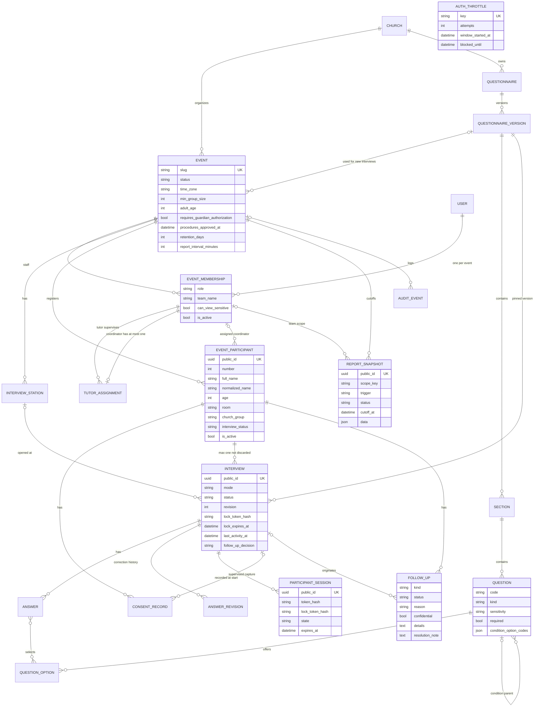

# Architecture

Emmaus is a single Django 5.2 project (`emmaus/`) with two apps, server-rendered templates, one small vanilla JavaScript file and PostgreSQL. There is no SPA, no WebSocket server, no task queue and no external service at runtime except SMTP (optional).

| Layer | What the code uses |
|---|---|
| Web server | gunicorn, 3 workers x 4 threads, 60 s timeout (`Dockerfile`, `docker-compose.prod.yml`) |
| Framework | Django 5.2 (`requirements.txt`), Python 3.12 image |
| Database | PostgreSQL 16 via `psycopg` 3. SQLite only when `DATABASE_URL` is unset (development) |
| Background work | `python manage.py run_report_cutoffs --loop 300` in a separate `scheduler` container |
| Static files | WhiteNoise, compressed manifest built into the image |
| PDF | ReportLab with bundled TTF fonts (`events/fonts/`) |
| Charts | Server-rendered SVG (`events/charts.py`), no chart library |
| Front end | `static/js/emmaus.js`, progressive enhancement only |

## Apps

### `core`: church, roles and the discipleship module

`core` is the original MVP and is still supported. It owns:

* `Church` and `UserChurchRole` (one role per user per church: `church_admin`, `pastor`, `mentor`, `participant`).
* The discipleship module: `Invitation`, `ParticipantProfile`, `DiscipleshipPath`, `Lesson`, `ReflectionQuestion`, `Enrollment`, `LessonProgress`, `ReflectionAnswer`, `ParticipantQuestion`, `QuestionResponse`, `FollowUpRequest`, `PastoralNote`, `AIDraft`.
* First-run setup (`/setup/`, only while no `Church` exists), `/health/`, and the account pages wired in `emmaus/urls.py`: login by e-mail with an attempt limit (`core.views.ThrottledLoginView`, `/cuenta/entrar/`), "¿Olvidaste tu contraseña?" (`/cuenta/olvide-mi-contrasena/`, Django's password reset, e-mail to the account owner) and the password-set page (`/cuenta/contrasena/<uidb64>/<token>/`).

`Church.discipleship_enabled` only controls whether administrators see a "Discipulado" link in the event sidebar (`templates/events/shell_rail.html`). The core views do not check it, so the discipleship URLs stay reachable for users with a church role.

The optional LLM drafting feature (`core.services.generate_ai_draft`) lives only here and is off unless `LLM_ENABLED=true`.

### `events`: camp operations

`events` is the camp module ("Emmaus Campamentos"). Model names are generic (`Event`, `EventParticipant`, `Interview`) so the same tables can serve retreats or conferences; Spanish appears only in labels. Camperos never get user accounts.

Layout:

* `events/models.py`: all tables (below).
* `events/access.py`: `EventAccess`, `resolve_access`, `accessible_events`. Every authorization decision lives here.
* `events/services/`: `interviews.py` (lifecycle, claims, kiosk), `questionnaire.py` (steps, conditions, versions), `metrics.py` (payload builder), `reports.py` (cutoffs and released aggregates), `presentation.py` (privacy serializer), `pdf.py`, `participants.py` (registration, CSV import, erasure), `throttle.py` (database-backed attempt limits), `audit.py`, `notifications.py`.
* `events/views/`: thin views per area (`home`, `coordinator`, `interview`, `kiosk`, `dashboards`, `reports`, `admin`).
* `events/urls.py` is mounted at `/eventos/`; `events/kiosk_urls.py` at `/estacion/`.
* `events/middleware.py`: shared-computer protections.
* `events/management/commands/`: `run_report_cutoffs`, `purge_expired_event_data`, `seed_camp_demo`, `deactivate_demo_accounts`.

## Data model

`AUTH_THROTTLE` has no foreign keys: its `key` is `login:<e-mail typed>` or `unlock:<ParticipantSession public_id>`.

Notes on the model:

* `EventParticipant.interview_status` (`pendiente`, `en_curso`, `completada`) is a denormalized copy of the live interview state. It is updated inside the same transaction as the interview and is what the metrics count.
* `QuestionnaireVersion` is immutable once published: `Section`, `Question` and `QuestionOption` raise `ImmutableRecordError` on save or delete unless the version is a draft. Each `Interview` points at the version it was started with, so editing means "duplicate as a new draft, publish, then use it for new interviews".
* `ReportSnapshot` refuses `save()` and `delete()` once its status is `listo`. Queryset deletes and cascades (deleting the `Event`) bypass this guard.
* `FollowUp.confidential` marks a care referral created automatically from a confidential answer; only members with confidential access see it (see `roles-and-permissions.md`).
* A snapshot's `data` holds the full metrics payload plus a `released` block: the follow-up counts and per-option answer counts as last released (they only change when a count moves by at least the minimum group size; see `reporting.md`).
* `AuditEvent` never stores answer contents.

## Request flow

Middleware order (`emmaus/settings.py`): `SecurityMiddleware` → `WhiteNoiseMiddleware` → `PrivateResponseMiddleware` → sessions → locale → common → CSRF → auth → messages → `KioskConfinementMiddleware` → `StaffIdleLogoutMiddleware` → `XFrameOptionsMiddleware`.

1. `PrivateResponseMiddleware` sets `Cache-Control: no-store`, `Pragma: no-cache`, a Content-Security-Policy and a Permissions-Policy on every response outside `/static/`.
2. `KioskConfinementMiddleware`: if the session holds the `kiosk` key, any path outside `/estacion/`, `/static/` and `/health/` is redirected to the kiosk home.
3. `StaffIdleLogoutMiddleware`: logs out an authenticated user idle for more than `EMMAUS_IDLE_LOGOUT_SECONDS` (default 1800). `last_seen` is refreshed at most every 30 s.
4. Every event view is wrapped by `event_view(*roles)` (`events/views/common.py`). It loads the `Event` by slug, calls `resolve_access(user, event)`, raises 403 if there is no access or the role is not allowed, activates the event's time zone and stores the slug in the session.
5. The view asks `request.access` for querysets (`participants()`, `interviews()`, `follow_ups()`, `snapshots()`) and object checks (`can_view_answer`, `can_correct`, ...). Services receive the `EventAccess` and re-check inside their transactions.
6. `events.context_processors.event_context` adds the role navigation, the shell template (top bar for coordinators, side rail for everyone else) and the current station.

## Server-side scoping

Nothing in a URL, form or query string can widen what a user sees:

* `EventAccess.participants()` derives the queryset from the role: the whole event for admins and pastors, the camperos of supervised coordinators for a tutor (from `TutorAssignment` rows), the user's own camperos for a coordinator.
* `interviews()` and `follow_ups()` are filtered through `participants(include_inactive=True)`. Object lookups use these querysets, so an ID from another team or another event returns 404 or 403.
* Filters (`?coordinador=`, `?cuarto=`, `?estado=`) are applied after scoping, so they can only narrow results.
* Answer visibility is per field (`can_view_answer`, see `roles-and-permissions.md`).
* Report snapshots are filtered by the scope keys the viewer may read today (`report_scopes()`), and the stored payload is trimmed per viewer (`visible_payload`): a tutor sees only the coordinadores currently assigned to them, even in an older team cutoff.
* Redirect targets taken from the request (`?siguiente=`) go through `safe_next()` (`url_has_allowed_host_and_scheme`), so only same-site paths are followed.

## Concurrency model

Ten interview computers can work at once on the same event. The guarantees rely on PostgreSQL. On SQLite `select_for_update()` is a no-op, so the threaded tests skip there.

* **One live interview per campero.** Partial unique index `one_live_interview_per_participant` on `Interview(participant)` where `status <> 'descartada'`. `start_interview` also locks the `EventParticipant` row (`SELECT ... FOR UPDATE`) and turns an `IntegrityError` into "Otra computadora acaba de iniciar la entrevista de este campero."
* **Row locks on every write.** `save_step`, `finalize`, `discard`, `claim`, `correct_step`, `update_follow_up_decision`, hand-over, unlock and revocation all run in `transaction.atomic()` with `select_for_update()` on the interview row.
* **Claims.** The editing browser holds a claim: `secrets.token_urlsafe(32)`. Only its SHA-256 (`lock_token_hash`) is stored on the row, with `lock_holder` and `lock_expires_at`. The raw token lives in the server-side (database-backed) Django session under `interview_claims` (the last 8 claims). Writes compare with `secrets.compare_digest`. A claim lasts 15 minutes (`CLAIM_MINUTES`) and is extended by each staff save; a kiosk claim lasts 60 minutes. Taking over an active claim is explicit and audited.
* **Optimistic revision.** Each form posts the interview's `revision`. A mismatch raises `StaleRevision` and the page reloads with the newest data. Every save, finalize, correction and follow-up decision increments it.
* **Idempotent finalize.** `finalize` returns a completed interview unchanged before any other check, so a double click or a browser retry changes nothing. Care follow-ups are protected by the partial unique constraint `one_open_care_follow_up_per_interview` on `(interview, confidential)` where `kind='seguimiento'` and `status <> 'cancelado'`: at most one ordinary and one confidential referral per interview.
* **Participant numbers.** `_next_number` locks the `Event` row before computing `max(number) + 1`; `participant_number_per_event` is unique.
* **Cutoffs.** The unique constraint `one_snapshot_per_cutoff` makes concurrent scheduler runs harmless. Manual cutoffs lock the `Event` row and return a manual cutoff of the same scope created in the last 60 seconds instead of making a new one.
* **Attempt limits.** `throttle.consume()` counts an attempt in `AuthThrottle` under `SELECT ... FOR UPDATE` **before** the password is checked, so parallel requests and several gunicorn workers share one counter. Used for login (8 attempts, then 5 minutes blocked) and kiosk unlock (5 attempts, then 60 seconds blocked); see `interview-station-workflow.md`.
* **Front end.** `emmaus.js` ignores a second submit of the same form for 8 seconds.

`events/tests/test_concurrency.py` runs four threaded tests against real PostgreSQL row locks: ten stations starting and finishing in parallel, five threads racing for the same campero (exactly one wins), four simultaneous finalizes (one follow-up, one completion), and ten parallel registrations (unique numbers). See `interview-station-workflow.md` for the HTTP load test.

## Live dashboards

There are no WebSockets. A region marked `data-live-url` is refreshed by `emmaus.js` with `fetch()` and the header `X-Requested-With: fetch`. Views check this header (`is_fragment`) and return only the fragment template (`_home_live.html`, `_progress_live.html`, `_slides.html`).

| Screen | Interval |
|---|---|
| Coordinator "Mi inicio", tutor "Mi equipo" | 20 s |
| Pastor "Resumen general", admin "Inicio", progress pages | 30 s |
| Live presentation | 60 s |

Polling pauses while the tab is hidden or while focus is inside the region. Each region has a status line: "Última actualización: HH:MM:SS"; on a network error it switches to "Sin conexión. Los datos pueden estar desactualizados (...)"; on a redirect, 401 or 403 it stops and shows "Tu sesión terminó. Vuelve a entrar para ver datos actuales." Every page also works without JavaScript; only the automatic refresh is lost.

Each poll counts as activity for `StaffIdleLogoutMiddleware`, so a visible dashboard left open is not logged out by the idle timer.

Live payloads contain operational counts only. Answer aggregates are never computed for a live view: the pastor home shows those of the latest saved event cutoff, and the presentation's follow-up tiles use the latest cutoff of its scope.

## PDF, static files and fonts

* **PDF:** `events/services/pdf.py` builds the cutoff PDF with ReportLab (pure Python, no system packages), using `events/fonts/Atkinson-*.ttf` and `Literata-*.ttf`. The PDF is built from the viewer-trimmed payload.
* **Static:** `STORAGES["staticfiles"]` is WhiteNoise's `CompressedManifestStaticFilesStorage` when `DEBUG=false` (and not under `manage.py test`). The Docker image runs `collectstatic` at build time. Do not mount a volume over `staticfiles/`.
* **Fonts:** Atkinson Hyperlegible Next and Literata are self-hosted WOFF2 files in `static/fonts/` (OFL licences included), declared with `@font-face` in `static/css/emmaus.css`. No CDN.
* **CSP:** `script-src 'self'` (no inline scripts), `style-src 'self' 'unsafe-inline'` (inline `style` attributes are used by meters and the optional church theme).

## Migrations and existing data

| Migration | Effect |
|---|---|
| `core/0001_initial` | Original MVP schema |
| `core/0002_church_theme_accent_color_and_more` | Church theme colour fields |
| `core/0003_church_custom_theme_enabled_and_more` | Adds `Church.custom_theme_enabled` and `Church.discipleship_enabled` (both default `False`); label/help-text changes |
| `core/0004_preserve_existing_churches` | Data migration: sets `discipleship_enabled=True` for every church that already has a `DiscipleshipPath`, and sets `is_active=False` on `participant@example.org`. Reverse is a no-op |
| `core/0005_alter_aidraft_options_alter_church_options_and_more` | Spanish `verbose_name` options only; no schema change |
| `events/0001_initial` | All camp tables, constraints and indexes. Depends on `core/0003` |
| `events/0002_security_review` | Adds `AuthThrottle`, adds `FollowUp.confidential` (default `False`) and widens the care follow-up constraint to `(interview, confidential)` |

Existing churches and discipleship data are not modified apart from `0004`. The camp module adds new tables and columns only. `makemigrations --check` reports no pending changes.

## Indexes and constraints

| Table | Unique constraints | Indexes |
|---|---|---|
| `EventMembership` | `(event, user)` | `(event, role, is_active)` |
| `TutorAssignment` | `coordinator` (one-to-one) | `(event, tutor)` |
| `InterviewStation` | `(event, number)` | |
| `EventParticipant` | `(event, number)`, `public_id` | `(event, is_active, interview_status)`, `(event, coordinator)`, `(event, normalized_name)`, `(event, room)`, `(event, church_group)` |
| `ConsentRecord` | | `(participant, kind, -recorded_at)` |
| `QuestionnaireVersion` | `(questionnaire, number)` | |
| `Interview` | partial `(participant)` where not discarded, `public_id` | `(event, status)`, `(event, completed_at)`, `(conducted_by, status)` |
| `Answer` | `(interview, question)` | |
| `ParticipantSession` | `public_id` | `(state, expires_at)` |
| `FollowUp` | partial `(interview, confidential)` for non-cancelled care follow-ups | `(event, kind, status)` |
| `ReportSnapshot` | `(event, scope_key, cutoff_at, trigger)`, `public_id` | `(event, scope_key, -cutoff_at)` |
| `AuditEvent` | | `created_at`, `(event, -created_at)`, `(action, -created_at)` |
| `AuthThrottle` | `key` | |

Name search uses `normalized_name LIKE '%...%'`, which cannot use the B-tree index. That is fine at camp sizes (the CSV import accepts up to 1500 rows per file).

## PostgreSQL connection settings

`database_config()` in `emmaus/settings.py` parses `DATABASE_URL`:

* `CONN_MAX_AGE = DB_CONN_MAX_AGE` (default 60 s): each gunicorn thread keeps its connection for a minute instead of opening one per request.
* `CONN_HEALTH_CHECKS = True`: a reused connection is checked before use, so a database restart does not surface as errors.
* `TEST.NAME = TEST_DATABASE_NAME` when set.

Connection budget: 3 workers x 4 threads gives at most 12 persistent connections from `web`, plus 1 from `scheduler`, plus 1 for each one-off `manage.py` command. That fits a free-tier PostgreSQL limit of about 20 connections.

## Known limitations

* No WebSockets: dashboards are up to 20 to 60 seconds behind.
* `Event.time_zone` is not in any event form; it defaults to `America/Mexico_City` and can only be changed in the Django admin.
* The questionnaire structure cache (`_structure_cache` in `questionnaire.py`) is per process and never invalidated. That is safe because published versions are immutable, but a published version changed with `save(allow_published=True)` would need a restart.
* Archived events are hidden from lists for non-superusers but remain reachable by URL for anyone who still has access.
