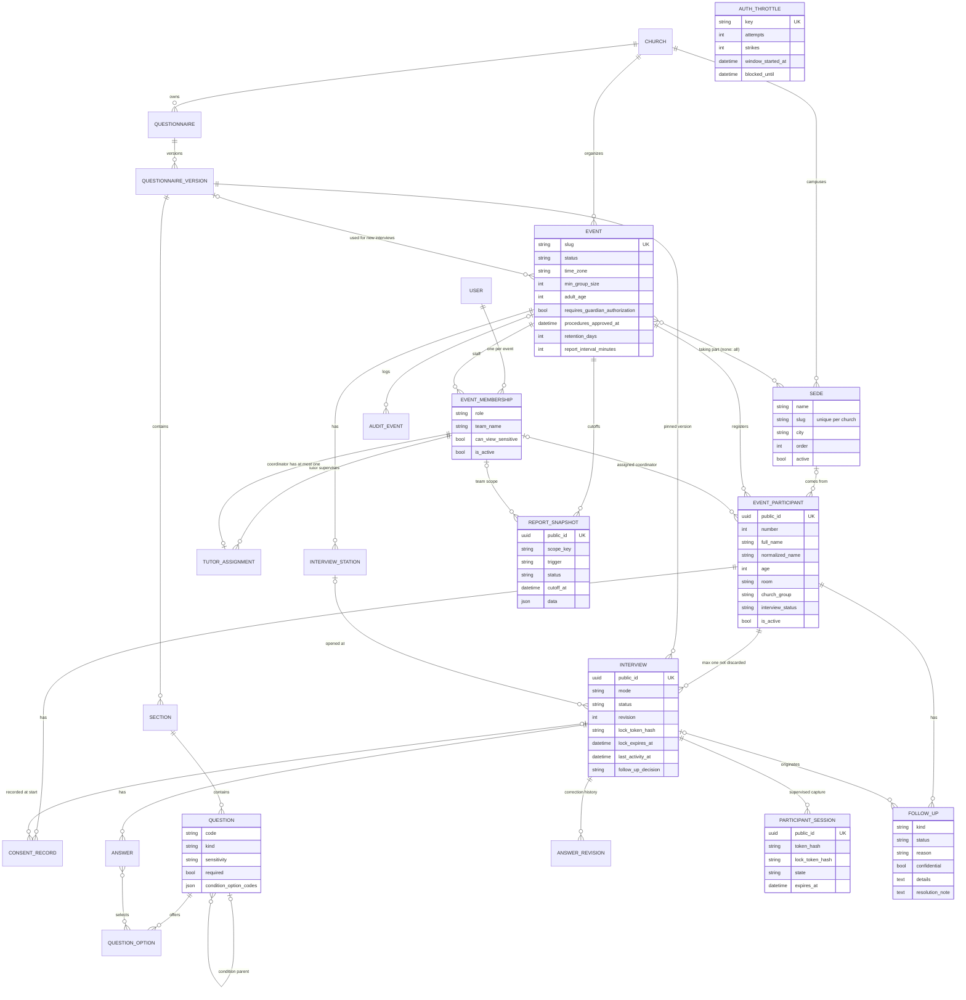

# Architecture

Emmaus is a single Django 5.2 project (`emmaus/`) with two apps, server-rendered templates, one small vanilla JavaScript file and PostgreSQL. There is no SPA, no WebSocket server, no task queue and no external service at runtime except SMTP (optional).

| Layer | What the code uses |
|---|---|
| Web server | gunicorn, 3 workers x 4 threads, 60 s timeout (`Dockerfile`, `docker-compose.prod.yml`) |
| Framework | Django 5.2 (`requirements.txt`), Python 3.12 image |
| Database | PostgreSQL 16 via `psycopg` 3. SQLite only when `DATABASE_URL` is unset (development) |
| Background work | `python manage.py run_report_cutoffs --loop 300` in a separate `scheduler` container |
| Static files | WhiteNoise, compressed manifest built into the image |
| PDF | ReportLab with bundled TTF fonts (`events/fonts/`) |
| Charts | Server-rendered SVG (`events/charts.py`), no chart library |
| Front end | `static/js/emmaus.js`, progressive enhancement only |

## Apps

### `core`: church, roles and the discipleship module

`core` is the original MVP and is still supported. It owns:

* `Church` and `UserChurchRole` (one role per user per church: `church_admin`, `pastor`, `mentor`, `participant`).
* The church's logo: `Church.logo` ("Logotipo") and `Church.logo_dark` ("Logotipo para fondo oscuro"), two optional `FileField`s (`upload_to="church-logos/"`, database default `''`) uploaded in the church settings (`ChurchSettingsForm`, which also removes them and deletes the replaced file). `core/logos.py` is the shared validator, PNG only: it reads the bytes, never the name, at most 512 KB, with no regular expression on what the file contains. A chunk walk (byte arithmetic) requires IHDR first and once, every length inside the file, every CRC right, no `acTL` (animation), an empty IEND as the last byte; then Pillow's `verify()` and a full `load()` (with `Image.MAX_IMAGE_PIXELS`), 32 to 2000 px on the long side (the largest use is the PDF's 660 px embed) and no more than 10:1. SVG was supported for a day and removed: parsing it safely (allowlist, nesting depth, `<use>` expansion) was a denial-of-service surface not worth it for a logo. The stored-file readers (`logo_meta`, the tag's `fit`, the PDF) catch any exception and fall back to the wordmark, so a damaged file never breaks a page. The Django admin leaves the two fields out, so there is no way around these checks. `core.views.church_logo` serves them (below) and `` (`core/templatetags/brand.py`) puts them in the wordmark's slot; see `docs/design-system.md`, "Marca de la iglesia".
* The discipleship module: `Invitation`, `ParticipantProfile`, `DiscipleshipPath`, `Lesson`, `ReflectionQuestion`, `Enrollment`, `LessonProgress`, `ReflectionAnswer`, `ParticipantQuestion`, `QuestionResponse`, `FollowUpRequest`, `PastoralNote`, `AIDraft`.
* First-run setup (`/setup/`, only while no `Church` exists), `/health/`, and the account pages wired in `emmaus/urls.py`: login by e-mail with an attempt limit (`core.views.ThrottledLoginView`, `/cuenta/entrar/`), "¿Olvidaste tu contraseña?" (`core.views.ThrottledPasswordResetView`, `/cuenta/olvide-mi-contrasena/`: Django's password reset, e-mail to the account owner, at most 3 e-mails per address per hour) and the password-set page (`/cuenta/contrasena/<uidb64>/<token>/`).

`Church.discipleship_enabled` only controls whether administrators see a "Discipulado" link in the event bar (`templates/events/rotulo/shell_leader.html`). The core views do not check it, so the discipleship URLs stay reachable for users with a church role.

The optional LLM drafting feature (`core.services.generate_ai_draft`) lives only here and is off unless `LLM_ENABLED=true`.

### `events`: camp operations

`events` is the camp module ("Emmaus Campamentos"). Model names are generic (`Event`, `EventParticipant`, `Interview`) so the same tables can serve retreats or conferences; Spanish appears only in labels. Camperos never get user accounts.

Layout:

* `events/models.py`: all tables (below).
* `events/access.py`: `EventAccess`, `resolve_access`, `accessible_events`. Every authorization decision lives here.
* `events/services/`: `interviews.py` (lifecycle, claims, kiosk), `questionnaire.py` (steps, conditions, versions), `metrics.py` (payload builder), `reports.py` (cutoffs and released aggregates), `presentation.py` (privacy serializer), `pdf.py`, `participants.py` (registration, CSV import with its optional `sede` column matched by name or identifier without case or accents, erasure), `throttle.py` (database-backed attempt limits), `audit.py`, `notifications.py`.
* `events/views/`: thin views per area (`home`, `coordinator`, `interview`, `kiosk`, `dashboards`, `reports`, `admin`).
* `events/urls.py` is mounted at `/eventos/`; `events/kiosk_urls.py` at `/estacion/`.
* `events/middleware.py`: shared-computer protections.
* `events/management/commands/`: `run_report_cutoffs`, `purge_expired_event_data`, `seed_camp_demo`, `deactivate_demo_accounts`.

## Data model

`AUTH_THROTTLE` has no foreign keys: its `key` is `login:<e-mail typed>`, `reset:<e-mail typed>` or `unlock:<ParticipantSession public_id>`.

Notes on the model:

* `EventParticipant.interview_status` (`pendiente`, `en_curso`, `completada`) is a denormalized copy of the live interview state. It is updated inside the same transaction as the interview and is what the metrics count.
* `QuestionnaireVersion` is immutable once published: `Section`, `Question` and `QuestionOption` raise `ImmutableRecordError` on save or delete unless the version is a draft. Each `Interview` points at the version it was started with, so editing means "duplicate as a new draft, publish, then use it for new interviews".
* `ReportSnapshot` refuses `save()` and `delete()` once its status is `listo`. Queryset deletes and cascades (deleting the `Event`) bypass this guard.
* `FollowUp.confidential` marks a care referral created automatically from a confidential answer; only members with confidential access see it (see `roles-and-permissions.md`).
* A snapshot's `data` holds the full metrics payload plus a `released` block: the follow-up counts and per-option answer counts as last released (they only change when a count moves by at least the minimum group size; see `reporting.md`).
* `AuditEvent` never stores answer contents.
* `Sede` belongs to the church, not to an event: one list ("Satélite", "Mérida", …) for all its events, edited from any of them on "Sedes de la iglesia" (`/eventos/<slug>/administracion/sedes/`), but only by a church admin or a superuser; an event-only Administrador chooses the event's sedes and nothing more (see `roles-and-permissions.md`). `Event.sedes` lists the sedes taking part. `Event.allowed_sedes()` returns the active ones of that list, or every active sede of the church when the list is empty or none of it is active any more (all deactivated or deleted since: registration never loses the select while the church has active sedes); the sedes page warns when a listed sede is inactive. The register form, the edit form, the CSV preview and the import confirmation all use it: the "Sede" select appears only when it returns something, and an edit also offers the campero's current sede even if it was deactivated since. The import reads a sede cell, a name and an identifier through `slugify` (no case, no accents), so `SedeForm` refuses a name or an identifier that would read like another sede's name or identifier, and a name with no letters or digits (an identifier cut to 40 characters loses a trailing `-` or `_`); the import never matches an empty reading, and a cell that still reads like two sedes (rows made outside the form) is a row error, "Sede ambigua: «X».", never a guess. The preview waits in the session, so `apply_import` checks each row's sede against `allowed_sedes()` again: a sede deleted, deactivated or taken off the event's list in between imports that campero without a sede, and the confirmation counts them ("2 camperos quedaron sin sede porque la sede ya no estaba disponible."; `ImportResult.sede_unavailable`, also `sin_sede` in the audit row). In "Participantes" each sede's count is taken under every other filter (participation, interview, coordinator, search), so it equals the rows that choosing it shows. `EventParticipant.sede` is `PROTECT`: a sede with camperos (in any event) cannot be deleted, only deactivated (`active=False`), which takes it out of registration and import but leaves it on the camperos who have it and in the list filter while they do. The sede is personal data about the campero (often a minor) but not sensitive: it is not a question of the interview, so it is shown like the room (in "Participantes", "Mis camperos" and the downloaded list), and it goes with the campero's row. `purge_expired_event_data` deletes every `EventParticipant` of an expired event (`event.participants.all().delete()`), so it needs no change; `purge_demo_data` deletes events (and their camperos) before churches, so the `PROTECT` never blocks it.

## Request flow

Middleware order (`emmaus/settings.py`): `SecurityMiddleware` → `WhiteNoiseMiddleware` → `PrivateResponseMiddleware` → sessions → locale → common → CSRF → auth → messages → `KioskConfinementMiddleware` → `StaffIdleLogoutMiddleware` → `XFrameOptionsMiddleware`.

1. `PrivateResponseMiddleware` sets `Cache-Control: no-store`, `Pragma: no-cache`, a Content-Security-Policy and a Permissions-Policy on every response outside `/static/`. The one exception to the cache headers is the church logo (the view marks its response `public_asset`): it keeps `Cache-Control: public, max-age=86400`, unless a cookie was set on it.
2. `KioskConfinementMiddleware`: if the session holds the `kiosk` key, any path outside `/estacion/`, `/static/` and `/health/` is redirected to the kiosk home. The church logo (`/iglesia/<slug>/logotipo/<claro|oscuro>/`) passes before the session is read: the campero's screens show it.
3. `StaffIdleLogoutMiddleware`: logs out an authenticated user idle for more than `EMMAUS_IDLE_LOGOUT_SECONDS` (default 1800). `last_seen` is refreshed at most every 30 s, and never by background requests (`X-Requested-With: fetch`, the dashboards' auto-refresh) or the church logo, so an unattended dashboard is logged out too and the logo never carries a session cookie.
4. Every event view is wrapped by `event_view(*roles)` (`events/views/common.py`). It loads the `Event` by slug, calls `resolve_access(user, event)`, raises 403 if there is no access or the role is not allowed, activates the event's time zone and stores the slug in the session.
5. The view asks `request.access` for querysets (`participants()`, `interviews()`, `follow_ups()`, `snapshots()`) and object checks (`can_view_answer`, `can_correct`, ...). Services receive the `EventAccess` and re-check inside their transactions.
6. `events.context_processors.event_context` adds the role navigation, the shell template (top bar for coordinators, side rail for everyone else) and the current station.

Joining a team (`events/views/join.py`) happens outside `event_view`, because the person has no access yet. `/unirme/` turns a typed code or event name into an event with `events.services.join.find_event_by_key` (the `Event.join_code` first, case-insensitively; then, while `Event.join_by_name` is on, the slug or the event's name compared after `slugify`, in Python over the non-archived events) and redirects to `/e/<code>/`. Each search counts against `AuthThrottle` under `join:<session key>`, a key bounded by the session rather than built from the typed text; a miss on `/e/<x>/` counts too, and a hit while blocked answers like a miss. A hit on `/e/<code>/` writes nothing on GET: someone with access is redirected to their role's home, a closed event says so, anyone else gets a form whose POST stores an `AccessRequest` (name, e-mail, tutor or coordinador, note; one pending per e-mail and event; at most 50 pending per event, checked under a lock on the event row; 5 POSTs per hour per session under `join-request:<session key>`). The scheduler (`run_report_cutoffs`) deletes expired attempt counters (`throttle.purge_expired`) and requests decided more than 30 days ago. No account is created there. An Administrador approves it on "Equipo", which calls `events.services.team.add_member`, the same function behind "Agregar persona", so the account, the password link and the audit rows are exactly those of adding someone by hand. `Event.save()` generates the code (6 characters without 0/O/1/I/L) and retries on a clash, since a callable default could not. `Event.regenerate_join_code()` replaces it from "Generar otro código" and turns `join_by_name` off. An approval never changes an account that already has access to the event (see `roles-and-permissions.md`).

## Server-side scoping

Nothing in a URL, form or query string can widen what a user sees:

* `EventAccess.participants()` derives the queryset from the role: the whole event for admins and pastors, the camperos of supervised coordinators for a tutor (from `TutorAssignment` rows), the user's own camperos for a coordinator.
* `interviews()` and `follow_ups()` are filtered through `participants(include_inactive=True)`. Object lookups use these querysets, so an ID from another team or another event returns 404 or 403.
* Filters (`?coordinador=`, `?cuarto=`, `?estado=`) are applied after scoping, so they can only narrow results.
* Answer visibility is per field (`can_view_answer`, see `roles-and-permissions.md`).
* Report snapshots are filtered by the scope keys the viewer may read today (`report_scopes()`), and the stored payload is trimmed per viewer (`visible_payload`): a tutor sees only the coordinadores currently assigned to them, even in an older team cutoff.
* Redirect targets taken from the request (`?siguiente=`) go through `safe_next()` (`url_has_allowed_host_and_scheme`), so only same-site paths are followed.

## Concurrency model

Ten interview computers can work at once on the same event. The guarantees rely on PostgreSQL. On SQLite `select_for_update()` is a no-op, so the threaded tests skip there.

* **One live interview per campero.** Partial unique index `one_live_interview_per_participant` on `Interview(participant)` where `status <> 'descartada'`. `start_interview` also locks the `EventParticipant` row (`SELECT ... FOR UPDATE`) and turns an `IntegrityError` into "Otra computadora acaba de iniciar la entrevista de este campero."
* **Row locks on every write.** `save_step`, `finalize`, `discard`, `claim`, `correct_step`, `update_follow_up_decision`, hand-over, unlock and revocation all run in `transaction.atomic()` with `select_for_update()` on the interview row.
* **Claims.** The editing browser holds a claim: `secrets.token_urlsafe(32)`. Only its SHA-256 (`lock_token_hash`) is stored on the row, with `lock_holder` and `lock_expires_at`. The raw token lives in the server-side (database-backed) Django session under `interview_claims` (the last 8 claims). Writes compare with `secrets.compare_digest`. A claim lasts 15 minutes (`CLAIM_MINUTES`) and is extended by each staff save; a kiosk claim lasts 60 minutes. Taking over an active claim is explicit and audited.
* **Optimistic revision.** Each form posts the interview's `revision`. A mismatch raises `StaleRevision` and the page reloads with the newest data. Every save, finalize, correction and follow-up decision increments it.
* **Idempotent finalize.** `finalize` returns a completed interview unchanged before any other check, so a double click or a browser retry changes nothing. Care follow-ups are protected by the partial unique constraint `one_open_care_follow_up_per_interview` on `(interview, confidential)` where `kind='seguimiento'` and `status <> 'cancelado'`: at most one ordinary and one confidential referral per interview.
* **Participant numbers.** `_next_number` locks the `Event` row before computing `max(number) + 1`; `participant_number_per_event` is unique.
* **Cutoffs.** The unique constraint `one_snapshot_per_cutoff` makes concurrent scheduler runs harmless. Manual cutoffs lock the `Event` row and return a manual cutoff of the same scope created in the last 60 seconds instead of making a new one.
* **Attempt limits.** `throttle.consume()` counts an attempt in `AuthThrottle` under `SELECT ... FOR UPDATE` **before** the password is checked, so parallel requests and several gunicorn workers share one counter. The attempt that goes over the allowance is refused (its password is not checked) and starts a block. When a block ends, the count drops by half the allowance (rounded down) instead of to zero, and the next block is twice as long, up to a cap. Everything is forgotten once a full window passes after the last block started, and on a successful login or unlock.

  | Key | Allowance | Window | First block | Longest block | Checked attempts after each block |
  |---|---|---|---|---|---|
  | Login (`login:<e-mail>`) | 8 | 60 min | 5 min | 60 min | 3 |
  | Kiosk unlock (`unlock:<session>`) | 5 | 60 min | 60 s | 15 min | 1 |
  | Password-reset e-mail (`reset:<e-mail>`) | 3 | 60 min | 60 min | 60 min in practice (the window has passed when the block ends) | — |

  A blocked reset request shows the same "Revisa tu correo" page as a successful one.

  There is no per-IP limit.
* **Front end.** `emmaus.js` ignores a second submit of the same form for 8 seconds.

`events/tests/test_concurrency.py` runs four threaded tests against real PostgreSQL row locks: ten stations starting and finishing in parallel, five threads racing for the same campero (exactly one wins), four simultaneous finalizes (one follow-up, one completion), and ten parallel registrations (unique numbers). See `interview-station-workflow.md` for the HTTP load test.

## Live dashboards

There are no WebSockets. A region marked `data-live-url` is refreshed by `emmaus.js` with `fetch()` and the header `X-Requested-With: fetch`. Views check this header (`is_fragment`) and return only the fragment template (`_home_live.html`, `_progress_live.html`, `_slides.html`).

| Screen | Interval |
|---|---|
| Coordinator "Mi inicio", tutor "Mi equipo" | 20 s |
| Pastor "Resumen general", admin "Inicio", progress pages | 30 s |
| Live presentation | 60 s |

Polling pauses while the tab is hidden or while focus is inside the region. Each region has a status line: "Última actualización: HH:MM:SS"; on a network error it switches to "Sin conexión. Los datos pueden estar desactualizados (...)"; on a redirect, 401 or 403 it stops and shows "Tu sesión terminó. Vuelve a entrar para ver datos actuales." Every page also works without JavaScript; only the automatic refresh is lost.

Polls do not count as activity for `StaffIdleLogoutMiddleware`. After 30 minutes without a real click, the next poll ends the session, the region stops refreshing and shows "Tu sesión terminó...". The live presentation shows the same status in its control bar (`#deck-estado`, "En vivo" at first).

Live payloads contain operational counts only. Answer aggregates are never computed for a live view: the pastor home shows those of the latest saved event cutoff, and the presentation's follow-up tiles use the latest cutoff of its scope.

## PDF, static files and fonts

* **PDF:** `events/services/pdf.py` builds the cutoff PDF with ReportLab (pure Python, no system packages), using `events/fonts/Atkinson-*.ttf` (static Atkinson Hyperlegible Next subsets that include "≈", used for rounded totals; the web subset lacks it) and `RecursiveCasual-Bold.ttf` (the web Recursive instanced at CASL 1, wght 700 with fontTools; ReportLab cannot read variable WOFF2). It follows the cutoff page and the Rótulo colours. The PDF is built from the viewer-trimmed payload.
* **Django's own messages:** its Spanish catalogs speak "usted" (and say "fichero"), so `locale/es_MX/LC_MESSAGES/django.po` overrides the validation, upload and password messages a person can meet, in tú-voice; `LOCALE_PATHS` wins over Django's catalogs. After editing the `.po`, run `python manage.py compilemessages -l es_MX` (needs GNU gettext); the `.mo` is committed so the image needs no gettext, and `core/test_locale.py` fails if the two drift.
* **Static:** `STORAGES["staticfiles"]` is WhiteNoise's `CompressedManifestStaticFilesStorage` when `DEBUG=false` (and not under `manage.py test`). The Docker image runs `collectstatic` at build time. Do not mount a volume over `staticfiles/`.
* **Fonts:** Atkinson Hyperlegible Next and Recursive (Casual axis, wght 500–900) are self-hosted WOFF2 files in `static/fonts/` (OFL licences included), declared with `@font-face` in `static/css/rotulo.css`. The PDF keeps its own TTF copies in `events/fonts/`. No CDN.
* **One stylesheet:** every screen extends `templates/layout/skeleton.html`, which loads `static/css/rotulo.css` (the "Rótulo" design system, `docs/design-system.md`). `events/tests/test_rotulo.py` checks every role's screens and that the stylesheet's blocks are balanced.
* **CSP:** `script-src 'self'` (no inline scripts), `style-src 'self' 'unsafe-inline'` (inline `style` attributes are used by meters, the optional church theme and the logo's width on the title slide), `img-src 'self' data:` (covers the church logo, a same-origin path).
* **Uploads (the church logo):** `MEDIA_ROOT` (`MEDIA_ROOT` environment variable, default `<checkout>/media`; the `media` volume in production) and no `MEDIA_URL`. Only `core.views.church_logo` reads it, at `/iglesia/<slug>/logotipo/claro/` (`Church.logo`) and `/oscuro/` (`Church.logo_dark`): public, GET and HEAD only, always `image/png` (the stored file is walked again before it is served), `Cache-Control: public, max-age=86400`, `X-Content-Type-Options: nosniff`; an empty 404 when the church, the variant or the file is missing or not a PNG. The template tag adds `?v=<bytes>-<mtime>` so a new upload is never hidden by that day of caching, and draws the painted "Emmaus" when the file is gone (logged at WARNING). The cutoff PDF draws a PNG logo in its header (at most 2.2 × 0.72 in), embedded at most 660 × 220 px from a copy decoded once per process and file version (1-bit, palette and 16-bit grey files become grey before resizing, never full-size RGBA); if the file cannot be read for any reason the header keeps the wordmark and a warning is logged. The 500 page never shows the logo: it is drawn without the database.

## Migrations and existing data

| Migration | Effect |
|---|---|
| `core/0001_initial` | Original MVP schema |
| `core/0002_church_theme_accent_color_and_more` | Church theme colour fields |
| `core/0003_church_custom_theme_enabled_and_more` | Adds `Church.custom_theme_enabled` and `Church.discipleship_enabled` (both default `False`); label/help-text changes |
| `core/0004_preserve_existing_churches` | Data migration: sets `discipleship_enabled=True` for every church that already has a `DiscipleshipPath`, and sets `is_active=False` on `participant@example.org`. Reverse is a no-op |
| `core/0005_alter_aidraft_options_alter_church_options_and_more` | Spanish `verbose_name` options only; no schema change |
| `events/0001_initial` | All camp tables, constraints and indexes. Depends on `core/0003` |
| `events/0002_security_review` | Adds `AuthThrottle`, adds `FollowUp.confidential` (default `False`) and widens the care follow-up constraint to `(interview, confidential)` |
| `events/0003_followup_confidential_db_default` | Gives `FollowUp.confidential` a database default (`db_default=False`), so code from before `0002` can still insert follow-ups during a rolling deploy |
| `events/0004_labels_and_throttle_strikes` | Adds `AuthThrottle.strikes` (escalating blocks) and Spanish labels on `FollowUp.kind`, `status`, `assigned_to` ("Tipo", "Estado", "Líder responsable") |
| `events/0005_throttle_strikes_db_default` | Gives `AuthThrottle.strikes` a database default, so older code can still create throttle rows; `throttle.consume()` also fails closed if a row cannot be written |
| `events/0006_event_join_code` | Adds `Event.join_code` (`db_default=''`, so older code can still insert events) and `Event.join_by_name` (`db_default=True`), a unique constraint on non-blank codes, then a data migration that gives every existing event its own code. Reverse of the data step is a no-op. A row still without a code (written by older code) gets one the first time "Equipo" or the printable sheet needs it |
| `events/0007_access_request` | Adds `AccessRequest` (requests from the event's public page) |
| `events/0008_sede` | Adds `Sede` (the church's campuses; `city`, `order` and `active` with database defaults), the `Event.sedes` join table and the nullable `EventParticipant.sede`. Additive: older code keeps inserting events and camperos. Reversing it drops every campero's sede |

Existing churches and discipleship data are not modified apart from `0004`. The camp module adds new tables and columns only. `makemigrations --check` reports no pending changes.

## Indexes and constraints

| Table | Unique constraints | Indexes |
|---|---|---|
| `EventMembership` | `(event, user)` | `(event, role, is_active)` |
| `TutorAssignment` | `coordinator` (one-to-one) | `(event, tutor)` |
| `InterviewStation` | `(event, number)` | |
| `EventParticipant` | `(event, number)`, `public_id` | `(event, is_active, interview_status)`, `(event, coordinator)`, `(event, normalized_name)`, `(event, room)`, `(event, church_group)` |
| `ConsentRecord` | | `(participant, kind, -recorded_at)` |
| `QuestionnaireVersion` | `(questionnaire, number)` | |
| `Interview` | partial `(participant)` where not discarded, `public_id` | `(event, status)`, `(event, completed_at)`, `(conducted_by, status)` |
| `Answer` | `(interview, question)` | |
| `ParticipantSession` | `public_id` | `(state, expires_at)` |
| `FollowUp` | partial `(interview, confidential)` for non-cancelled care follow-ups | `(event, kind, status)` |
| `ReportSnapshot` | `(event, scope_key, cutoff_at, trigger)`, `public_id` | `(event, scope_key, -cutoff_at)` |
| `AuditEvent` | | `created_at`, `(event, -created_at)`, `(action, -created_at)` |
| `AuthThrottle` | `key` | |
| `Event` | `slug`, partial `(join_code)` where not blank | |
| `AccessRequest` | partial `(event, email)` where `pendiente` | `(event, status)` |
| `Sede` | `(church, slug)` | `church` (foreign key), `slug` (a `SlugField` is indexed); `EventParticipant.sede` gets its own foreign-key index |

Name search uses `normalized_name LIKE '%...%'`, which cannot use the B-tree index. That is fine at camp sizes (the CSV import accepts up to 1500 rows per file).

## PostgreSQL connection settings

`database_config()` in `emmaus/settings.py` parses `DATABASE_URL`:

* `CONN_MAX_AGE = DB_CONN_MAX_AGE` (default 60 s): each gunicorn thread keeps its connection for a minute instead of opening one per request.
* `CONN_HEALTH_CHECKS = True`: a reused connection is checked before use, so a database restart does not surface as errors.
* `TEST.NAME = TEST_DATABASE_NAME` when set.

Connection budget: 3 workers x 4 threads gives at most 12 persistent connections from `web`, plus 1 from `scheduler`, plus 1 for each one-off `manage.py` command. That fits a free-tier PostgreSQL limit of about 20 connections.

## Known limitations

* No WebSockets: dashboards are up to 20 to 60 seconds behind.
* `Event.time_zone` (default `America/Mexico_City`) is chosen in "Configuración" from a fixed list of Mexican zones (`MEXICO_TIME_ZONES` in `events/forms.py`); other zones need the Django admin.
* The questionnaire structure cache (`_structure_cache` in `questionnaire.py`) is per process and never invalidated. That is safe because published versions are immutable, but a published version changed with `save(allow_published=True)` would need a restart.
* Archived events are hidden from lists for non-superusers but remain reachable by URL for anyone who still has access.
