# Auditoría integral de UI/UX de Emmaus

Informe del brief del dueño (26 de octubre de 2026) tras la ronda Atrio; código `4b6393b`, datos sintéticos. Es una auditoría: no se cambió código, estilos ni permisos. Compila cinco secciones de especialistas (UX, UI, accesibilidad, lenguaje, referencias); cada afirmación cita su ID y la evidencia completa está en la sección de origen (Anexo A). «Observación del compilador» marca lo que sale de cruzar secciones. Las capturas son propias y no prueban usabilidad.

## 1. Resumen ejecutivo

Emmaus es un producto sólido y cuidado: calmo, con voz propia y sin aspecto de panel SaaS genérico. Es fuerte en cuatro cosas. Los **permisos**: 33 URLs con 7 perfiles dieron 403, 404 o 302 donde debían, sin fugas. La **accesibilidad automática**: axe-core, 0 violaciones en 347 ejecuciones; foco visible en 692 de 697 paradas; reflow correcto en 65 de 65 páginas. La **base Atrio**: una familia, un color de acción, sin sombras ni tarjetas, 0 desbordes horizontales en 195 combinaciones. El **flujo**: una pregunta por pantalla y el panel «Lo que sigue», la mejor decisión de orientación según UX. Ninguna sección halló hallazgos críticos. Las oportunidades están en los bordes: cuando falla la red o la sesión (UX-05, A11Y-04); en la sala de liderazgo, con cifras pisadas, teclas muertas y datos vencidos (UX-02, UX-03, UX-04); en teclado y zoom, que axe no ve (UX-01, A11Y-01, A11Y-02); en promesas de privacidad más amplias que el código (LANG-01, LANG-03, LANG-28); y en el primer uso del administrador (UI-03, UX-11, UX-12).

| Sección | Originales (Alta / Media / Baja) | Deduplicados (Alta / Media / Baja) |
|---|---|---|
| UX | 26 (5 / 10 / 11) | **25** (5 / 10 / 10) |
| UI | 45 (3 / 20 / 22) | **40** (2 / 19 / 19) |
| Accesibilidad | 17 (3 / 4 / 10) | **15** (2 / 4 / 9) |
| Lenguaje | 58 (3 / 29 / 26) | **56** (3 / 27 / 26) |
| **Total** | **146** (14 / 63 / 69) | **136** (12 / 60 / 64) |

0 críticas. Se fusionaron 10 IDs en 9 filas (Anexo B); con severidades distintas se tomó la mayor (LANG-02, UX-17, LANG-11).

**Los cinco cambios de mayor valor**
1. **Que la entrevista no pierda lo contestado:** mensaje propio sin red y preguntas en el respaldo (UX-05), «Parar por ahora» que guarde (UX-06), «Cambiar» que vuelva a la revisión (UX-07), aviso previo a la inactividad (A11Y-04).
2. **Que la reunión de liderazgo se lea y se conduzca:** cifras sin pisarse (UX-02), clicker (UX-03), datos vencidos visibles (UX-04), la decisión arriba (UI-10).
3. **Que lo prometido sobre privacidad y riesgo sea verdad:** LANG-01, LANG-27, LANG-03, LANG-28 y la acción de riesgo visible (UI-02).
4. **Que teclado y zoom funcionen:** UX-01, A11Y-01, A11Y-02.
5. **Que el primer uso diga qué sigue:** UI-03, UX-11, UX-12, UX-14.

## 2. Metodología

| Especialista | Qué hizo | Alcance |
|---|---|---|
| UX | Leyó docs y rutas; recorrió cada rol en Chromium con Playwright 1.63.0 (`es-MX`); simuló sin red, pestaña cerrada, segunda computadora, sesión caducada y tiempo del quiosco; probó permisos; contó pasos | 2 bases SQLite sintéticas; 360 a 1440 px y 1920×1080; 48 pantallas; más de 580 capturas |
| UI | Recorrió las 65 pantallas de `e2e/all_urls.py` y estados vacío, error, ocupado y sin conexión, presentación, PDF e impresión; midió texto, objetivos y desbordes | 390, 820 y 1440 más 1024, 1366 y 1920; 425 capturas |
| Accesibilidad | axe-core 4.10.2 (`best-practice` incluido), teclado, 697 paradas de foco, objetivos, reflow, espaciado, árbol de accesibilidad, temporizadores, colores forzados, PDF | 130 pantallas, 347 ejecuciones |
| Lenguaje | 3 539 cadenas, 268 volcados a 390 px, 23 reglas automáticas, 319 citas de la guía | es-MX, tuteo, consistencia |
| Referencias | 99 fuentes externas y 3 internas leídas el 26-oct-2026 (GOV.UK, USWDS, NHS, Analysis Function, Linear, Basecamp, Planning Center, Tally, W3C, NN/g) | 10 principios, 7 dimensiones |

**Severidad** (escala de UX): Crítica = exposición o pérdida de datos sensibles, o tarea crítica sin salida; Alta = deteriora seriamente una tarea crítica en el evento en vivo o deja ilegible un dato clave; Media = fricción o riesgo de error con salida; Baja = pulido. UI, accesibilidad y lenguaje la usan con variantes que no se recalibraron. El compilador no volvió a probar: deduplicó y ordenó. **Límites:** sin personas reales (todo lo humano es hipótesis); solo Chromium con anchos emulados, sin táctil real ni lector de pantalla; tiempos simulados (30 min, 4 min); SQLite con 2 o 3 sesiones, no PostgreSQL con 10 computadoras; `DEBUG=true`, sin correo, HTTPS ni programador de cortes; proyector e impresión emulados; Discipulado solo abierto; las referencias se leyeron con una herramienta que resume (confirmar citas en la URL) y con plantillas anteriores a Atrio. Lo no ejercitado, en el Anexo C.

## 3. Inventario de la experiencia actual

**Qué es.** Django 5.2 (es-MX) con renderizado en servidor, `static/css/rotulo.css` (sistema Atrio) y 276 líneas de JavaScript. Dos módulos: **Campamentos** (`events/`, el auditado) y **Discipulado** (`core/`, solo abierto). Cinco roles por evento; «equipo de cuidado» es el permiso `can_view_sensitive`, no un rol. Contrastado con el código: no hay «distribución» del cuestionario (el campero nunca recibe un enlace), el «análisis» es agregado para pastor y administración y «en tiempo real» es sondeo de 20 a 60 s.

| Área | Rutas y pantallas (`…/` = `/eventos/<slug>/`) | Roles | Plantillas | Visto |
|---|---|---|---|---|
| Público | `/`, `/setup/`, `/cuenta/entrar/`, `/unirme/`, `/e/<código>/`, `/eventos/`, `/eventos/nuevo/` | Pub, autenticados | `core/landing`, `registration/*`, `events/join/*` | ✔ (invitación y crear contraseña, solo código) |
| Coordinador | `…/computadora/`, `mi-inicio/`, `mis-camperos/`, ficha, riesgo, `mi-avance/`, `lista-de-respaldo/`, entrevista (`paso/<n>`, `revision`, `entregar`, `otra-computadora`, `corregir/<n>`) | Coo, Adm | `coordinator/*`, `events/interview/*` | ✔ |
| Quiosco | `/estacion/`, `paso/<n>/`, `revisar/`, `desbloquear/` | Cam | `kiosk/*` | ✔ |
| Liderazgo | `mi-equipo/`, `resumen/`, `avance/`, `seguimiento/`, `reportes/` (+ PDF), `presentacion/` | Tut, Pas, Adm | `tutor/*`, `supervision/*`, `pastor/*`, `presentation/*` | ✔ |
| Administración | `administracion/`, `participantes/` (importar), `equipo/`, `cuestionarios/`, `configuracion/`, `sedes/` | Adm | `admin/*` | ✔ (acciones sin ejecutar: Anexo C) |
| Discipulado | `/dashboard/`, `/church/…`, `/mentor/…`, `/participant/…` | Roles de iglesia | `core/*` | Abiertas, sin evaluar |

Unas 100 filas en `ux/hallazgos-ux.md`. **Componentes (UI):** 32 familias; consistencia alta en «Lo que sigue», «Estás aquí», opciones, camino, conteo y regla, ficha, confirmación, marca de la iglesia y foco; con hallazgos botones, casillas, estado, renglones, avisos, filtros, tablas, barras, gráficas, presentación y hojas impresas (UI-07, 09, 13, 14, 15, 16, 20, 24 a 27, 29 a 31). **Flujos** (órdenes de magnitud): alta del administrador ≈ 40 pantallas y ≈ 37 toques; primera entrevista asistida 11 pantallas y ≈ 19 toques; campero 9 pantallas y ≈ 12 toques; corte y PDF en 3 pantallas; presentación en 1 + 4 toques; voluntario nuevo 5 pantallas.

## 4. Análisis por rol

| Rol | Tareas críticas | Qué funciona | Qué duele |
|---|---|---|---|
| **Administrador** | Crear iglesia y campamento; procedimientos; equipo; importar 350–400 camperos; primer corte; liberar entrevistas (≈ 40 pantallas) | «Confirma los procedimientos de la iglesia» con un botón; vista previa de importación | UI-03, UX-11, UX-12, UX-13, UX-14, UI-06, UX-24 |
| **Coordinador** | Computadora; buscar; consentimiento; entrevista asistida o a solas; seguimiento; retomar; corregir (11 pantallas, ≈ 19 toques) | «Mi inicio» con un botón; búsqueda tolerante; retomar y versión vieja detectadas | UX-01, UX-10, UX-07, UX-08, UX-05, A11Y-01, A11Y-02, UI-02 |
| **Campero** (quiosco) | Entender, responder solo, no responder, parar, terminar (9 pantallas) | Bienvenida clara; quiosco confinado; «Gracias» sin datos | UX-06, UX-07, LANG-01, LANG-27, A11Y-05 |
| **Tutor** | Avance del equipo; interrupciones; seguimientos (aterriza en «Mi equipo»; actualizar un seguimiento, 3 toques) | Marcas por coordinador; no ve respuestas y lo explica | UX-21, UX-15 |
| **Pastor** | Cómo va, qué falta, qué decidir; corte y PDF (3 pantallas); presentación (1 + 4 toques) | «Resumen general», la mejor pantalla de lectura; presentación legible en Cal y Noche | UX-02, UX-03, UX-04, UI-10, UI-08, UX-16 |
| **Cuidado** y **voluntario nuevo** | Leer seguimientos de apoyo; pedir acceso con el código | Sin fugas; sin cuentas hasta aprobar | LANG-25, LANG-28, UX-24 |

**Permisos (UX).** El coordinador recibe 404, no 403, ante lo ajeno; el tutor, 404 en cortes de otro equipo; lo confidencial depende del permiso, no del cargo. Mejoras sin tocar permisos: UX-16, LANG-28.

## 5. Hallazgos UX

25 hallazgos (5 altas, 10 medias, 10 bajas); UX-18 está en A11Y-11. Texto completo en `ux/hallazgos-ux.md`. Compl. = complejidad; Tipo: Verificado, Hipótesis o Preferencia.

| ID | Rol · pantalla | Problema · evidencia | Impacto | Sev. | Mejora · criterio de aceptación | Compl. | Tipo | Ver también |
|---|---|---|---|---|---|---|---|---|
| UX-01 | Coordinador · elegir computadora, «Antes de empezar» | El `div` de opciones repite el `id` del primer radio: tocar «Computadora 1» o «Entrevista asistida» no selecciona; radio sin nombre (`checked: []`; axe, 9 nodos) | Toca y no pasa nada; «a solas» no se deshace | Alta | Renombrar el `id`. 0 ids duplicados; 10/10 computadoras seleccionables | Baja | Verificado | **A11Y-03** (absorbido; WCAG 1.3.1, 4.1.2, 3.3.2, 2.5.3; automática incompleta + manual) |
| UX-02 | Pastor, admin · Resumen, «¿Cuánto falta?» | «8 horas 25 minutos» (36 px, `nowrap`) pisa «Última hora» a 1440 (UI-01: también 390, 820, 1920); a 1024 y 768, scroll horizontal. `ux-02-1440`, `ux-02-1024` | Cifra clave ilegible | Alta | Texto partible o «6 h 15 min». De 1920 a 390 px, `scrollWidth ≤ innerWidth` y 0 cifras superpuestas | Baja | Verificado | **UI-01** (absorbido), UI-34 |
| UX-03 | Pastor, admin, tutor · presentación | Con el foco en un botón, `→`, Re Pág, Av Pág y «F» no responden hasta tocar la diapositiva | El clicker falla tras «Modo noche» | Alta | Atender esas teclas con foco en botón. `→` avanza tras cada botón (4/4) | Baja | Verificado | UX-04, A11Y-16 |
| UX-04 | Pastor, admin · presentación en vivo | A los 30 min sin actividad la sesión cierra; el aviso está en la barra (se oculta a los 3 s) y la diapositiva dice «En vivo, con datos de las 09:35». `ux-04-1920` | La sala ve cifras viejas como en vivo | Alta | Aviso en la diapositiva o sesión viva. En < 61 s, «Los datos dejaron de actualizarse a las HH:MM» a ≥ 24 px | Media | Verificado (efecto: hipótesis) | UI-17, UI-13, A11Y-04 |
| UX-05 | Coordinador · pregunta, lista de respaldo | Sin red, «Continuar» muestra la página de error del navegador y la opción elegida se pierde (`ux-05-1440`); el respaldo no trae las preguntas | Pierde la respuesta y no puede seguir | Alta | Mensaje propio, selección conservada, «Reintentar»; imprimir preguntas. ≤ 3 s; 0 páginas del navegador | Media | Verificado (frecuencia: hipótesis) | UI-12, UI-13, UI-20 |
| UX-06 | Campero · «Parar por ahora» | Enlace que no guarda: la opción elegida se pierde y la revisión solo ofrece «Ya terminé» («¡Gracias! Ya terminaste») (`ux-06-1440`) | Pierde lo elegido o termina con 4 vacías | Media | Que guarde; «Seguir respondiendo» principal. 10/10 conservan; ≥ 4 de 5 jóvenes distinguen pausar de terminar | Baja | Verificado (comprensión: hipótesis) | LANG-01, LANG-27 |
| UX-07 | Coordinador, campero · revisión | «Cambiar» guarda y sigue con la siguiente pregunta: hasta 4 pantallas más | No sabe volver a «finalizar» | Media | «Guardar y volver a la revisión». 1 clic (hoy 4 o 5) | Baja | Verificado | — |
| UX-08 | Coordinador · «otra computadora» | Quien pierde el control no lee que lo último no se guardó; ve «Abierta por: Ana López Ferrer» (ella misma); «Tomar el control aquí» es primario | No sabe si perdió su respuesta | Media | «Lo último de esta pantalla no se guardó; lo anterior sí.»; «Abierta por ti en Computadora 7». ≥ 4 de 5 explican qué pasó | Baja | Verificado (efecto: hipótesis) | LANG-41, A11Y-04 |
| UX-09 | Todos los que escriben · tras 30 min | La pantalla de entrar no dice que lo último escrito no se guardó; sin cookie, nada | No sabe si perdió algo | Baja | «Lo que respondiste antes sigue guardado; lo último no.» 3/3 escenarios | Baja | Verificado | A11Y-04, UX-08 |
| UX-10 | Coordinador · «Mi inicio» → «Antes de empezar» | Con procedimientos sin confirmar «Mi inicio» luce normal; el bloqueo sale tras varios pasos; el formulario se llena con el botón gris; «Avísale» no dice a quién | Los 12 coordinadores lo descubren uno a uno | Media | Motivo en «Mi inicio»: «avisa a [administración]». 12/12 lo ven sin buscar | Baja | Verificado | UX-11, UI-03 |
| UX-11 | Admin · «Preparación» | «Listo» en «Equipo» con 0 personas y en «Cortes» sin cortes (`ux-11-1440`) | Cree que todo está listo | Media | «Falta» sin un coordinador ni corte. Ningún «Listo» no cumplido (0, 1, 2 personas) | Baja | Verificado | LANG-15, UI-03, UI-06 |
| UX-12 | Admin · alta de iglesia y evento, hoja del código, editor | «Identificador» (slug) que la persona inventa; la hoja dice «escribe el código o el nombre del evento, prueba-2026» (es el slug); «Identificador interno: salvo». LANG-17: reglas de programador | Pausa en el primer uso; se pide el nombre equivocado | Media | Proponerlo desde el nombre: «Dirección corta» (UX) o «Nombre corto para la dirección» (LANG-17; decidir). ≥ 4 de 5 no técnicos lo completan | Baja | Verificado (hesitación: hipótesis) | **LANG-17** (absorbido), LANG-04, LANG-05, UI-19 |
| UX-13 | Admin de iglesia · `/eventos/` | La barra muestra Rutas, Lecciones, Preguntas, Participantes e Invitaciones (Discipulado) con la bandera apagada; «Rutas» y «Lecciones» van al mismo destino | Ve un producto ajeno | Media | ≤ 3 entradas con Discipulado apagado; sin duplicados | Baja | Verificado | UI-44, LANG-40 |
| UX-14 | Admin · Configuración | 13 formularios: editar una columna y guardar la otra pierde el cambio sin avisar («Edad de mayoría» 19 vuelve a 18). UI-23: «Guardar» secundario, aviso cortado | Cree que cambió la autorización de menores | Media | Un formulario por sección y aviso al salir. Conserva o avisa (2/2) | Media | Verificado | **UI-23** (absorbido; su Hipótesis queda verificada), UI-26 |
| UX-15 | Pastor, admin, tutor · Seguimiento | Lista plana (56 abiertos) sin filtro por líder, equipo o «sin líder»; asignar exige abrir cada uno; corta a 200 sin avisar | 29 pendientes ≈ 87 acciones | Media | Filtros, asignación en la fila, «Mostrando 200 de N». ≤ 30 toques | Media | Verificado (volumen: hipótesis) | UI-08, UX-21 |
| UX-16 | Pastor, admin, tutor · entrevista ajena | Todas las filas dicen «Confidencial» y «Ver respuestas» lleva a una página sin respuestas | «Confidencial» significa «no es para ti» | Baja | «No disponible para tu rol»; ocultar «Ver respuestas» | Baja | Verificado (confusión: hipótesis) | UI-29, LANG-25, LANG-26 |
| UX-17 | Todos · toda la app | Sin ayuda en la app: la guía (500 líneas) no está enlazada. A11Y-17 (WCAG 3.2.6): sin ayuda coherente en el personal | Un voluntario nuevo no sabe dónde mirar | Media (A11Y-17: Baja; se toma la mayor) | «Ayuda» fija en la barra con 5 tareas. ≥ 80 % de ≥ 5 voluntarios halla «cómo retomar» en ≤ 60 s | Media | Verificado (ausencia); efecto: hipótesis | **A11Y-17** (absorbido) |
| UX-19 | Coordinador, admin · «Mis camperos» vacío, importar | «No encontramos camperos con esa búsqueda» sin búsqueda; un no-CSV dice «Faltan estas columnas…» | Culpa a la persona sin motivo | Baja | «Todavía no tienes camperos»; «No pudimos leer el archivo». 3 pruebas | Baja | Verificado | UI-11, LANG-16 |
| UX-20 | Coordinador · «Mi inicio» | No dice en qué computadora estás hasta elegirla; se pide en cada inicio de sesión | Paso fijo; el tutor no ve dónde está | Baja | «Elige tu computadora» en «Mi inicio»; «¿Sigues en la Computadora 4?» | Baja | Verificado | — |
| UX-21 | Tutor, coordinador · Seguimiento | Tras guardar desde «Pendientes» cae en «Seguimiento», fuera de su navegación | Regresa por otra vía | Baja | Volver al origen. 5/5 | Baja | Verificado | UX-15 |
| UX-22 | Admin · importar | Con vista previa pendiente no hay selector de archivo | Cree que no puede subir otro | Baja | «Tienes un archivo por revisar» y selector visible | Baja | Verificado | — |
| UX-23 | Coordinador · revisión | Con indicios, «Se requiere seguimiento» viene preseleccionado | Aceptar por inercia | Baja | Medir; si se acepta sin leer, no preseleccionar. ≤ 20 % sin abrir «Lo que X pidió» | Baja | Hipótesis | LANG-36 |
| UX-24 | Admin, voluntario nuevo · alta de equipo | Sin correo, cada alta muestra un enlace largo y «Copiar enlace»; el voluntario no sabe si lo aprobaron | Más de 16 enlaces a mano | Baja | «Copiar mensaje listo para enviar». 16 enlaces en ≤ 5 min | Media | Hipótesis | LANG-31, A11Y-12 |
| UX-25 | Admin, pastor, coordinador · confirmación, listas | Bloque petróleo sólido (único fondo oscuro fuera de la presentación); listas a 2/3 del ancho | Disonancia | Baja | Panel tintado habitual | Baja | Preferencia estética | UI-30 |
| UX-26 | Admin · Sedes | «Sedes» bajo «Camperos»; casillas vacías de «Sedes que participan» significan «todas» | Marcar una restringe sin que se note | Baja | Preseleccionar todas; «Solo participan las marcadas». ≥ 2 de 3 predicen el efecto | Baja | Hipótesis | LANG-37 |

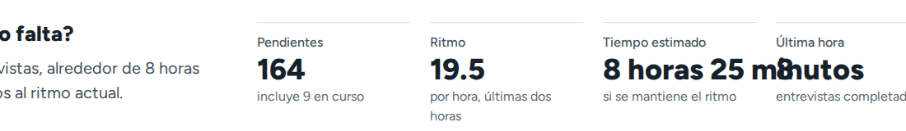
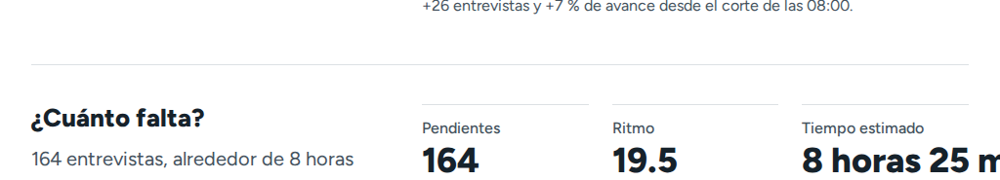
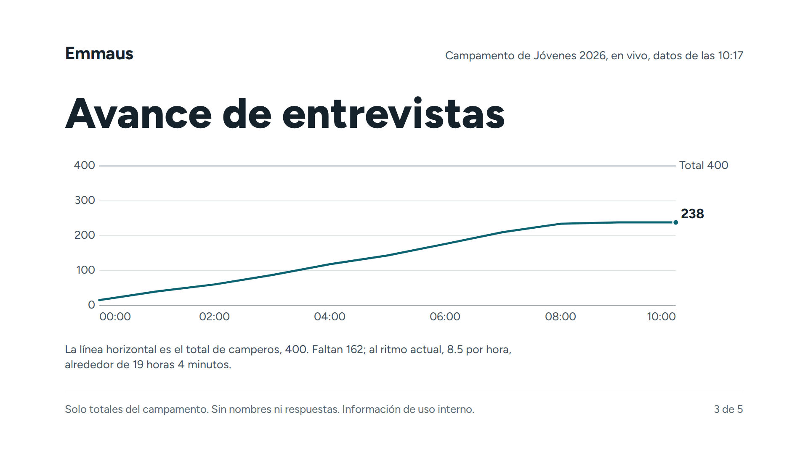
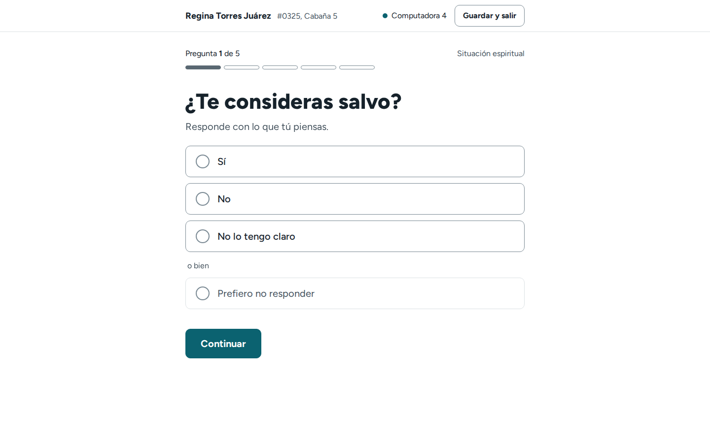
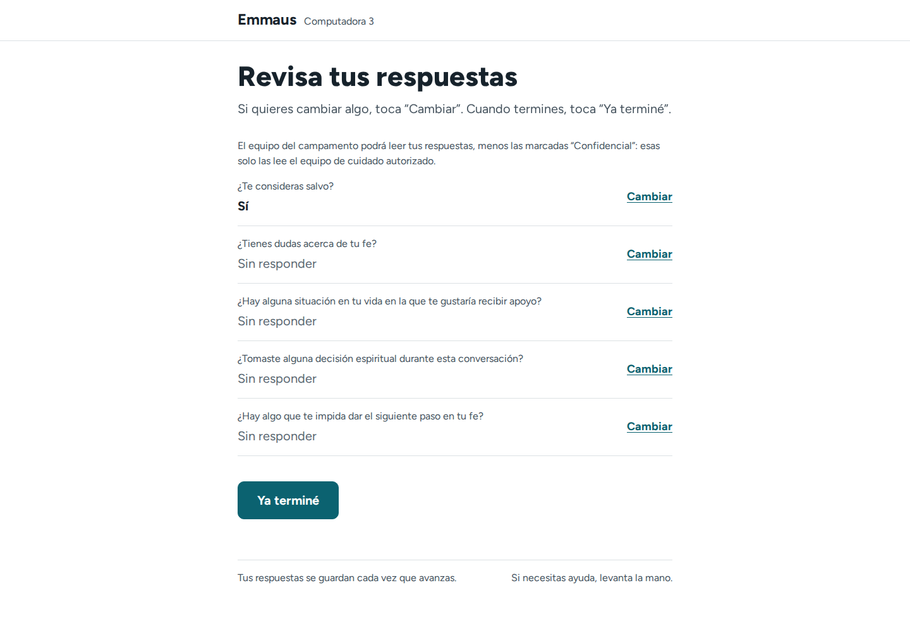
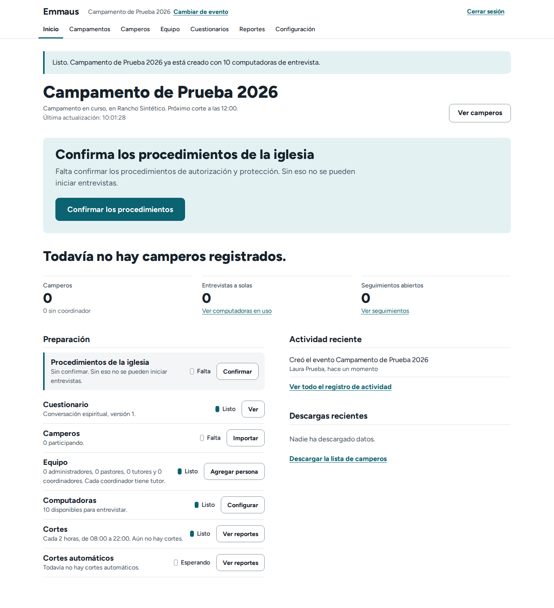

## 6. Hallazgos UI

40 hallazgos (2 altas, 19 medias, 19 bajas); UI-01, UI-23, UI-28, UI-36 y UI-37 están en UX-02, UX-14, LANG-11, LANG-02 y A11Y-11. La fuente identifica pantalla, no rol. Detalle en `ui/hallazgos-ui.md`.

| ID | Pantalla o componente | Problema · evidencia | Por qué daña | Sev. | Mejora · criterio de aceptación | Compl. | Tipo | Ver también |
|---|---|---|---|---|---|---|---|---|
| UI-02 | Ficha y revisión · «Reportar una situación de riesgo» | Enlace de peso 400 y 22 px; en la revisión comparte estilo con «Descartar esta entrevista», que borra (`ui-02-1440`) | La acción más urgente tiene el menor peso | Alta | Lugar estable, peso 700, borde chile. Visible a 1024×768 y 390; ≥ 5 voluntarios la hallan en < 5 s | Baja | Verificado | LANG-03 |
| UI-03 | Inicio de administración sin camperos | Sin panel de lo que sigue: solo «Todavía no hay camperos registrados.» y una fila «Falta, Importar» sin realce (`ui-03-1440`) | La regla falla ante «nada todavía» | Alta | Panel «¿Cómo vas a registrar a los camperos?» con «Importar la lista». 5/5 nuevos administradores inician sin ayuda | Baja | Verificado | UI-11, UX-11, UX-10 |
| UI-04 | Mis camperos (34 filas) | Mezcla 30 «Completada» con 4 que piden acción; estado desalineado | Busca lo pendiente entre filas iguales | Media | Pendientes primero. Un pendiente en < 5 s | Baja | Verificado | UI-09 |
| UI-05 | Inicio del coordinador y Resumen · títulos | `h1` «Hola, Ana.» de 26 px bajo títulos de 36; en el Resumen, `h1` y titular de 44 | Todo es título; el `h1` es un saludo | Media | Tres niveles; el saludo no es `h1` | Media | Verificado | — |
| UI-06 | Inicio de administración · «Preparación» | Siete renglones con botón; seis «Listo»; «Cortes» y «Cortes automáticos» casi iguales; repite el panel | Esconde lo pendiente | Media | «6 de 7 pasos listos»; unir cortes | Media | Verificado | LANG-24, UX-11 |
| UI-07 | Marca de estado | El contorno vacío significa «Sin iniciar», «Pendiente», «Publicada», «Descartada», «Vencida»…; 10×16 px | Una versión publicada se ve «todavía no» | Media | Marcas solo para avance; 12×20 px | Baja | Verificado | LANG-19 |
| UI-08 | Seguimientos | «Abiertos» pone primero «En proceso»; al fondo «Pendiente» (17 primeras del pastor) | Lo urgente queda abajo | Media | Pendientes sin responsable primero, con conteo | Baja | Verificado; intención: hipótesis | UX-15, LANG-19 |
| UI-09 | Renglones de camperos y seguimientos | Frase con comas («#0133, Cabaña 1, Mérida, 16 años…»; LANG-23: «Pidió hablar con un líder, Ana López Ferrer…» parece pedido por Ana); en teléfono el estado pierde su marca | 5 a 7 datos sin etiqueta no se barren | Media | Dos renglones, ≤ 3 datos, etiquetas. Responsable en < 4 s | Media | Verificado | **LANG-23** (absorbido), LANG-53 |
| UI-10 | Resumen del pastor | 4 795 px a 1440; «¿Qué hay que coordinar?» es la última sección y sus asuntos no son enlaces | Responde «cómo vamos», no «qué decido» | Media | Subir y enlazar los asuntos. En los primeros 1 100 px; < 3 500 px | Media | Verificado; efecto: hipótesis | UI-05, UI-11, LANG-32 |
| UI-11 | Estados vacíos: Resumen, inicio, lista | El Resumen repite «Aún no hay camperos registrados.» cinco veces; la lista dice «con estos filtros» sin filtros | Parece falla; no dice quién actúa | Media | Un mensaje por pantalla con su siguiente paso | Baja | Verificado | UI-03, LANG-15, UX-19 |
| UI-12 | Envío de formularios | El botón solo baja a opacidad 0.7; el segundo toque se ignora hasta 8 s | La espera muda parece falla | Media | «Guardando…» y `aria-busy` a los 100 ms | Baja | Verificado | UX-05 |
| UI-13 | Sin conexión en pantallas en vivo | Solo una línea roja de 16 px (`ui-13-1440`) | Decide con cifras viejas | Media | `.notice` de ancho completo con la hora a los 25 s sin red | Baja | Verificado | UX-04, UX-05, A11Y-07 |
| UI-14 | Barra y «Menú» (< 1180 px) | Bajo 1180 px, «Menú» de pantalla completa, también en 1024×768; sin paso intermedio | Dos toques por cambio; se pierde «estás aquí» | Media | Segunda fila entre 760 y 1180 px | Baja | Verificado; costo: hipótesis | A11Y-02, A11Y-08, UI-44 |
| UI-15 | Gráficas SVG en teléfono | Texto de 11.9 a 13.9 px a 390 (piso: 15) | Ilegible con sol | Media | Texto ≥ 15 px | Baja | Verificado | — |
| UI-16 | Presentación a 1366×768 | Los controles tapan el pie «Solo totales…»; texto mínimo de 18 px (`ui-16-1366`) | Se pierde la promesa de privacidad | Media | Franja propia; ≥ 22 px a 1366 | Media | Verificado | UX-04 |
| UI-17 | Presentación en vivo · base de tiempo | Encabezado «en vivo, datos de las 09:28» y diapositiva 4 «Según el corte de las 08:00» con otras cifras | Dos cifras del mismo asunto parecen error | Media | Rotular la base en cada diapositiva | Baja | Verificado | UX-04, LANG-07 |
| UI-18 | Colores propios de la iglesia | Con terracota: botón naranja sobre panel petróleo; hover = reposo; se parece al chile; solo lo ven roles de iglesia (`ui-18-1440`) | Rompe «un color, tres trabajos» | Media | Derivar de un color; ≥ 40° del chile; todos los roles o retirar | Media | Verificado | A11Y-06, LANG-21 |
| UI-19 | Editor de cuestionarios | «Identificador interno: salvo» y `no_seguro` en monoespaciada; 1 759 px | Ruido técnico | Media | Identificadores en «Datos técnicos» plegable | Media | Verificado | LANG-05, UX-12 |
| UI-20 | Lista de respaldo impresa | Primera hoja casi vacía; 34 camperos ocupan cuatro hojas | Contingencia torpe | Media | Grupo partible con encabezado repetido: 2 hojas | Baja | Verificado (emulación) | UX-05 |
| UI-21 | «Recuperar la computadora» | Título en x=168, campo y botón en x=272: `auth-card--left` sin regla (`ui-21-1024`) | Dos bordes izquierdos | Media | Definir la regla | Baja | Verificado | UI-32 |
| UI-22 | Inicio del coordinador | Cinco bloques; 1 535 px a 1440 | Quizá compiten con el panel | Media | Probar panel, conteo y «Por entrevistar»; 5/5 inician en < 20 s | Media | Hipótesis | UI-04 |
| UI-24 | Enlaces | Tres estilos; 34 nombres subrayados seguidos | Hay que adivinar qué se toca | Baja | Dos estilos | Baja | Verificado; ruido: preferencia | — |
| UI-25 | Casillas, radios y `select` | `.choice` de 64 px y nativos de 28 px | En administración parecen de otro producto | Baja | `.choice` y objetivo de 44 px | Media | Verificado | A11Y-11, UI-43 |
| UI-26 | Botones | Primario de 60 px junto a secundario de 48; «Guardar» a veces primario | No enseña cuál es «la» acción | Baja | Misma altura; un relleno por formulario | Baja | Verificado | UX-14 |
| UI-27 | Hover y activo | Hover a 1.09:1; activo = hover | Sin respuesta al ratón | Baja | Hover ≥ 1.3:1 | Baja | Verificado | — |
| UI-29 | Avisos y «Confidencial» | Cinco variantes, tres aspectos; la etiqueta parece botón | Advertencia que parece informativa | Baja | Peso propio; etiqueta sin borde | Baja | Verificado | UX-16, LANG-26 |
| UI-30 | Paginación y tablas | Paginación de 52 rem en tabla de 80; «Anterior» vacío; sin total | Control fuera de lugar | Baja | Alinear; «400 camperos» | Baja | Verificado | UX-25 |
| UI-31 | Barras de filtros | «Filtrar» solo en un segundo renglón con 5 filtros | Botón huérfano | Baja | Un renglón | Baja | Verificado | — |
| UI-32 | Portada y entrada | «Emmaus» en x=112 y la columna en x=480; título en tres renglones | Dos bordes | Baja | Alinear; dos renglones | Baja | Verificado | UI-21 |
| UI-33 | Portada sin logotipo | Texto sin señal visual de la iglesia | Prolija pero impersonal | Baja | Pedir el logotipo; nombre destacado | Baja | Preferencia estética | UI-41 |
| UI-34 | Decimales y duraciones | «26.0 por hora»; tres formatos de duración | Precisión falsa; alarga la celda de UX-02 | Baja | Enteros; un formato | Baja | Verificado | UX-02, LANG-06 |
| UI-35 | Errores 403 y 500 | El 403 pierde la barra del rol; sin código | Sin contexto | Baja | Barra del rol y código con hora | Baja | Verificado | LANG-51 |
| UI-38 | Movimiento | Subida de 6 px y fundido en cada carga | Decora y se repite | Baja | Solo la primera carga | Baja | Preferencia (tiempos verificados) | — |
| UI-39 | Gráfica por hora | La hora en curso con cero no dibuja columna | Un cero parece «sin dato» | Baja | Columna con «0» | Baja | Verificado | — |
| UI-40 | Hoja impresa del código | Código de 96 px; dos tercios vacíos | Cartel poco legible | Baja | ≈ 180 px. Se lee a 3 m | Baja | Preferencia estética | UX-12, LANG-04 |
| UI-41 | Pantallas del campero | Misma voz visual; palomitas que en el resto significan «hecho» | A jóvenes de 12 a 22 podría parecer institucional | Baja | Probar con 5 jóvenes un saludo más cálido | Baja | Preferencia estética | UI-33, LANG-01 |
| UI-42 | Entrega de la computadora | La consecuencia («Tu sesión se cerrará…») va en el aviso más tenue | Pierde su sesión quien no lee | Baja | Subirla a la entradilla | Baja | Verificado | LANG-18, UX-01 |
| UI-43 | Controles nativos | `mm/dd/aaaa`, «Choose File» en inglés (Chromium sin interfaz) | Rompe el es-MX si ocurre | Baja | Verificar en Chrome o Edge es-MX | Media | Hipótesis | UI-25 |
| UI-44 | Navegación | «Campamentos» y «Cambiar de evento» van al mismo destino; cuatro barras | Parece de varias manos | Baja | Un enlace por destino; barra común | Media | Verificado | UX-13, LANG-40, UI-14 |
| UI-45 | Aviso «Solo totales» | ≈ 95 caracteres por línea | Fuera del rango de 45 a 75 | Baja | Tope de 65ch | Baja | Verificado | — |

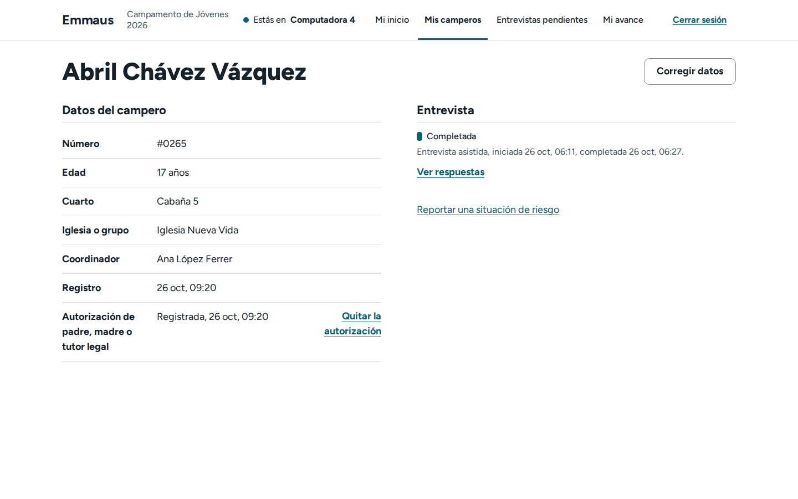
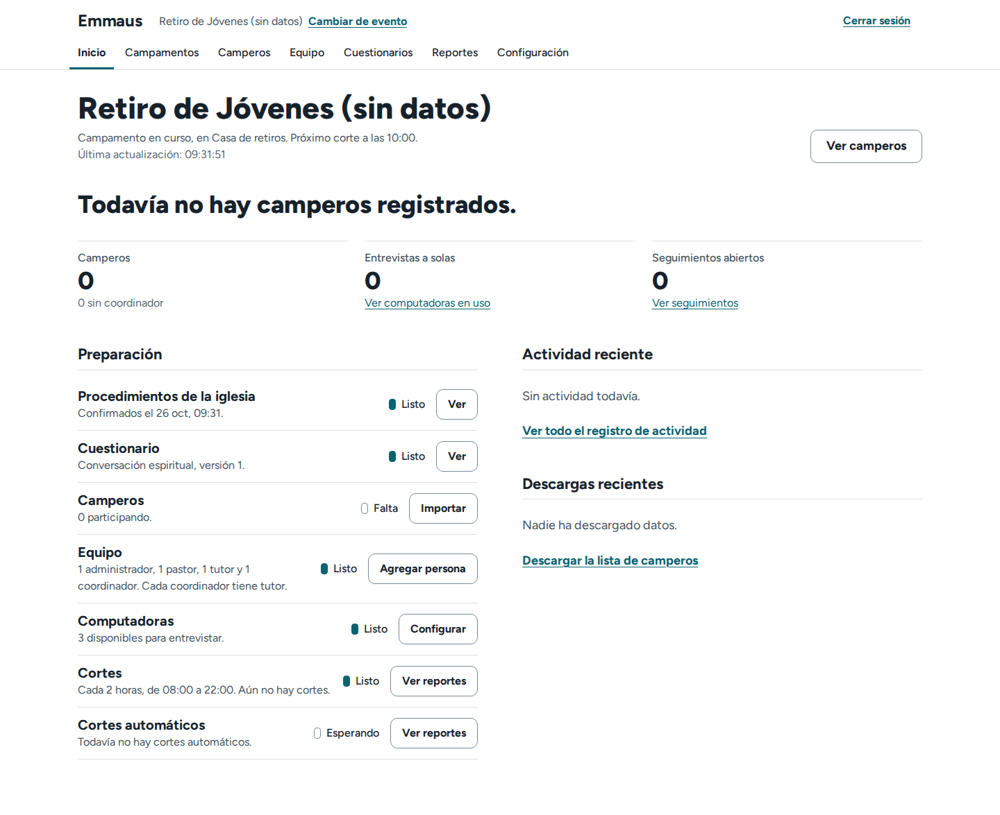
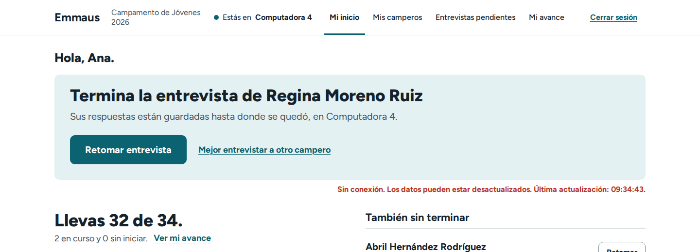
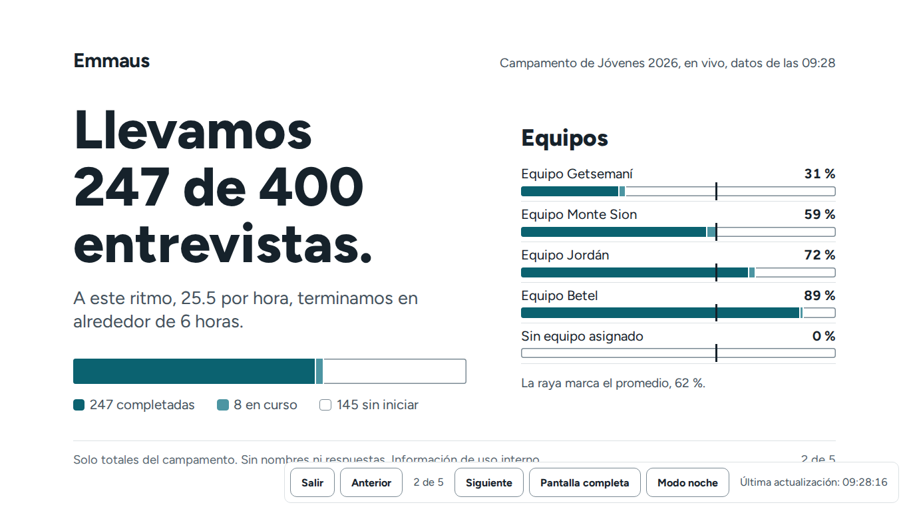
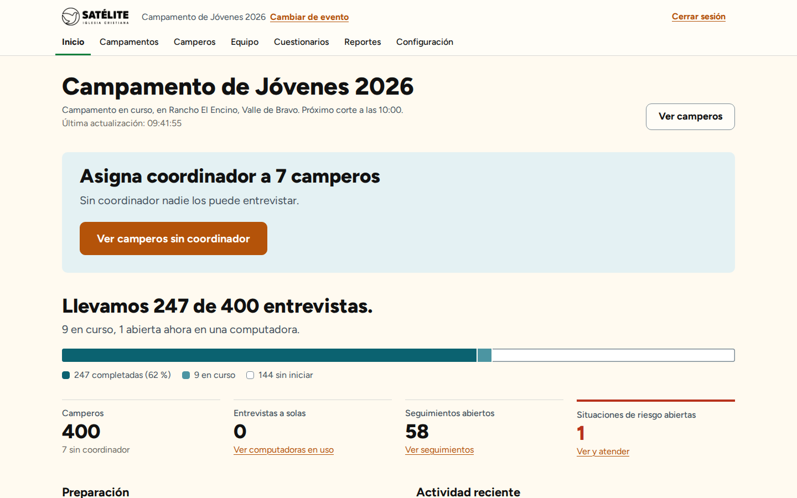
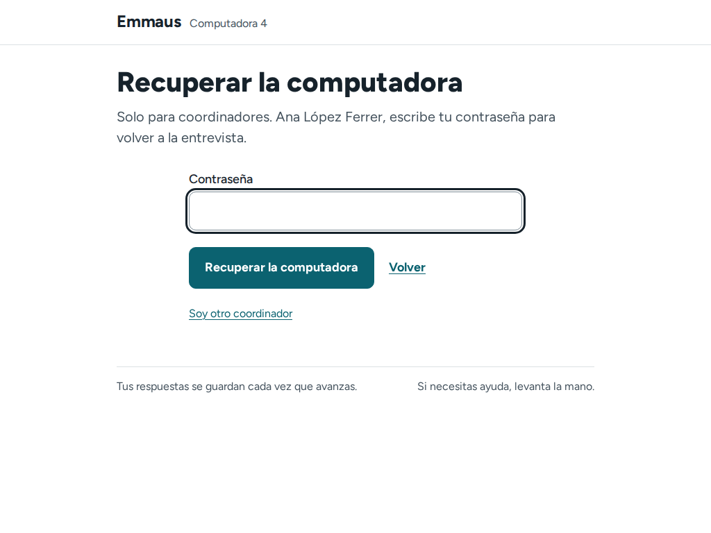

## 7. Hallazgos de accesibilidad (WCAG 2.2 AA)

**Detección automática.** axe-core 4.10.2 (con `best-practice`): **0 violaciones en 347 ejecuciones** (130 pantallas × 3 anchos, con quiosco, presentación y páginas de error). De 1 005 nodos «incompletos», 996 de contraste se resolvieron calculando colores (0 fallan; el menor, 5.74:1) y 9 de `duplicate-id-aria` eran un defecto real (UX-01). **Ningún hallazgo de esta sección es una violación de axe**: «0 violaciones» no es «accesible» (A05 estima que lo automático detecta cerca del 30 %).

**Verificación manual** (Chromium: teclado, 697 paradas de foco, objetivos, reflow, espaciado, árbol de accesibilidad, temporizadores simulados) frente a lo que **requiere verificación con personas o lector de pantalla** (NVDA, JAWS, VoiceOver, TalkBack, táctil real; Anexo C). 15 hallazgos: 2 altas, 4 medias, 9 bajas (A11Y-03 y A11Y-17 están en UX-01 y UX-17). **2.4.11 no se cumple** (A11Y-01, A11Y-02); parciales: 1.3.1, 1.3.2, 1.4.12, 2.2.1, 2.4.3, 2.5.3, 3.3.1, 3.3.2, 3.2.6, 4.1.2 y 4.1.3; el resto se cumple (1.4.3 con la paleta de Emmaus, 1.4.10, 2.5.8, 3.3.7, 3.3.8).

| ID | WCAG · pantalla | Problema y evidencia | Impacto | Sev. | Mejora · criterio de aceptación | Compl. | Detección | Ver también |
|---|---|---|---|---|---|---|---|---|
| A11Y-01 | 2.4.11 · preguntas de opciones y de texto, ≤ 600 px | La barra pegajosa «Continuar» (89 px) tapa el elemento enfocado, sin `scroll-padding`: a 390×844 «Sexualidad» 0 % y «Relaciones» 33 %; a 320×256 (zoom 400 %), 4 de 8 opciones (`a11y-01-390`) | Con teclado, interruptor o zoom no ve qué opción tiene enfocada | Alta | `scroll-padding-bottom` ≥ barra + 8 px. Con Tab a 390×844, 568×320, 320×568 y 320×256: 0 controles ocultos o parciales | Baja | Manual verificada | — |
| A11Y-02 | 2.4.11, 2.4.3, 1.3.2 · panel «Menú» (≤ 1180 px) | Capa de pantalla completa sin `aria-modal` ni `inert`: Tab sale al contenido tapado (coordinadora a 390: 5 paradas en el panel y 19 detrás) | Foco perdido en elementos invisibles; el lector puede leer `main` | Alta | `inert` al abrir o `<dialog>` modal (Esc ya cierra). Tab recorre solo el panel; confirmar con NVDA y VoiceOver | Baja | Manual verificada (lector: con personas) | UI-14 |
| A11Y-04 | 2.2.1 · pantallas de personal (30 min) | Cierre sin aviso ni forma de extender; escribir no cuenta como actividad: con sesión de 31 min, «Continuar» pierde el texto y la entrevista aparece «abierta en otra computadora» | Se puede perder una respuesta larga; el rodeo confunde | Media | `<dialog>` 2 min antes (patrón del quiosco), contar `input` como actividad, borrador del paso. A los 28 min hay aviso de ≥ 20 s. *Observación del compilador:* un borrador en `sessionStorage` en computadora compartida exige decisión de privacidad | Media | Manual verificada | UX-09, UX-04, UX-08 |
| A11Y-05 | 2.2.1, 2.1.1 · «¿Sigues aquí?» del quiosco | El diálogo se cierra con cualquier tecla, rueda o clic fuera y el temporizador se reinicia en silencio | El lector lo cierra al empezar a leerlo; la pantalla de un ausente queda abierta por un roce | Media | Cerrar solo con «Sí, sigo aquí» o Esc. Tab, flechas, Shift y rueda no lo cierran | Baja | Manual verificada | — |
| A11Y-06 | 1.4.3, 1.4.11 · configuración de iglesia, «colores propios» | El formulario acepta cualquier color sin comprobar contraste: texto `#8A8A8A` y principal `#F2C230` dan 432 violaciones en la lista de camperos | Se puede dejar ilegible la app de toda la iglesia | Media | Validar al guardar (≥ 4.5:1 texto, ≥ 3:1 controles), mostrar la razón, volver a la paleta de Emmaus. Un par < 4.5:1 muestra error | Media | Automática (caso de prueba) + manual | UI-18, LANG-21 |
| A11Y-07 | 4.1.3, 2.2.2 · tableros en vivo | «Última actualización: HH:MM:SS» en `aria-live="polite"` cambia cada 20 s y la región se reemplaza entera; sin pausa (3 cambios en 62 s) | Posible lectura repetida y pérdida del cursor virtual (hipótesis, sin lector) | Media | Anunciar solo cambios de estado, hora fuera de la región, «Pausar actualización». Confirmar con NVDA y VoiceOver | Baja | Manual (efecto: con lector) | UI-13 |
| A11Y-08 | 1.4.12 · barra del personal, 1200–1440 px | Con el espaciado WCAG hay scroll horizontal y «Cerrar sesión» queda fuera (20 px a 1440; 180 a 1200). Caso limítrofe | Quien usa extensiones de legibilidad desplaza en dos sentidos | Baja | `flex-wrap` en dos filas. `scrollWidth` = `clientWidth` a 1200, 1280 y 1440 | Baja | Manual verificada | UI-14, UI-44 |
| A11Y-09 | 3.3.1, 4.1.2 · pregunta de texto con error | El error no está en `aria-describedby` y falta `aria-invalid` (los demás formularios sí) | El lector no lo lee al entrar al campo | Baja | Añadir ambos. El árbol incluye el error e `invalid` | Baja | Manual verificada | A11Y-10 |
| A11Y-10 | 2.4.3, 3.3.1 · resumen de errores (`#q17`, `#decision`) | El enlace apunta a un `div` o `fieldset` no enfocable: el foco queda en `body` | El lector no recibe el foco en el control con error | Baja | Apuntar al primer `input` del grupo. El foco llega al primer control | Baja | Manual verificada | A11Y-09, LANG-11 |
| A11Y-11 | 2.5.8 y regla de 44 px · listas, filas, logotipo, «Cambiar» | AA se cumple (0 objetivos < 24 px sin excepción), pero a 390 px 419 objetivos miden < 44 px, todos enlaces; «Cambiar» del quiosco 72×24.4. UX-18: 12 en «Mi inicio», 21 en «Mi equipo»; UI-37: «Reportar una situación de riesgo» 22 px, casillas 28 px | Un toque errado abre la ficha de otro campero; el joven toca un enlace de 24 px | Baja | `min-height: 44px` en enlaces de acción o documentar 24 px. A 390 px 0 destinos < 44 px en las tres pantallas | Baja | Manual verificada (medición) | **UX-18, UI-37** (absorbidos), UI-25 |
| A11Y-12 | 4.1.3 · «Copiar enlace» | El texto pasa a «Copiado» sin región viva y no vuelve; si falla, solo selecciona | No sabe si copió | Baja | `role="status"` con «Enlace copiado» o «No se pudo copiar…» y volver a los 3 s | Baja | Manual (lector: con personas) | UX-24 |
| A11Y-13 | 4.1.3, 1.3.1 · preguntas condicionales y opciones exclusivas | Aparece un cuadro o se desmarcan las demás sin aviso ni `aria-expanded` | El lector no se entera del cambio | Baja | `aria-controls`, `aria-expanded` y mensaje breve. Confirmar con NVDA y VoiceOver | Media | Manual (lector: con personas) | — |
| A11Y-14 | 1.3.1, 3.1.1 · PDF del corte | Sin etiquetas, `/Lang` ni `DisplayDocTitle` (3 páginas); existe versión HTML | El lector no lo lee con estructura | Baja | PDF etiquetado con idioma es-MX; enlazar el HTML. Pasa Acrobat o PAC | Media | Manual verificada | — |
| A11Y-15 | 1.3.1 · tablas de datos (19) | Sin `scope` en la mayoría y sin encabezado de fila (el nombre es una `cell`) | El lector no repite el nombre de la fila | Baja | `scope="col"` y `th scope="row"` | Baja | Manual verificada | — |
| A11Y-16 | 4.1.3 · presentación | La región viva dice «2 de 5» sin el título nuevo (hipótesis, sin lector) | El presentador con lector no sabe qué diapositiva muestra | Baja | «Diapositiva 2 de 5: Llevamos 255 de 400 entrevistas» | Baja | Requiere verificación con personas | UX-03 |

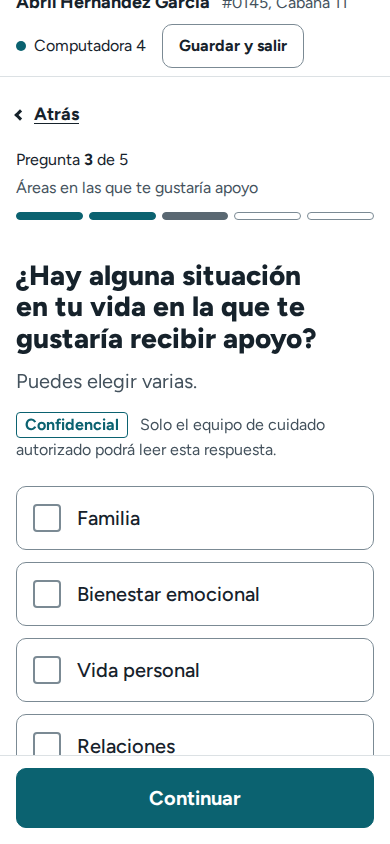

## 8. Hallazgos de lenguaje (es-MX)

56 hallazgos (3 altas, 27 medias, 26 bajas); LANG-17 y LANG-23 están en UX-12 y UI-09. La base es buena: tuteo sin excepciones, sin rastros de España ni de «usted», errores que dicen qué hacer y confidencialidad dicha en voz alta. Los problemas se concentran en privacidad y avisos (LANG-01, 03, 27, 28), jerga técnica en administración (LANG-05, 16, 18, 21, 22) y conceptos con dos nombres (LANG-19, 20, 25, 55). La fuente no asigna rol, impacto ni complejidad: «Problema» recoge el impacto y el esfuerzo se estima en el §11. **Tipo** es la detección de la fuente: Automático (regla repetible) o Manual (lectura y criterio; «código» = confirmado también en el código). El texto actual se leyó en pantalla o código; las propuestas no se probaron con voluntarios y solo LANG-06 está marcado Hipótesis. Archivo y línea: `lenguaje/hallazgos-lenguaje.md`.

| ID | Dónde · texto actual | Problema e impacto | Sev. | Propuesta · criterio de aceptación | Tipo | Ver también |
|---|---|---|---|---|---|---|
| LANG-01 | Aviso por defecto y quiosco · «El equipo del campamento podrá leer tus respuestas, menos las marcadas “Confidencial”…» (`ux-06-1440`) | Solo leen las respuestas el coordinador del campero y quien tenga acceso confidencial (`can_view_answer`); la frase nombra un grupo mayor y puede hacer callar al joven; fija en dos plantillas | Alta | «Tus respuestas las leen tu coordinador y el equipo de cuidado…» en una sola fuente. Prueba que falla con la frase actual; ≥ 4 de 5 jóvenes nombran solo a esos dos | Manual (código) | UX-06, LANG-26, LANG-27 |
| LANG-02 | Discipulado · «Llevas 0 de 7 lecciónes terminadas.» (`lang-02-1440`) | Plural mal formado en el inicio de cada persona. UI-36 (Baja); se toma Alta | Alta | `lección` y `lecciones`. Sin «ónes»; pruebas con 1, 2 y 7 | Automático | **UI-36** (absorbido) |
| LANG-03 | Reporte de riesgo · «El reporte llegó al equipo de cuidado autorizado.» / «Emmaus les avisa por correo a los dos…» | Promete entrega y correo siempre; con correo de consola o sin nadie con acceso, el reporte queda guardado y nadie se entera | Alta | «El reporte quedó guardado… Avísales también en persona.»; correo solo si existe; avisar si nadie puede leerlo. 3 combinaciones probadas | Manual (código) | UI-02, LANG-31 |
| LANG-04 | Hoja del código, Equipo · «escribe el código o el nombre del evento, jovenes-2026» | Llama «nombre del evento» al slug | Media | «Escribe el código 4PDA38. También sirve el nombre corto…» 3/3 voluntarios entran desde la hoja | Manual (código) | UX-12, UI-40 |
| LANG-05 | Editor de cuestionarios · «…se responde si, no. Identificador interno: salvo.» | Códigos internos en una oración; pide teclearlos | Media | «…se elige “Sí” o “No”»; casillas. Sin códigos; configurar en < 2 min | Automático | UI-19, UX-12 |
| LANG-06 | ≈ 25 usos de `H:i` · «de 00:00 a 23:00», «Última actualización: 09:25:02» | Todo en 24 h con segundos (0 «a. m./p. m.»); en México se habla en 12 h; menos natural para voluntarios mayores. Hipótesis | Media | 12 h en frases, 24 h en ejes, sin segundos. ≥ 4 de 5 voluntarios de 50+ dicen la hora del corte; mismo formato en pantalla, PDF y presentación | Manual (hipótesis) | UI-34 |
| LANG-07 | Cortes, pastor, tutor, PDF · «+25 entrevistas y +26 % de avance…» | «+» con «%»: son puntos (51 % a 77 %) pero se lee «26 % más» | Media | «Pasamos de 51 % a 77 %.» Sin «+» antes de una cifra | Automático | UI-17 |
| LANG-08 | Roles, barra, Equipo · «Ana López Ferrer, coordinador», «Administrador» | Masculino para mujeres; la guía dice «Administración» | Media | «Administración», «Pastoral», «Tutoría», «Coordinación». Ninguna etiqueta cambia el género | Manual | LANG-09, LANG-44 |
| LANG-09 | Quiosco · «Avisa a tu coordinador…», «Soy coordinador: recuperar la computadora» | Masculino genérico; una coordinadora lo lee en primera persona | Media | «Avisa a quien te está acompañando»; «Coordinación: recuperar…». Ninguna cadena concuerda en masculino | Manual | LANG-08 |
| LANG-10 | Primera pregunta · «¿Te consideras salvo?» | Solo concuerda con hombres; sale en revisión y PDF; una versión publicada exige versión nueva | Media | Neutra, p. ej. «¿Tienes la certeza de tu salvación?»; decide la pastoral. Versión 2 aprobada por el pastor | Manual (doctrinal) | — |
| LANG-11 | Resumen de errores · «Confirmo que la iglesia definió… procedimientos…: Marca la casilla para confirmar.» | Antepone la etiqueta completa: «.:» y el mensaje repetido hasta tres veces. UI-28 (Baja; se toma la mayor): el campo con error se corre 21 px | Media | Nombre corto en el resumen; el campo no se mueve. Sin «.:»; un mensaje ≤ 2 veces | Automático | **UI-28** (absorbido), A11Y-10 |
| LANG-12 | Antes de empezar · «Le expliqué el aviso de privacidad a Prueba…: Para comenzar, confirma esta autorización.» | Un mensaje para dos casillas; la del aviso no tiene «autorización» | Media | «Confirma que le explicaste el aviso de privacidad.» Un error por casilla | Automático | LANG-11 |
| LANG-13 | Contraseña · «…se parece demasiado a tu nombre de usuario.» | «Nombre de usuario» no existe: se entra con el correo | Media | «…a tu correo o a tu nombre.» | Automático | — |
| LANG-14 | Crear contraseña · «Escríbela otra vez: Esta contraseña es muy corta.» | El error de la primera cuelga de la confirmación | Media | Asignarlo a «Contraseña nueva»; el foco va ahí | Automático | — |
| LANG-15 | Pendientes, corte, Preparación · «¡Buen trabajo!», «ya habíamos terminado», «Listo» | Con 0 camperos felicita o declara «terminado»; otra pantalla dice «Todavía no tienes camperos» | Media | «Todavía no tienes camperos. Registra al primero…»; «Listo» con ≥ 1 persona. Sin «Buen trabajo» ni «meta (0)» | Manual | UX-11, UI-11, UI-03 |
| LANG-16 | Importar · «Importar CSV», «Guarda la hoja como CSV (UTF-8).» | Siglas y codificación para quien administra una iglesia | Media | «Importar desde Excel» con el paso exacto. Ningún botón dice CSV. *Observación del compilador:* UX-19 muestra que un `.xlsx` se rechaza (decidir) | Automático | UX-19 |
| LANG-18 | Entrega · «Tu sesión se cerrará en esta computadora» | «Sesión» es ambigua (también entrevista abierta) en el paso más delicado | Media | «Saldrás de tu cuenta en esta computadora…» 3 coordinadores explican qué pasará | Manual | UI-42 |
| LANG-19 | Resumen del pastor · «Pendientes 151» y «31 sin atender» | «Pendiente» nombra entrevistas y seguimientos | Media | Entrevistas: «Faltan»; seguimientos: «Sin atender» en todo | Manual | UI-07, UI-08, LANG-20 |
| LANG-20 | Campamento y discipulado | Seguimiento «Abierto/Completado» frente a «Pendiente/Atendido»; «Participante» frente a «Campero»; dos títulos de «Panorama» | Media | Unificar estados y definir ambos términos | Manual | LANG-19, LANG-40 |
| LANG-21 | Colores de la iglesia · «Superficies», «Color de acento» | Jerga de diseño en 8 selectores sin vista previa | Media | «Color de los botones y enlaces», «del fondo». Sin «superficie» ni «acento» | Manual | A11Y-06, UI-18 |
| LANG-22 | Logotipo · «PNG… hasta 512 KB, lado mayor de 32 a 2000 px» | Formato, peso y píxeles; errores sobre la estructura del archivo | Media | «Sube tu logotipo como imagen PNG con fondo transparente.» Sin KB ni px | Automático | — |
| LANG-24 | Inicio de administración · «8 en curso, ninguna abierta ahora en una computadora.» | No se entiende; «Cortes» y «Cortes automáticos» repiten | Media | «8 entrevistas a medias; ninguna está abierta…»; fusionar filas | Manual | UI-06 |
| LANG-25 | Equipo · «Puede leer información confidencial», «acceso confidencial» | Tres nombres para un permiso; ayuda circular | Media | Un nombre: «Equipo de cuidado» en todo | Manual | UX-16, LANG-26 |
| LANG-26 | Preguntas, revisión · «Solo el equipo de cuidado autorizado podrá leer esta respuesta.» | Nunca dice quiénes son; «autorizado» suena a trámite | Media | «Son las personas que la iglesia eligió para cuidar a los jóvenes.» | Manual | LANG-01, UI-29 |
| LANG-27 | Quiosco · «Nadie más ve esta pantalla mientras respondes.» | Promete algo físico que el sistema no controla | Media | «Tus respuestas aparecen solo en esta pantalla…» Una prueba por frase | Manual | LANG-01, UX-06 |
| LANG-28 | Registro de actividad · «Consultó un seguimiento confidencial del campero #0333» | La administración deduce quién pidió apoyo en privado | Media | «Consultó información confidencial», sin campero ni tipo | Manual (con quien decide privacidad) | — |
| LANG-29 | Ficha · «Descargar todos sus datos» (JSON técnico) | Ni una familia ni la administración lo leen | Media | PDF o Excel en español | Manual (código) | — |
| LANG-30 | Correos de aviso · «Entra a Emmaus para atenderlo…» | Sin enlace ni nombre del evento; el de riesgo exige actuar | Media | Enlace directo y evento | Manual | LANG-03 |
| LANG-31 | Invitaciones · «La invitación se envió por correo.» | Se dice aunque el correo sea de consola | Media | Sin correo: «Copia el enlace y envíalo tú.» | Automático | LANG-03, UX-24 |
| LANG-32 | Tutor, pastor · «Tu equipo lleva 83 de 98. 85 %… 7.5 por hora, faltan alrededor de 2 horas…» | Cuatro oraciones y ocho cifras; el dato útil, al final | Media | «Tu equipo lleva 83 de 98 (85 %).» / «A este ritmo faltan unas 2 horas.» | Manual | UI-10 |
| LANG-33 | Edad · «Usa un número igual o mayor que 0.» / «Revisa la edad.» | Matemático o mudo | Baja | «Escribe la edad con números, entre 1 y 120.» | Automático | — |
| LANG-34 | ≈ 30 formularios · «Este campo es obligatorio.» | Genérico | Baja | «Escribe la pregunta.» | Automático | — |
| LANG-35 | Desbloqueo vacío · «La contraseña no es correcta.» | Dice «incorrecta» sin escribir nada | Baja | «Escribe tu contraseña.» | Automático | — |
| LANG-36 | Revisión · «Lo que Sebastián pidió: Tomó una decisión espiritual.» | Mezcla peticiones y hechos | Baja | «Lo que Sebastián compartió» | Manual | UX-23 |
| LANG-37 | Sedes · «después ya no hay forma de saberlo» | Suena a fatalidad; sí se corrige | Baja | «Puedes corregirla después en su ficha.» | Manual | UX-26 |
| LANG-38 | Sedes · «Sede «Sede de Prueba» guardada.» | Comillas « » de España | Baja | “ ” en todo | Automático | — |
| LANG-39 | Guía y datos de demostración | La guía cita textos que ya no existen («≈ 10», «Márcala»); demostración dice «Cabaña», el producto «Cuarto» | Baja | Actualizar guía y datos | Automático | UX-17 |
| LANG-40 | Menús · «Campamentos» / «Campamentos y eventos» / «Cambiar de evento» | Tres nombres para la lista; «Seguimiento» y «Seguimientos» | Baja | Uno solo; singular | Manual | UI-44, UX-13, LANG-20 |
| LANG-41 | Conflicto · «Tomar el control aquí» | Suena a sistema remoto | Baja | «Seguir aquí» | Manual | UX-08 |
| LANG-42 | Computadoras en uso · «Abierta en: Libre» | Se contradice | Baja | «Computadora: Ninguna» | Manual | — |
| LANG-43 | Participantes · «Dados de baja» | Lenguaje de recursos humanos | Baja | «Ya no participan» | Manual | — |
| LANG-44 | Equipo · «Tutor que lo supervisa» | Jerárquico (la guía dice «acompaña»); masculino | Baja | «Quién acompaña a su coordinación» | Automático | LANG-08 |
| LANG-45 | Presentación · «interrumpidas hace más de 20 minutos» | Ambiguo; difiere de «20 minutos o más» | Baja | «…que llevan 20 minutos o más sin cambios» | Manual | — |
| LANG-46 | Permisos · «Este campero no está asignado a ti.» | No dice qué hacer | Baja | Añadir «Pide a la administración que te lo asigne.» | Manual | — |
| LANG-47 | Eliminar datos · «Si existieran seguimientos confidenciales…» | Condicional vago | Baja | «…si los hay (la administración no puede verlos)» | Manual | — |
| LANG-48 | Glosario del PDF · «Avance: Completadas entre camperos.» | «Entre» oscuro; definición circular | Baja | «…dividido entre los camperos que participan» | Manual | — |
| LANG-49 | Comandos de gestión (278 cadenas) | Jerga y «·» en terminal | Baja | Frases completas | Manual | — |
| LANG-50 | Hoja del código · «en tu teléfono» | En México, «celular» | Baja | «…en tu celular» | Manual | LANG-04 |
| LANG-51 | 404 · «Volver a mi inicio» sin sesión | «Mi inicio» no existe | Baja | «Ir a Emmaus» | Manual | UI-35 |
| LANG-52 | «Aviso para participantes» y «Aviso de privacidad» | Dos nombres para un documento | Baja | «Aviso de privacidad» | Manual | LANG-20 |
| LANG-53 | Búsqueda · «#0229, Cabaña 4» | «#» y ceros a la izquierda | Baja | «Número 229, Cabaña 4» | Manual | UI-09, LANG-39 |
| LANG-54 | Gráficas · «acumuladas», «proyección», «raya» | Jerga estadística; «raya» y «línea» | Baja | «terminadas hasta ahora»; «línea punteada» | Manual | — |
| LANG-55 | «Equipo» | Cuatro sentidos | Baja | «Personas» para la sección | Manual | LANG-01, LANG-25 |
| LANG-56 | Editor · «Tipo de respuesta: ---------» | Opción vacía de Django | Baja | «Elige un tipo de respuesta» | Automático | — |
| LANG-57 | Ficha · «Asentimiento del menor» | Término legal poco usado en México | Baja | «Acuerdo del menor» | Manual | — |
| LANG-58 | Equipo · «…tienen acceso a todo el evento» | «Todo» puede leerse como las respuestas | Baja | «…ven los datos y los totales… Las respuestas de los jóvenes no.» | Manual | LANG-01 |

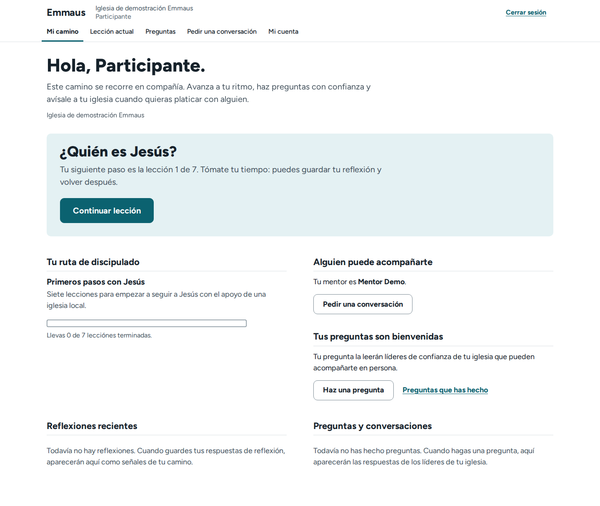

## 9. Dirección de diseño

**Veredicto.** Atrio (blanco, petróleo `#0B6270`, Figtree, frases como títulos, el logotipo de la iglesia como único adorno) cumple cuatro de los seis adjetivos del brief y dos a medias (UI, §8). No hay motivo para cambiar de dirección, sino para afinarla; Paloma sigue siendo la salida prevista en `design-direction.md` si Atrio se sintiera genérico tras el §13.

| Adjetivo | Veredicto | A favor | En contra |
|---|---|---|---|
| Humana | Parcial | Calidez en las palabras («Platicar con cada joven, sin perder a nadie.») y en el logotipo | Sin logotipo, neutra (UI-33); quiosco a probar (UI-41); roles en masculino (LANG-08, 09) |
| Calma | Sí | Blanco, un color, sin sombras; movimiento ≤ 320 ms y apagable | Resumen de 4 795 px (UI-10), «Preparación» (UI-06), negritas y subrayados (UI-24) |
| Tecnológica | Parcial | axe 0; foco 692/697; reflow 65/65; regla con promedio | Cifras pisadas (UX-02), UI-21, UI-18, «lecciónes» (LANG-02), A11Y-01 |
| Intuitiva | Sí, en lo que importa | Una pregunta por pantalla; «Lo que sigue» | UX-01, UX-06, UX-07, jerga de alta (UX-12, LANG-16) |
| Con propósito | Sí | Un encargo por rol; una marca por campero | Listas idénticas (UI-06, UI-09); la decisión del pastor, al final (UI-10) |
| Atemporal | Sí | Sin vidrio, degradados, sombras, ilustraciones ni tarjetas | Petróleo con sans geométrica es el aspecto común del software de iglesia |

No parece SaaS genérico en lo grueso; sí en tres rasgos: filas «etiqueta, cifra, nota», avisos con filo izquierdo y listas idénticas (UI). **Minimalismo no es usabilidad:** en cuatro sitios quitar la señal quitó la función (UI-02, UI-07, UI-12, UI-27). **Refinamientos de mayor efecto**, sin dirección ni librerías nuevas: (1) cerrar las violaciones de sus propias reglas (UX-02, UI-21, UI-18, LANG-02); (2) tres niveles de título y menos negrita y subrayado (UI-05, UI-24); (3) cuatro señales de significado fijo (riesgo, confidencial, terminado, estado de documento) sin sistema de iconos (UI-02, UI-07, UI-29); (4) lo que cada rol decide, primero (UI-10, UI-04, UI-22, UI-03); (5) estados difíciles explícitos: ocupado, sin conexión, vacío (UI-11, UI-12, UI-13, UX-05); (6) calidez propia en portada y quiosco, probada antes (UI-33, UI-41). *Observación del compilador:* la barra superior concentra cinco hallazgos (UI-14, UI-44, A11Y-02, A11Y-08, UX-13): conviene tratarla como un componente.

## 10. Investigación de referencia

99 fuentes externas y 3 internas leídas el 26 de octubre de 2026; la tabla completa con URL y fecha está en `referencias/investigacion-de-referencia.md` (§1). Se extrajeron principios, sin copiar interfaces ni usar marketing; las citas textuales deben confirmarse en la URL. Linear y Basecamp son de uso diario (solo se tomó jerarquía y estado); lo más parecido a los voluntarios está en Planning Center Check-Ins, Tally y el sector público.

| # | Principio | Fuentes | Se prueba en |
|---|---|---|---|
| 1 | Una superficie por rol; en el campero, una cosa por pantalla (probar si los coordinadores quieren más ritmo) | G01 G24 G26 T01 P06 P08 | Quiosco, entrevista |
| 2 | Cada pantalla dice qué sigue: un panel o frase y un botón principal | G06 N07 L01 B05 G18 | «Mi inicio», UI-03 |
| 3 | El título es la pregunta o la frase que dice qué se hace | G01 N03 B04 | UI-05 |
| 4 | Lenguaje llano, verbos completos, sin inventar términos | N06 B04 L03 L04 G04 | LANG-* |
| 5 | Errores: resumen con foco, mensaje junto al campo, qué hacer, conservar lo escrito | G02 G03 G04 N02 W09 W10 U02 | LANG-11 a 14, A11Y-09, 10 |
| 6 | Pedir solo lo necesario, una vez, y decir para qué | G01 G24 P12 W11 U03 G20 | UX-12 |
| 7 | Cambiar y deshacer sin repetir; cerrar diciendo qué sigue | G07 P11 P15 G08 T04 N08 | UX-07, UX-08 |
| 8 | Estado real con la fecha del dato; el color nunca es la única señal | B01 L08 A04 A02 G17 W02 P10 | UX-04, UI-13, UI-17 |
| 9 | Tablero solo con necesidad clara; gráficas simples; jerarquía desigual a propósito | A03 A01 L01 B06 B07 N01 | UI-10, UI-15 |
| 10 | La accesibilidad se prueba: foco no tapado, objetivos grandes, manual además de automático | G12 U06 A05 G25 W05 W07 G11 | A11Y-01, A11Y-11 |

Por dimensión: **jerarquía** (L01, B05, A03); **interacción** (G01, P06, G07); **tipografía** (cuerpo de 16 a 19 px, líneas de 45 a 75 caracteres: G13, N03, U10; el tamaño para proyector no está tratado y debe validarse); **formularios** (etiqueta visible y «(opcional)» en GOV.UK frente a asterisco en USWDS: las guías discrepan; validar al enviar, G02, U02); **tableros** (B01, A04, A01); **accesibilidad** (un componente accesible no vuelve accesible el servicio, G12, U06; lo automático detecta cerca del 30 %, A05). **No copiar:** mosaicos iguales (inferencia), ilustración decorativa, temas oscuros de administración (NN2), navegación solo con iconos (NN1), color libre sin control de contraste (P13, P14), validación en vivo y avance automático (U02, T01). **URLs clave** (leídas el 2026-10-26): G01 https://design-system.service.gov.uk/patterns/question-pages/ · G03 https://design-system.service.gov.uk/components/error-summary/ · G12 https://design-system.service.gov.uk/accessibility/ · A03 https://analysisfunction.civilservice.gov.uk/policy-store/data-visualisation-building-and-managing-dashboards/ · A05 https://analysisfunction.civilservice.gov.uk/policy-store/data-visualisation-testing-dashboards-for-design-and-accessibility/ · L01 https://linear.app/blog/behind-the-latest-design-refresh · B01 https://basecamp.com/shapeup/3.4-chapter-12 · P06 https://help.planningcenter.com/en/138213-create-a-station.html · W05 https://www.w3.org/WAI/WCAG22/Understanding/focus-not-obscured-minimum.html

## 11. Recomendaciones priorizadas

**Estado al 26 de octubre de 2026.** La ronda «cada rol sabe qué hacer» (`design-direction.md`; `ux-review.md`, ronda 17) atendió las filas 20, 21, 23 a 30 y 33, en todo o en parte. Lo que se puede rastrear en sus commits, por fila: 20, UI-10, UI-11, UI-45, LANG-32 y UI-05 en el Resumen (el saludo del coordinador sigue siendo el `h1`; quedan UI-15 y LANG-07); 21, UI-16 y, de la fila 12, la hora de los datos en cada diapositiva (UI-17) (quedan UI-39 y A11Y-16); 23, UX-15, UI-08 y UX-21; 24, UI-14, UI-44, UX-13 y LANG-40 en lo que toca a la lista de eventos («Seguimiento» y «Seguimientos» siguen siendo dos palabras), y A11Y-08 en parte (los enlaces bajan a su propia fila de 761 a 1280 px; a 1440 px con el espaciado de texto de WCAG, sin confirmar); 25, UX-14 (con UI-23) y UI-26; 26, UI-06 y la fusión de «Cortes» de LANG-24 (la frase «ninguna abierta ahora en una computadora» sigue igual); 27, UX-12 (con LANG-17), UI-19 y LANG-05 en parte (los identificadores van bajo «Datos técnicos»; quedan LANG-04, LANG-22, LANG-49 y UI-40); 28, UX-17 y A11Y-17, y LANG-39 en la guía (ya no cita «≈ 10»; los datos de demostración siguen diciendo «Cabaña»); 29, UI-07 en parte (rastreado en el código, no en los mensajes: «Inactiva» y las invitaciones vencidas usan la marca de cerrado; quedan UI-24, UI-25, UI-27 y UI-29); 30, UI-04, UI-09 (con LANG-23) y UI-22, que sigue siendo una hipótesis sin probar con personas (queda LANG-53); 33, UX-24, UI-31, UX-20 en parte («Elegir computadora» en «Mi inicio», sin «¿Sigues en la Computadora 4?») y UI-30 en parte (la paginación alineada con la tabla, sin total). De la fila 18 cerró UX-22, LANG-42, LANG-43 y LANG-56, y los estados vacíos de UX-19 en «Mis camperos». LANG-27 cerró: la bienvenida del campero ya no promete «Nadie más verá tus respuestas en esta pantalla.», cada pregunta del quiosco ya no dice «Nadie más ve esta pantalla mientras respondes» y la lista de entrega remite a la bienvenida en vez de prometerlo. Las filas 19 y 22 no son de esta ronda: el mensaje sin red de «Continuar» (UX-05) y el aviso «¿Sigues aquí?» (A11Y-04) llegaron con las correcciones de antes del campamento, y «Guardando…» (UI-12) y el aviso al volver a entrar (UX-09) siguen abiertos. Siguen abiertas la fila 31 (lector de pantalla), la 32 y las decisiones D1 a D10, salvo lo que esta ronda fijó de hecho: D6 en parte (el nombre corto se forma solo y la palabra «Nombre corto para la dirección» no cambió; «Faltan» para entrevistas y «sin atender» para seguimientos, LANG-19; los mismos cuatro estados de seguimiento en el campamento y en el discipulado, LANG-20). D3 no avanzó: esta ronda no cambió las palabras de los roles; solo la línea de quién eres en «Menú» dice ahora el rol de cada persona en vez de un «coordinador» fijo.

Cada fila agrupa lo que se corrige junto; cada ID figura al menos una vez. **Impacto:** Alto = evento en vivo, privacidad o seguridad; Medio = fricción con salida o calidad percibida; Bajo = pulido. **Esfuerzo:** el de los especialistas (el mayor de la fila); en lenguaje, estimación del compilador (Bajo = texto; Medio = lógica o varias plantillas; Alto = contenido doctrinal o migración). **Sev.:** la mayor de la fila. Orden por impacto y esfuerzo.

### Antes del campamento (rápidas, de alto impacto, sin cambio de diseño)

| Orden | ID(s) | Recomendación | Impacto | Sev. | Esfuerzo | Dependencias |
|---|---|---|---|---|---|---|
| 1 | UX-01, A11Y-03 | Quitar el `id` duplicado de las opciones | Alto | Alta | Bajo | — |
| 2 | UX-02, UI-01, UI-34 | Cifras sin pisarse; duraciones cortas | Alto | Alta | Bajo | — |
| 3 | UX-03 | Teclas activas con foco en un botón | Alto | Alta | Bajo | — |
| 4 | A11Y-01 | `scroll-padding` bajo «Continuar» | Alto | Alta | Bajo | — |
| 5 | A11Y-02 | `inert` o `<dialog>` en «Menú» | Alto | Alta | Bajo | — |
| 6 | UI-02 | Acción de riesgo con peso propio | Alto | Alta | Bajo | — |
| 7 | UI-03 | Panel de siguiente paso sin camperos | Alto | Alta | Bajo | — |
| 8 | LANG-01, 26, 27 | Frase de privacidad exacta, única y probada | Alto | Alta | Bajo | D4 |
| 9 | UX-05 (papel), UI-20 | Preguntas impresas con el respaldo | Alto | Alta | Bajo | — |
| 10 | UX-06 | «Parar por ahora» guarda | Alto | Media | Bajo | — |
| 11 | LANG-03, 30, 31 | Riesgo e invitaciones: solo lo verificable; correos con enlace | Alto | Alta | Medio | Saber si hay correo |
| 12 | UX-04, UI-13, UI-17 | Datos vencidos y su base de tiempo visibles. *Observación del compilador:* mientras tanto, tocar la diapositiva renueva la actividad | Alto | Alta | Medio | — |
| 13 | UX-07, UX-08, LANG-41 | Volver a la revisión; textos de control perdido | Medio | Media | Bajo | — |
| 14 | UX-10, UX-11, LANG-15 | Motivo del bloqueo; «Listo» solo si es verdad | Medio | Media | Bajo | — |
| 15 | A11Y-05, UI-12, UI-21, UI-42, LANG-18 | Diálogo del quiosco; «Guardando…»; «Recuperar»; entrega sin «sesión» | Medio | Media | Bajo | — |
| 16 | LANG-02, UI-36 | «lecciones» | Medio | Alta | Bajo | — |
| 17 | LANG-11, UI-28, LANG-12, 13, 14, 33, 34, 35, A11Y-09, A11Y-10 | Errores: resumen corto, mensaje por casilla, foco | Medio | Media | Bajo | — |
| 18 | UX-09, 19, 22, LANG-36 a 38, 42 a 48, 50 a 54, 56 a 58 | Textos de una línea y vocabulario menor | Bajo | Baja | Bajo | — |

### Después del campamento

| Orden | ID(s) | Recomendación | Impacto | Sev. | Esfuerzo | Dependencias |
|---|---|---|---|---|---|---|
| 19 | UX-05, UI-12 | Falla de red: conservar selección, «Reintentar» | Alto | Alta | Medio | 9 |
| 20 | UI-10, 05, 11, 15, 45, LANG-07, LANG-32 | Resumen del pastor: decisión arriba, un vacío, tres títulos | Medio | Media | Medio | §13 |
| 21 | UI-16, 39, A11Y-16 | Presentación: franja de controles, texto ≥ 22 px | Medio | Media | Medio | 12 |
| 22 | A11Y-04, UX-09 | Aviso 2 min antes del cierre, borrador | Medio | Media | Medio | D7 |
| 23 | UX-15, UI-08, UX-21 | Seguimiento: filtros, orden, asignación en fila | Medio | Media | Medio | — |
| 24 | UI-14, 44, A11Y-08, UX-13, LANG-40 | Barra superior como un componente | Medio | Media | Medio | 5 |
| 25 | UX-14, UI-23, UI-26 | Configuración por secciones y aviso | Medio | Media | Medio | — |
| 26 | UI-06, LANG-24 | «Preparación» colapsada | Medio | Media | Medio | 7, 14 |
| 27 | UX-12, LANG-17, 04, 05, 22, 49, UI-19, UI-40 | Lenguaje llano en alta, editor y hoja | Medio | Media | Medio | D2, D6 |
| 28 | UX-17, A11Y-17, LANG-39 | «Ayuda» en la app; guía al día | Medio | Media | Medio | — |
| 29 | UI-07, 24, 25, 27, 29 | Señales de significado fijo; enlaces; hover | Medio | Media | Medio | — |
| 30 | UI-04, 09, 22, LANG-23, LANG-53 | Listas del coordinador | Medio | Media | Medio | §13 |
| 31 | A11Y-07, 12, 13, 14, 15 | Lector de pantalla: regiones vivas, PDF, `scope` | Medio | Media | Medio | NVDA, VoiceOver |
| 32 | A11Y-11, UX-18, UI-37 | Enlaces de acción de 44 px | Bajo | Baja | Bajo | — |
| 33 | UX-20, 24, 25, 26, UI-30, 31, 32, 35, 38, LANG-51, 55 | Pulido de flujo y visual | Bajo | Baja | Bajo | — |

### Decisiones de producto (del dueño; algunas, tras el §13)

| Orden | ID(s) | Decisión | Impacto | Sev. | Esfuerzo | Dependencias |
|---|---|---|---|---|---|---|
| D1 | LANG-06, UI-34 | Hora en 12 h o en 24 h | Medio | Media | Bajo | Voluntarios de 50+ |
| D2 | LANG-16, UX-19 | «Importar desde Excel»: ¿aceptar `.xlsx` o «archivo CSV de Excel»? | Medio | Media | Medio | — |
| D3 | LANG-08, 09, 44 | Roles neutros («Administración», «Pastoral», «Tutoría», «Coordinación») | Medio | Media | Medio | — |
| D4 | LANG-25, 28, 29, UX-16 | «Equipo de cuidado», «Confidencial», registro y descarga | Medio | Media | Medio | Privacidad |
| D5 | UI-18, A11Y-06, LANG-21 | Paleta propia: validar y aplicar a todos los roles, o retirar | Medio | Media | Medio | — |
| D6 | UX-12, LANG-17, 19, 20, 52 | Nombre del campo y vocabulario común | Medio | Media | Medio | — |
| D7 | A11Y-04 | ¿Borradores en una computadora compartida? | Medio | Media | Medio | Privacidad |
| D8 | LANG-10 | «¿Te consideras salvo?»: redacción neutra, versión nueva | Medio | Media | Alto | Pastor |
| D9 | UX-23, UX-26 | ¿Preseleccionar el seguimiento?; semántica de sedes | Bajo | Baja | Bajo | §13 |
| D10 | UI-33, 41, 43 | Calidez en portada y quiosco; Atrio o Paloma | Bajo | Baja | Medio | §13 |

## 12. Hoja de ruta

| Fase | Contenido | Depende de | Criterios de salida medibles |
|---|---|---|---|
| 0. Antes del campamento | Filas 1 a 18 | Aprobación de privacidad (LANG-01); pruebas en CI | 0 ids duplicados; `scrollWidth ≤ innerWidth` de 1920 a 390 px en `…/resumen/`; `→` avanza tras los 4 botones; 0 controles ocultos con Tab a 390×844, 568×320, 320×568 y 320×256; Tab recorre solo «Menú»; «Parar por ahora» conserva 10/10; «Cambiar» vuelve en 1 clic; axe sigue en 0 |
| 1. Validación y decisiones | Prueba de una tarde (§13); D1 a D10 | Fase 0 desplegada | Cada hipótesis con resultado (≥ 4 de 5 donde la fuente fija umbral); decisiones registradas |
| 2. Resiliencia y accesibilidad | Filas 19, 21 a 25, 31, 32 | Fase 0 (filas 5, 9, 12); D7 | 0 páginas de error del navegador con `setOffline`; aviso ≥ 20 s a los 28 min; 2.4.11 sin «No cumple»; A11Y-02, 05, 07, 12, 13 y 16 confirmados con lector |
| 3. Las tres pantallas | §14; filas 20 y 26 | Fases 1 y 2; D5, D10 | Métricas del §14 |
| 4. Consistencia | Filas 27 a 30 y 33; D1 a D6, D8 y D9 | Fase 1 | Una palabra por concepto en pantalla, PDF y presentación; 0 «identificador» ni «sesión» en administración; «CSV» solo si D2 lo decide |
| 5. Reauditoría | Repetir guiones (Playwright 1.63.0, axe 4.10.2, extractor de cadenas); criterios como pruebas de regresión | Fases 0 a 4 | 0 altas; axe en 0; totales comparados con este informe |

## 13. Plan de validación

Las secciones no probaron con personas; este plan convierte sus hipótesis y criterios en una prueba de una tarde en la iglesia. Cinco personas por grupo dan señales, no estadística; los umbrales son los de las secciones y los «propuesto» son del compilador. **Condiciones:** evento de práctica con datos sintéticos (los jóvenes leen y responden con datos ficticios, conforme a las reglas de protección de menores de la iglesia); computadora compartida, proyector del salón, impresora y wifi que se pueda cortar; un facilitador que no ayuda y un observador con hoja de tareas (éxito, éxito con ayuda, fallo, tiempo, cita). **Una tarde, ≈ 3 h 30:** 30 min de montaje, 2 h con cuatro estaciones en paralelo y 1 h para marcar cada tarea «pasó» o «no pasó» y enlazarla a su ID.

| Grupo | Tareas | Éxito | Qué observar | Resuelve |
|---|---|---|---|---|
| A. Coordinadores, 6 a 8 de 20 min | Elegir «Computadora 1» y empezar una entrevista asistida; cambiar una respuesta; cortar el wifi a media pregunta; perder el control; hallar «Reportar una situación de riesgo»; ver el bloqueo por procedimientos; decidir seguimiento | Empiezan en < 20 s (5/5); «Cambiar» en 1 clic; mensaje en ≤ 3 s; ≥ 4 de 5 explican qué pasó; riesgo en < 5 s; 12/12 ven el motivo; ≤ 20 % acepta la sugerencia sin leer | Duda ante la computadora; uso del respaldo | UX-01, 05, 07, 08, 10, 23; UI-02, 22 |
| B. Pastor y tutor, 2 o 3 de 30 min, con proyector | Leer el Resumen y decir cómo va, qué falta y qué decide; asignar líder a 29 seguimientos; presentar con clicker tras «Modo noche»; dejar 31 min la presentación y decir si los datos son actuales; leer desde la última fila; explicar «corte», «sede» y «seguimiento» | Nombra el asunto principal en < 60 s (propuesto); ≤ 30 toques; `→` 4/4; ve los datos viejos en < 61 s; lee a 1366 y 1920 | Dónde mira; «+26 %» entendido como puntos; hora frente a rango | UX-02, 03, 04, 15; UI-10, 16, 17, 34; LANG-07, 19 |
| C. Jóvenes de 14 a 17, ≥ 5 de 10 min, en el quiosco | Leer la bienvenida y decir quién puede leer lo que contestan; pausar con «Parar por ahora» y decir qué pasó; cambiar una respuesta; terminar y entregar | ≥ 4 de 5 nombran coordinador y equipo de cuidado y a nadie más; ≥ 4 de 5 distinguen pausar de terminar; 10/10 conservan la opción | Duda ante «No lo tengo claro» y «Prefiero no responder»; si se siente fría | LANG-01, 27; UX-06, 07; UI-41 |
| D. Voluntarios de 50+, ≥ 5 de 10 min | Decir la hora del próximo corte en tres redacciones; hallar «retomar una entrevista» en la guía impresa; explicar «Entregar la computadora» | ≥ 4 de 5 dicen la hora; ≥ 80 % halla «retomar» en ≤ 60 s; 3 explican bien | Formato preferido | LANG-06, 18; UX-17 |

**Cierra:** 12 h frente a 24 h (LANG-06); «Parar por ahora» como pausa (UX-06); quién lee las respuestas (LANG-01); sugerencia preseleccionada (UX-23); inicio de cinco bloques (UI-22); calidez de quiosco y portada (UI-41, UI-33); «Sedes que participan» (UX-26); ayuda en la app (UX-17); y de las referencias: si se entienden «corte», «sede» y «seguimiento», si un rango de término se entiende mejor, si los coordinadores quieren varias preguntas por pantalla, si alcanza el tamaño en un proyector real y si «Pregunta X de Y» es fiable con preguntas condicionales. *Observación del compilador:* «No lo tengo claro» no es hallazgo en ninguna sección; se observa a pedido del dueño y solo dice algo si los jóvenes dudan. **No cabe en una tarde:** lector de pantalla, táctil real, Firefox y Safari, los 30 min reales de inactividad e impresión real.

## 14. Siguiente fase de diseño: las tres pantallas más valiosas

**Estado al 26 de octubre de 2026.** La ronda «cada rol sabe qué hacer» dio a la segunda pantalla las filas 20 y 21 del §11 (la decisión después de «¿Cómo va?», un solo mensaje vacío, tres niveles de título, franja de controles, letra chica de 22 px, la hora de cada dato) y a la tercera las filas 25, 26 y 27 («N de M pasos listos» con lo pendiente primero, un solo renglón de cortes, Configuración por secciones, un botón relleno por formulario, el nombre corto que se forma solo). La primera pantalla no cambió de estructura en esta ronda, salvo la bienvenida del campero. Ninguna métrica de éxito de esta sección se ha medido todavía con personas. El detalle por ID está al inicio del §11.

Elegidas por severidad y frecuencia, no por estética: reúnen 9 de las 12 altas (las otras: «Menú», A11Y-02, fila 24; «lecciónes», LANG-02; reporte de riesgo, LANG-03, contiguo a la primera). El inicio del coordinador queda fuera: UX lo juzga la mejor decisión de orientación, no tiene altas y su hallazgo principal (UI-22) es una hipótesis. Dirección: conservar Atrio y aplicar los refinamientos del §9, sin implementar todavía; antes hay que cerrar D5 y D10.

**1. Pregunta de la entrevista, revisión y quiosco.** *Por qué primero:* es la tarea central, se repite decenas de veces al día y el campero la hace solo; 5 altas (UX-01, UX-05, UI-02, A11Y-01, LANG-01), 15 medias y 11 bajas; se afina, no se reemplaza. *Problemas:* UX-01, 05, 06, 07, 08, 09, 10, 20, 23; UI-02, 12, 13, 21, 41, 42; A11Y-01, 05, 09, 10, 11, 13; LANG-01, 09, 10, 11, 12, 18, 26, 27, 36, 41. *Visual:* barra «Continuar» que no tape el foco; «Guardando…» y «Sin conexión» explícitos; acción de riesgo con peso propio; «Cambiar» de 44 px; consecuencia de «Entregar» arriba; un solo borde en «Recuperar la computadora»; sin tocar opciones de 64 px, camino ni «o bien». *Éxito:* pasos sin aumentar (11 pantallas y ≈ 19 toques; campero 9 y ≈ 12); 0 ids duplicados; foco 100 % visible; «Cambiar» en 1 clic; sin red, mensaje en ≤ 3 s; ≥ 4 de 5 jóvenes distinguen pausar de terminar y responden bien «¿quién lee esto?».

**2. Resumen general del pastor y presentación.** *Por qué segunda:* el liderazgo la lee, proyecta y compara cada reunión y los fallos se ven ante un grupo; 3 altas (UX-02, 03, 04), 12 medias y 6 bajas. Responde «cómo vamos» y «qué falta» y deja «qué decido» al final (UI-10). *Problemas:* UX-02, 03, 04; UI-05, 10, 11, 13, 15, 16, 17, 34, 39, 45; A11Y-07, 16; LANG-06, 07, 19, 32, 45, 54. *Visual:* tres niveles de título; «¿Qué hay que coordinar?» bajo el titular con enlaces; un solo mensaje de vacío; gráficas de ≥ 15 px; franja propia de controles; base de tiempo por diapositiva; un formato de hora y duración; se conserva el titular en frase y la regla con promedio. *Éxito:* 0 superposiciones de 1920 a 390 px; < 3 500 px a 1440 y asuntos en los primeros 1 100 px; `→` 4/4; aviso de datos vencidos en < 61 s; ≥ 22 px a 1366; asunto principal nombrado en < 60 s (propuesto).

**3. Inicio de administración y primer uso.** *Por qué tercera:* una persona, una vez por evento, pero sin procedimientos ni camperos nadie entrevista; 1 alta (UI-03), 10 medias y 8 bajas (UI-11 y UI-13 se comparten); sube por impacto sobre esfuerzo (casi todo es Bajo) y porque ahí se concentra la jerga. *Problemas:* UI-03, 06, 11, 26, 44; UX-11, 12, 13, 14, 19, 22, 24, 26; LANG-04, 15, 16, 24, 37, 40. *Visual:* panel con una acción rellena; «Preparación» como «6 de 7 pasos listos»; «Listo» solo si es verdad; Configuración por secciones; un botón relleno por formulario. *Éxito:* 5/5 administradores nuevos inician la importación sin ayuda; ≥ 4 de 5 no técnicos completan el alta; no más de ≈ 40 pantallas, ≈ 37 toques y ≈ 30 campos; ningún «Listo» sin cumplirse.

## 15. Anexo

### A. Secciones, capturas y herramientas

Base `/home/adrian/sandbox-docs/emmaus/auditoria-ux/`; brief `/home/adrian/sandbox-docs/emmaus/design-v3/audit-brief.md`.

| Sección | Archivo | Capturas y datos |
|---|---|---|
| UX | `ux/hallazgos-ux.md` | `ux/capturas/<rol>/` (más de 580), `ux/evidencia/`, `ux/guiones-playwright/` |
| UI | `ui/hallazgos-ui.md` | `ui/capturas/` (425), `ui/datos/` |
| Accesibilidad | `a11y/hallazgos-accesibilidad.md` | `a11y/capturas/`, `a11y/evidencia/` (19 JSON), `a11y/herramientas/` |
| Lenguaje | `lenguaje/hallazgos-lenguaje.md` | `cadenas.tsv` (3 539), `deteccion-automatica.tsv` (1 370), `paginas/` (268), `capturas-390/` |
| Referencias | `referencias/investigacion-de-referencia.md` | 99 fuentes con URL y fecha |

Herramientas: Chromium con Playwright 1.63.0, axe-core 4.10.2, Django 5.2 con SQLite desechable (`seed_camp_demo`, `seed_dev_data`), Node 22 y Python (`ast`, PyMuPDF). Las 14 imágenes de `docs/img/auditoria/` son copias de las carpetas de captura de UX (`pastor`, `pastor-presentacion`, `coordinador-offline`, `campero-quiosco`, `administrador-vacio`), accesibilidad (`A11Y-01-barra-fija-390`) y UI (`c-ficha`, `vacio-a-inicio`, `estado-sin-conexion-inicio`, `deck1366-cal-02`, `tema-propio-a-inicio`, `k07-desbloquear`, `e-camino`).

### B. IDs fusionados

| Absorbido | Canónico | Severidad |
|---|---|---|
| A11Y-03 | UX-01 | Alta |
| UI-01 | UX-02 | Alta |
| UX-18, UI-37 | A11Y-11 | Baja |
| UI-36 | LANG-02 | Baja → Alta (la mayor) |
| UI-23 | UX-14 | Media; su Hipótesis queda verificada por UX |
| A11Y-17 | UX-17 | Baja → Media (la mayor) |
| LANG-17 | UX-12 | Media |
| UI-28 | LANG-11 | Baja → Media (la mayor) |
| LANG-23 | UI-09 | Media |

Relacionados, no fusionados: UX-09 y A11Y-04; UX-11, LANG-15 y UI-03; UX-15 y UI-08; UI-14, A11Y-08 y UI-44; UI-18 y A11Y-06; UX-12, LANG-04, LANG-05 y UI-19; UX-05, UI-12 y UI-13; UX-04, UI-17 y A11Y-07.

### C. No verificado (consolidado)

- **Personas reales:** ninguna prueba con voluntarios, tutores, pastores ni jóvenes; toda hipótesis sigue abierta.
- **Dispositivos y navegadores:** táctil real, interruptores, ampliadores, control por voz, Firefox, Safari, Edge, Chrome Android e iOS, teclado en pantalla sobre «Continuar», alto contraste del sistema (solo emulado).
- **Lectores de pantalla:** A11Y-02, 05, 07, 12, 13 y 16; si el resumen de errores con `role="alert"` se anuncia dos veces.
- **Tiempo real:** «¿Sigues aquí?», el cierre de 5 min del quiosco y los 30 min del personal se simularon.
- **Escala, red e infraestructura:** 10 computadoras y 12 coordinadores en PostgreSQL, redes lentas, cuestionarios de 30 preguntas, importaciones grandes; correo, HTTPS, programador de cortes, un 500 real.
- **Acciones no ejecutadas:** «Rechazar», «Generar otro código», «Volver a permitir el nombre», «Marcar como recibida», descarga JSON, «Eliminar los datos», enviar un reporte de riesgo, publicar una versión del cuestionario, editar secciones y opciones, «Cerrar la pantalla», logotipo y colores propios, borrar sede, liberar entrevista, borrador con IA, corte guardado o de un solo equipo, historial de correcciones.
- **Impresión y proyector reales;** PDF en Acrobat o PAC; controles nativos en es-MX (UI-43); avisos de privacidad editados por una iglesia.
- **Discipulado:** solo abierto; configuración inicial, correos de contraseña y paginación sin recorrer en UI y LANG.
- **Referencias:** páginas autenticadas de Planning Center, Linear y Basecamp; manuales de lenguaje claro de México; plantillas de la rama `feat/rotulo-everywhere`, anterior a Atrio.
- **Otros:** idioma de fragmentos (3.1.2), cancelación de puntero (2.5.2), legibilidad de lo que escribe la administración.

### D. Notas de reconciliación

1. **UX-03 y WCAG 2.1.1.** A11Y marca «Cumple» (presentación operable con flechas, Re Pág, Av Pág, Espacio, Inicio, Fin y F); UX-03 muestra que con el foco en un botón no responden. Ninguna prueba cubre ambas condiciones.
2. **Quiosco y privacidad.** UX cuenta como fortaleza que la bienvenida diga quién lee las respuestas; LANG-01 muestra que lo dice mal: se conserva LANG-01. *Observación del compilador:* la frase «Si quieres parar, toca “Parar por ahora”», que LANG elogia, promete algo que UX-06 muestra que no se cumple.
3. **Barra «Continuar».** UX midió que no tapa la última opción (691 contra 723 px a 390×844); A11Y-01 mide opciones enfocadas tapadas con Tab. Mediciones distintas.
4. **Anchos.** UI mide 390, 820 y 1440 y declara 0 desborde; UX añadió 768 y 1024 y halló UX-02.
5. **Escalas.** Las severidades difieren entre especialistas y no se recalibraron; LANG no trae rol, impacto ni complejidad, por lo que el esfuerzo del §11 es estimación del compilador.
6. **Sin resolver:** «Importar desde Excel» (LANG-16) frente a un `.xlsx` rechazado (UX-19); «Dirección corta» (UX-12) frente a «Nombre corto para la dirección» (LANG-17). Quedan como D2 y D6.
