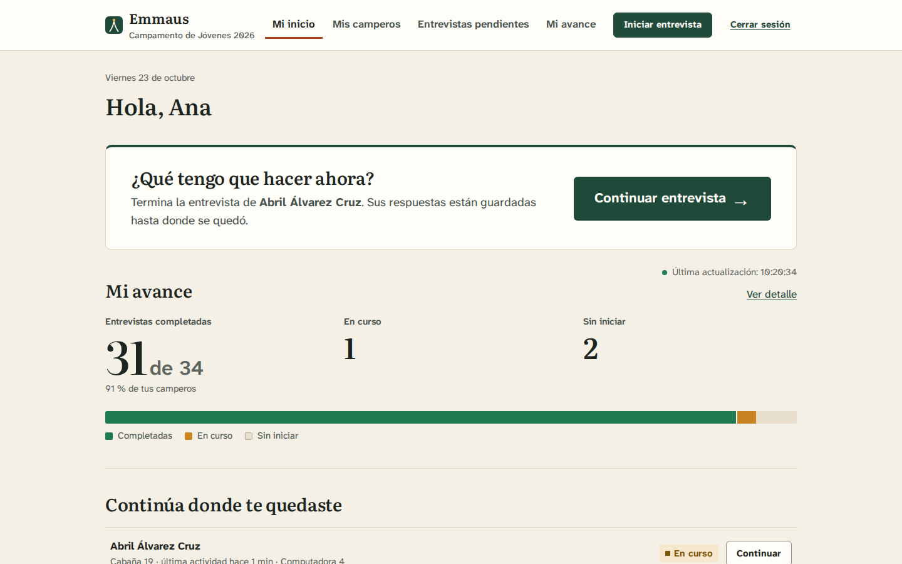
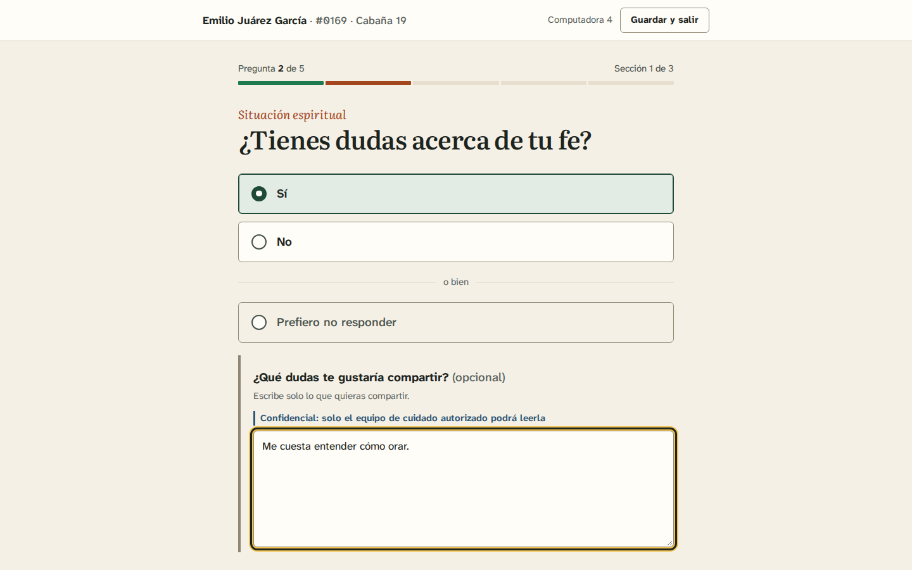
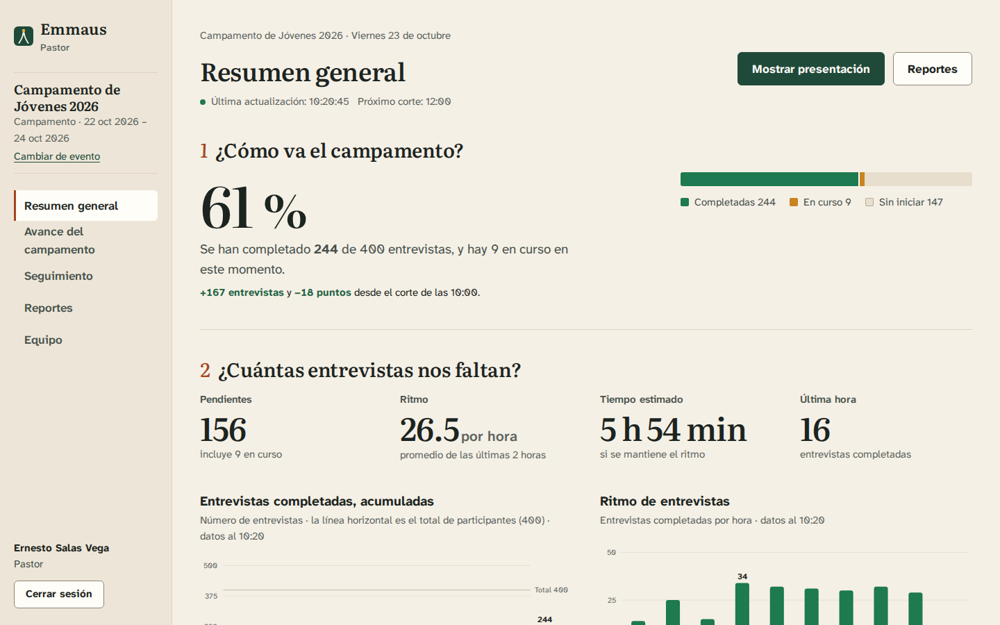
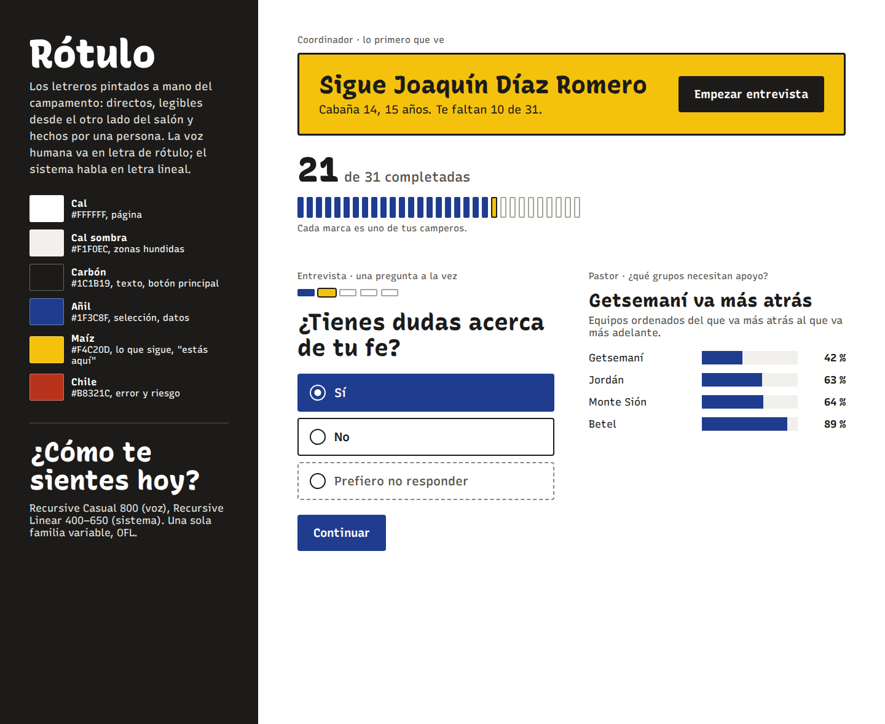
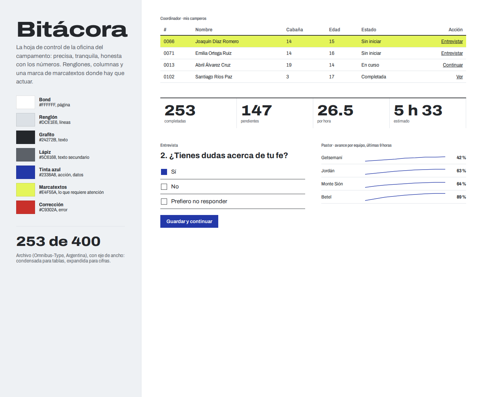
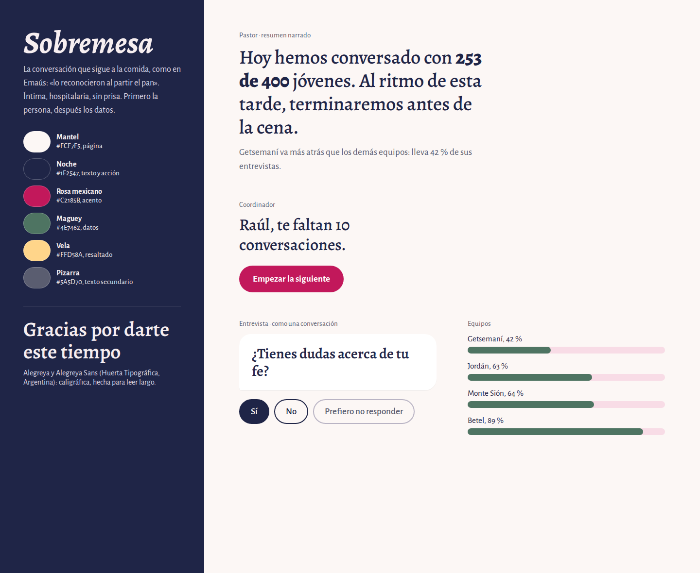
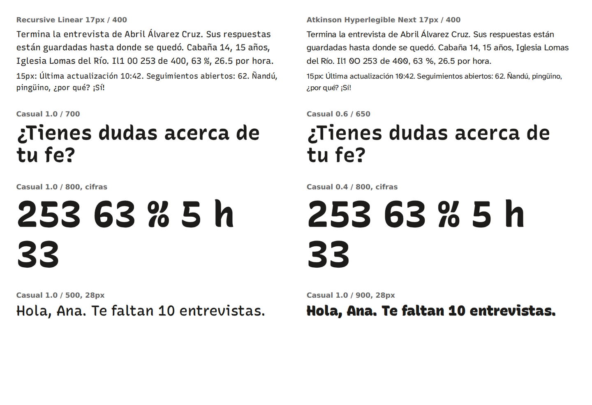
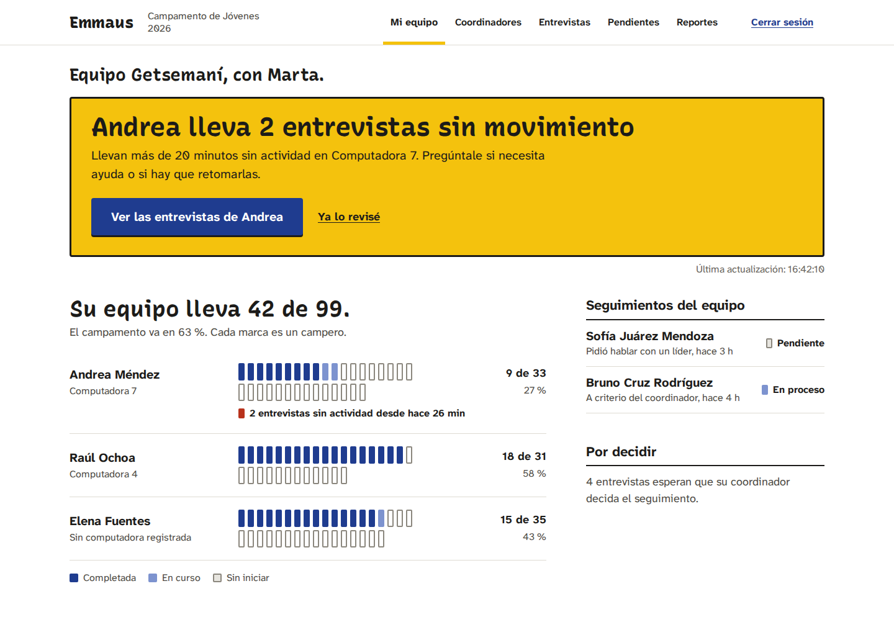
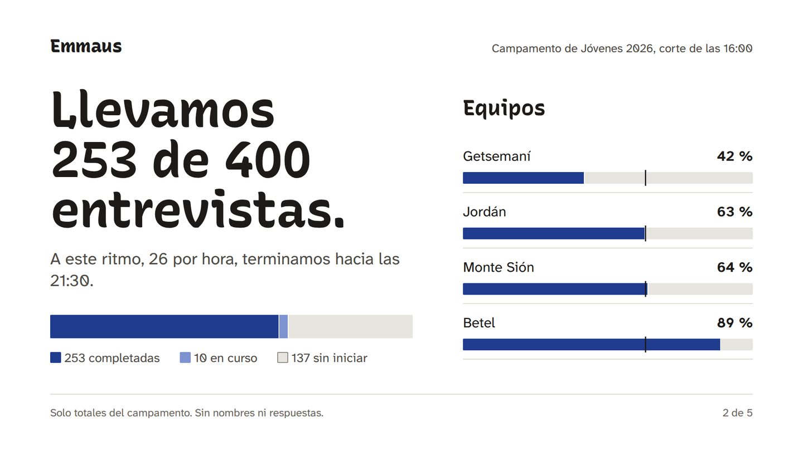
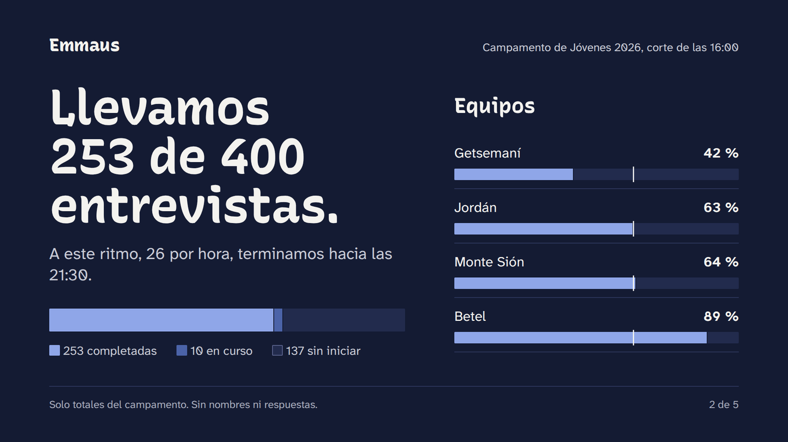

# Dirección de diseño · Emmaus

## Por qué la versión anterior se veía generada

"Cuaderno de campo" era cuidadosa y accesible, pero juntaba casi todos los rasgos que hoy delatan una interfaz hecha por inteligencia artificial:

| Rasgo | Cómo aparecía |
|---|---|
| Papel crema, serif de alto contraste y acento terracota | Fondo `#F5F0E6`, títulos en Literata, marcas en `#A3461E`. Es, casi al hexadecimal, la combinación por defecto de los generadores |
| Metadatos unidos con "·" | "#0066 · Cabaña 14", "Viernes 23 de octubre · Computadora 4" |
| Flecha al final del botón | "Iniciar entrevista →" |
| Etiqueta encima de cada título | Sección en cursiva terracota sobre cada pregunta; fecha encima del saludo |
| Numeración decorativa | "1 ¿Cómo va el campamento?", "2 …" en terracota |
| Cifra enorme con etiqueta chica | "63 %" y "21 de 31" como héroe de cada tablero |
| Renglones finos por todas partes | Reglas de 1 px entre todo, como un periódico |

| Antes: coordinador | Antes: pregunta | Antes: pastor |
|---|---|---|
|  |  |  |

Nada de eso estaba mal por separado. Juntos, hacían que Emmaus pareciera cualquier producto, no uno pensado para un campamento de jóvenes en México.

## El encargo, en una frase por persona

- **Coordinador:** "Tengo a un campero enfrente. ¿Cómo lo encuentro y empiezo?"
- **Campero:** "¿Esto es privado? ¿Cuánto falta? ¿Puedo no contestar?"
- **Tutor:** "¿Cuál de mis coordinadores necesita ayuda ahorita?"
- **Pastor:** "¿Cómo vamos, qué falta y qué tengo que decidir en la reunión?"
- **Proyector:** "Que se lea desde la última fila, sin un solo nombre."

El tema de donde sale lo visual: un campamento real. Letreros pintados a mano en la entrada, la cabaña, el comedor; listas de asistencia; el camino a Emaús, que es una conversación mientras se camina.

## Tres conceptos

Se construyeron como tableros reales (HTML con las fuentes verdaderas) y se compararon lado a lado.

### A. Rótulo (elegido)

| | |
|---|---|
| **Personalidad** | Los letreros pintados a mano del campamento: directos, legibles desde el otro lado del salón y hechos por una persona. Cálido sin ser cursi, claro sin ser institucional. |
| **Tipografía** | **Recursive Casual** (Arrow Type, OFL), en su eje "Casual" al máximo: la letra de un rotulista de una sola pincelada. Es la **voz humana**: preguntas, saludos, titulares que son frases. **Atkinson Hyperlegible Next** (Braille Institute) es la **voz del sistema**: etiquetas, botones, datos, todo lo demás. |
| **Color** | Cal `#FFFFFF`, cal sombra `#F3F2EE`, carbón `#1C1B19`, añil `#1F3C8F` (acción y datos), maíz `#F4C20D` (solo orientación: "lo que sigue", "estás aquí", foco), chile `#B8321C` (solo error y riesgo). |
| **Espacio y densidad** | Grande donde se actúa (letrero, opciones de 64 px, botones de 60 px), medio donde se lee (renglones de 68 px), compacto solo en datos. Retícula de 4 px. |
| **Navegación** | Señalización: pocas salidas con nombres llanos y una marca amarilla en "estás aquí". La computadora se señala como un lugar. |
| **Formularios** | La pregunta pintada a mano como título; opciones como tablas con borde de tinta de 2 px; la elegida se llena de añil. |
| **Tableros** | Frases antes que cifras. Una marca por persona cuando el grupo es chico. |
| **Gráficas** | Marcas planas y gruesas de añil, sin degradados, con etiquetas directas y el dato en tabla. |
| **Por qué encaja** | Viene del mundo del campamento, no del software. La letra de rotulista se lee bien grande (estación, proyector) y la hiperlegible se lee bien chica (personas mayores, pantallas viejas). |
| **Riesgo** | Amarillo, negro y azul juntos pueden gritar como ferretería. Se controla con una regla: un solo letrero amarillo por pantalla. |

### B. Bitácora

| | |
|---|---|
| **Personalidad** | La hoja de control de la oficina del campamento: precisa, tranquila, honesta con los números. |
| **Tipografía** | **Archivo** (Omnibus-Type, Argentina) con su eje de ancho: condensada para tablas, expandida para cifras. |
| **Color** | Bond `#FFFFFF`, renglón `#DCE1E6`, grafito `#24272B`, lápiz `#5C6168`, tinta azul `#2338A8`, marcatextos `#E4F55A`, corrección `#C9302A`. |
| **Espacio y densidad** | Alta: renglones de 40 px, tablas por todas partes. |
| **Navegación** | Pestañas de carpeta a la izquierda. |
| **Formularios** | Respuestas sobre renglones, como en papel. |
| **Tableros** | Tablas ordenables, fila de cifras, líneas pequeñas por equipo. |
| **Gráficas** | Múltiplos pequeños de líneas finas. |
| **Por qué no** | Excelente para administración, fría para un joven que contesta sobre su fe. Los campos sobre renglón dan poca pista de dónde tocar. Y al verlo terminado se parece demasiado a un tablero de finanzas: justo el tipo de producto del que queremos alejarnos. **Tomamos** las cifras tabulares y la marca de "marcatextos" en la fila que pide acción. |

### C. Sobremesa

| | |
|---|---|
| **Personalidad** | La plática que sigue a la comida, como en Emaús ("lo reconocieron al partir el pan"). Íntima, hospitalaria, sin prisa. |
| **Tipografía** | **Alegreya** y **Alegreya Sans** (Huerta Tipográfica, Argentina): caligráfica, hecha para leer. |
| **Color** | Mantel `#FCF7F5`, noche `#1F2547`, rosa mexicano `#C2185B`, maguey `#4E7462`, vela `#FFD58A`, pizarra `#5A5D70`. |
| **Espacio y densidad** | Muy baja. Una cosa a la vez. |
| **Navegación** | Casi nada: nombre y salir. |
| **Formularios** | La pregunta como globo de conversación; respuestas en píldoras. |
| **Tableros** | Informe narrado: "Hoy hemos conversado con 253 de 400 jóvenes". |
| **Gráficas** | Barras suaves y redondeadas. |
| **Por qué no** | Vuelve a la serif sobre un fondo casi crema (el rasgo que queremos dejar) y redondea todo igual. El globo de chat es un truco: dificulta revisar respuestas. El rosa no sirve para distinguir estados. **Tomamos** el informe que empieza con una frase y el ritmo pausado de las pantallas del campero. |

## Revisión del plan antes de construir

Antes de escribir código se revisaron las decisiones contra el encargo, y tres cambiaron:

1. **El texto del sistema no va en Recursive.** En una prueba de tipografía (abajo), Recursive "Linear" a 15–17 px se ve de editor de código: anchos casi monoespaciados. Atkinson Hyperlegible Next lee mejor y ya cumplía con personas de baja visión. La voz pintada se queda solo para lo que dice una persona.
2. **El amarillo no es dato.** El primer tablero pintaba "en curso" en amarillo. El validador de color lo rechaza (1.67:1 contra blanco) y además mezclaba dos ideas. Ahora el avance es una escala de añil (completada oscura, en curso clara) y el amarillo solo orienta.
3. **Las cifras grandes no van solas.** En vez de "63 %" gigante con etiqueta, el titular es una frase: "Llevamos 253 de 400 entrevistas."

## Decisión: Rótulo

1. **Es de este lugar.** Los letreros pintados a mano son parte del paisaje de cualquier campamento y de cualquier calle en México. No hace falta ninguna imagen religiosa ni ninguna ilustración para que se sienta propio.
2. **La tipografía cuenta algo.** Dos voces con una regla simple: lo que pregunta o dice una persona va pintado a mano; lo que informa el sistema va en letra lineal. El campero lee "¿Tienes dudas acerca de tu fe?" como una pregunta de alguien, no como un formulario.
3. **La audacia está en un solo lugar.** Cada pantalla tiene a lo mucho un letrero amarillo, y ese letrero es lo siguiente que hay que hacer. Todo lo demás es blanco, tinta y añil.
4. **Usabilidad primero.** Controles de 48 a 64 px, texto base de 18 px, foco amarillo visible en cualquier fondo, contraste de texto de 5.3:1 o más.
5. **Escala a proyector y a celular.** La letra de rotulista está hecha para leerse grande; la hiperlegible, para leerse chica.

**Préstamos:** de *Bitácora*, cifras tabulares en tablas y la fila que pide acción; de *Sobremesa*, el informe que empieza con una frase y la calma de la experiencia del campero.

## Principios

- **Un letrero por pantalla.** El amarillo dice "esto sigue" o "estás aquí". Nunca decora y nunca es dato.
- **Lo que dice una persona, pintado; lo que dice el sistema, lineal.**
- **Frases antes que cifras.** "Llevas 18 de 31." "Getsemaní va más atrás, con 42 %."
- **Una marca por persona** cuando el grupo cabe en la pantalla. Un coordinador ve a sus 31 camperos, no un porcentaje.
- **Sin tarjetas.** Las piezas se separan con espacio, una regla de tinta de 2 px para empezar un tema y líneas de 1 px entre renglones.
- **Dos radios, por función:** 2 px para marcas (blazes, conteo, etiquetas) y 4 px para lo que se toca (botones, campos, opciones, letrero). Nada en píldora.
- **Sin "·", sin "→", sin etiquetas encima de los títulos.** Los datos se escriben como frase: "Cabaña 11, 17 años".
- **Movimiento solo como respuesta:** cambio de color de 120 ms y el botón que se hunde al presionarlo. Nada se anima solo. Con "reducir movimiento", nada se mueve.

## Una forma por rol

### Coordinador (implementado)

Pantalla de acción. Arriba: "Emmaus", el campamento, **"Estás en Computadora 4"** y cuatro enlaces. Luego un saludo y **el letrero**: "¿A quién vas a entrevistar?" con la búsqueda adentro. Si dejó una entrevista abierta, el letrero cambia a "Termina la entrevista de Santiago Castillo Ortiz" con "Continuar entrevista". Debajo, a la izquierda: "Llevas 18 de 31." con una marca por campero y "Por entrevistar"; a la derecha: seguimiento y "Completadas hace poco".

| Escritorio | Con una entrevista abierta |
|---|---|
|  |  |

### Entrevista y campero (implementado)

Sin navegación. Arriba, quién (o solo "Emmaus" y la computadora, si responde el campero) y una salida. Un camino de marcas: añil las respondidas, amarillo donde estás, contorno las que faltan. La pregunta pintada a mano, opciones grandes, "o bien" y "Prefiero no responder" más discreto, un solo botón. Al terminar, un panel añil: "Entrevista completada" o "¡Gracias!". La bienvenida del campero dice cuántas preguntas son y promete tres cosas, marcadas como en un sendero.

| Pregunta | Campero, bienvenida |
|---|---|
|  |  |

### Pastor (implementado)

Informe de cinco preguntas, sin barra lateral (más ancho para la evidencia). A la izquierda la pregunta pintada y su respuesta en una frase; a la derecha la evidencia. El titular: "Llevamos 253 de 400 entrevistas." con la hora estimada de término. Gráfica acumulada con proyección punteada a la meta, columnas por hora (la última, más clara, es la hora en curso), equipos con una raya en el promedio del campamento, totales de respuestas protegidos y una agenda de asuntos para la reunión.

### Tutor (propuesta, sin implementar)

El mismo letrero, ahora para la persona que supervisa: "Andrea lleva 2 entrevistas sin movimiento", con el botón para verlas. Debajo, cada coordinador con su propia tira de marcas y un aviso en rojo solo cuando hay entrevistas detenidas. A la derecha, los seguimientos del equipo. Todo con componentes que ya existen (letrero, conteo, renglones, estado).

### Modo presentación (propuesta, sin implementar)

Diapositivas de 16:9 para leerse desde el fondo de un salón: titular pintado de 120 px, regla de avance de 56 px, equipos con el promedio marcado, y al pie siempre "Solo totales del campamento. Sin nombres ni respuestas." Dos versiones con la misma escala de datos validada: **Cal** para salones con luz y **Noche** (`#141B33`, datos `#8FA6E8` y `#4B63A8`) para salones oscuros.

| Cal | Noche |
|---|---|
|  |  |

### Administración (después)

Será la pantalla más densa: aquí entran las tablas tabulares tomadas de *Bitácora*, con el mismo letrero para lo único urgente (por ejemplo, "Faltan 7 camperos sin coordinador").

## Lo que sigue

1. ~~Migrar el resto de las pantallas del coordinador~~ Hecho: el coordinador ya no cambia de sistema en ninguna pantalla.
2. Implementar el tutor y el modo presentación según las propuestas.
3. Migrar administración y el módulo de discipulado; después, retirar `emmaus.css` y Literata.
4. Probar con voluntarios reales en una computadora compartida y con un proyector real.
