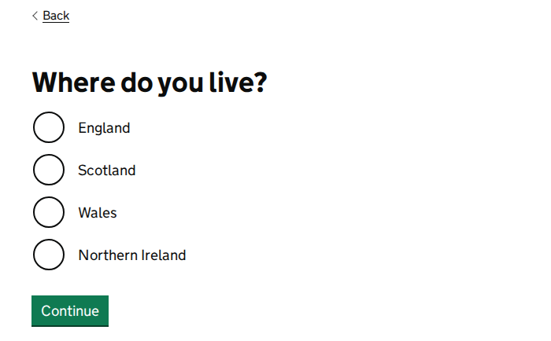
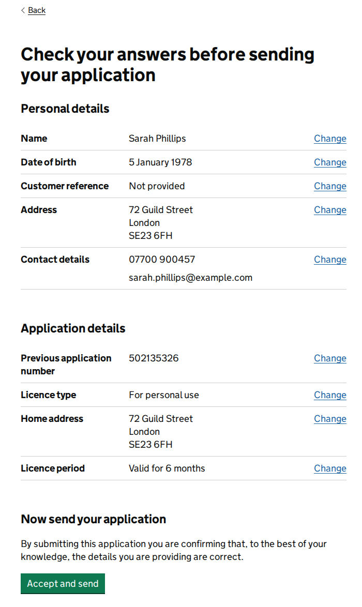
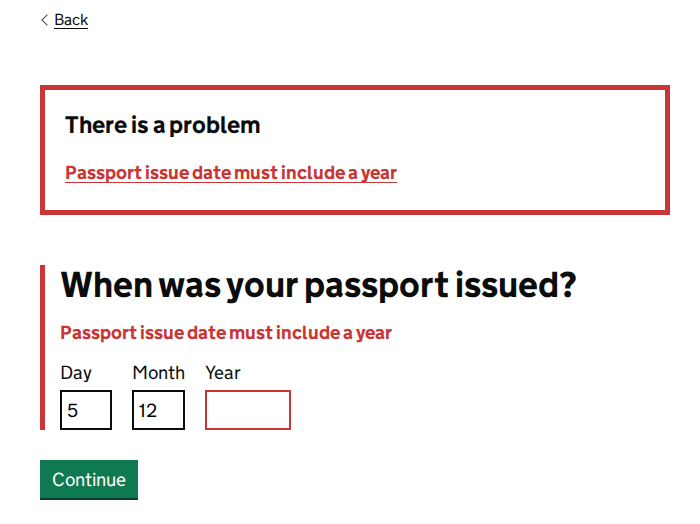
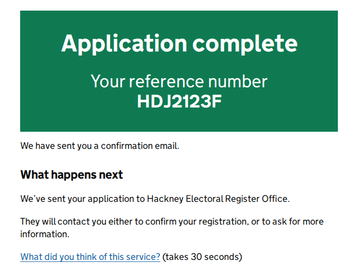

# Investigación de diseño · Emmaus

Fecha: 23 de octubre de 2026. Alcance: cómo resuelven otros productos los mismos trabajos que Emmaus (estación compartida, cuestionario de una pregunta por pantalla, tablero operativo, errores y confirmaciones en lenguaje claro) y qué **no** debemos copiar de ellos.

## Cómo se hizo

- Un navegador automatizado (Playwright 1.63, Chromium) abrió páginas públicas sin iniciar sesión, tomó capturas a 1440 px y a 390 px y guardó los estilos calculados (tipo, tamaño, color, bordes, espacios) de los elementos clave. **No se creó ninguna cuenta y no se envió ningún formulario**: en Tally solo se presionó "Next" en páginas que no eran la última.
- Las capturas, los estilos en JSON y las notas completas (`NOTES.md`, con cada URL y su resultado) están fuera del repositorio, en `~/sandbox-docs/emmaus/referencias/` (más de 200 archivos). El repositorio es público, así que **aquí solo se incluyen capturas de GOV.UK** (Open Government Licence), recortadas para dejar fuera el logotipo, la corona y el escudo, que esa licencia no cubre. De los demás productos describimos lo que vimos, sin reproducir sus imágenes.
- Todo lo que sigue se vio en pantalla. Cuando algo viene de un texto de ayuda y no de una interfaz, se dice.

### Lo que no se pudo ver

| Referencia | Qué quedó fuera | Por qué |
|---|---|---|
| Planning Center Check-Ins | La aplicación de estación en vivo y sus estilos | Pide cuenta y una estación emparejada. Usamos las capturas y GIF de su centro de ayuda (`help.planningcenter.com`) |
| Tally | Un formulario publicado (`tally.so/r/…`) | Solo encontramos uno incrustado en un video. Todo es de la vista previa de plantillas; la barra de progreso existe en el código pero no se ve en esa vista |
| Airtable | Una interfaz real | Pide cuenta. Vimos imágenes de su centro de ayuda y de la página de producto. Las páginas de "Number" y "Chart" ahora redirigen a un artículo de funciones antiguas |
| Mobbin | `/discover`, búsqueda, flujos, imágenes en resolución completa | Piden cuenta. Las páginas de categoría y de pantalla individual sí son públicas, en tamaño reducido |
| Refero | Más de 6 resultados por búsqueda, pantallas similares, flujos completos | "1,373 more pages hidden": piden cuenta |
| Mobbin y Refero | Flujos de kiosco o de registro en sitio (check-in) | No aparecieron en las categorías públicas y no pudimos buscarlos sin cuenta |

## 1. Planning Center Check-Ins

**Lo que vimos.** Capturas y GIF del centro de ayuda de la estación atendida, la de autoservicio y la de lista (roster):

- Estación atendida en reposo: un solo campo, "Search or add new by name, phone number, or barcode". Arriba, el nombre del evento y "Start over"; abajo, el nombre de la estación ("Lobby").
- Después de buscar: **una familia por pantalla**, con cuatro renglones de persona (casilla, foto, nombre) y "Show more people to check in". Abajo a la derecha, un solo botón que dice cuántos: **"Check in 1 person"**.
- El GIF completo: escribir "mi jo", aparece "Johnson Household", se marca una persona, botón, y la confirmación "You're all set! Have an amazing time!" con una palomita verde.
- Autoservicio: teclado numérico grande para los últimos cuatro dígitos del teléfono, o escanear un código.
- El texto de ayuda recomienda buscar con "las primeras dos letras del nombre y las primeras dos del apellido". Hay atajos de teclado (`/` busca, `s` empieza de nuevo, `esc` regresa) y la estación se reinicia sola tras un tiempo sin uso.
- Todas las capturas usan fondos degradados morados o azules detrás de tarjetas blancas.

**Qué funciona y por qué.** Una estación compartida no tiene "inicio": tiene **una acción**, buscar. El voluntario escribe dos letras y dos letras, no un nombre completo con acentos. El botón final dice exactamente qué va a pasar y a cuántas personas. "Start over" siempre está visible porque la computadora pasa de mano en mano.

**Qué flujo de Emmaus beneficia.** La pantalla de inicio del coordinador y el arranque de cada entrevista: un campero se sienta enfrente y hay que encontrarlo rápido. También la estación del campero (supervisada), que debe poder abandonarse y recuperarse.

**Qué no copiar.** El degradado morado de fondo (justo lo que este proyecto quiere evitar), las fotos de cada persona (no las tenemos y no queremos pedirlas a menores), los atajos de una sola tecla (WCAG 2.1.4 pide poder desactivarlos, y un voluntario puede activarlos sin querer al escribir) y la confirmación con mensajes aleatorios "divertidos", que no caben en una conversación espiritual.

**Cómo lo adaptamos.** El inicio del coordinador abre con un letrero cuya única acción es buscar ("¿A quién vas a entrevistar?") y cuyo texto enseña el truco: "las primeras letras de su nombre y apellido, por ejemplo 'mat jim'". La búsqueda ahora acepta palabras en cualquier orden (`events/views/interview.py`, prueba `test_search_matches_the_first_letters_of_each_name`). La barra dice "Estás en Computadora 4", igual que la estación de Planning Center lleva su nombre al pie. "Terminar por ahora" y "Guardar y salir" cumplen el papel de "Start over".

## 2. Tally

**Lo que vimos** (vista previa de plantillas): una pregunta por paso con "← Back" arriba, escala de 0 a 10 en casillas de 36 px, botón negro "Next →" de 36 px de alto. Las opciones son "chips" con letras A, B, C, D. Al dejar vacío un campo obligatorio y presionar "Next", aparece debajo un texto rojo de **12 px** ("Please enter a value"), el campo no cambia y surge un botón "Continue anyway". Al presionar la tecla `b` no se eligió la opción B: las letras no funcionaron como atajo en nuestra prueba.

**Qué funciona y por qué.** Mucho aire alrededor de una sola pregunta; nada compite con ella. "Back" arriba y a la izquierda, lejos del botón de avanzar. La pregunta es el título de la página.

**Qué flujo de Emmaus beneficia.** El cuestionario, sobre todo cuando el campero responde solo.

**Qué no copiar.** Los controles de 36 px (pequeños para dedos y para personas mayores), el error de 12 px que no cambia el campo, las letras A/B/C que parecen atajos y no lo son, y "Continue anyway", que en Emmaus no tendría sentido: ninguna pregunta es obligatoria y nadie debe sentirse presionado.

**Cómo lo adaptamos.** Una pregunta por pantalla con la pregunta como único `h1`, "Atrás" arriba a la izquierda, opciones de 64 px de alto que ocupan todo el ancho y un solo botón de avanzar. El error, cuando existe, sigue el patrón de GOV.UK (más abajo), no el de Tally.

## 3. Airtable Interface Designer

**Lo que vimos.** En la imagen de ayuda del diseño "Dashboard": barra lateral azul, título y descripción, **una fila de filtros**, **una fila de seis números** iguales (uno con barra de progreso, dos con color condicional verde y rojo), **tres tarjetas de gráficas** del mismo alto (barras agrupadas, barras simples, dona) y al final la lista de registros. El texto de ayuda dice que el diseño "se basa sobre todo en números y gráficas" y que cada gráfica puede abrir los datos que la forman.

**Qué funciona y por qué.** El orden: filtro → cifras → gráficas → registros. Cada nivel responde a una pregunta más detallada que el anterior, y siempre se puede bajar al dato.

**Qué flujo de Emmaus beneficia.** El resumen del pastor y, después, el tablero del tutor.

**Qué no copiar.** Casi todo lo visual: es exactamente la plantilla de tablero genérico (tarjetas iguales, seis cifras sin jerarquía, dona). Ninguna cifra dice si es buena o mala ni qué hacer con ella; el color condicional rojo/verde depende solo del color.

**Cómo lo adaptamos.** Conservamos el orden, no la forma. El resumen del pastor es un informe de cinco preguntas: a la izquierda la pregunta y su respuesta en una frase; a la derecha la evidencia (cifras, gráficas, equipos, totales). Cada gráfica tiene "Ver los datos en una tabla". No hay donas ni tarjetas.

## 4. GOV.UK Design System

**Lo que vimos.** Todo es público. Revisamos los patrones de página de pregunta, revisar respuestas, confirmación, validación y resumen de errores, y los componentes de opciones (incluido el separador "or" y el contenido que se revela), lista resumen, botón, panel, etiqueta y aviso. Medimos sus estilos: pregunta como `h1` de 36 px (27 px en móvil), pistas de 19 px en `#484949`, opciones redondas de 40 px, campo con borde negro de 2 px, botón verde con sombra inferior de 2 px, contenido revelado con línea gris de 4 px a la izquierda.

El foco con teclado: fondo amarillo `#ffdd00` y subrayado negro grueso en enlaces; en botones, fondo amarillo y texto negro; en campos, contorno amarillo de 3 px y borde negro más grueso. Al pulsar un enlace del resumen de errores, el foco salta al campo con el problema.

| Pregunta | Revisar respuestas |
|---|---|
|  |  |

| Resumen de errores | Confirmación |
|---|---|
|  |  |

**Qué funciona y por qué.** Cada patrón resuelve un momento de incertidumbre: "¿qué me preguntan?", "¿qué contesté?", "¿qué salió mal y dónde?", "¿ya quedó?". El foco amarillo se ve en cualquier fondo. El botón con sombra parece algo que se puede presionar.

**Qué flujo de Emmaus beneficia.** Todo el flujo de entrevista: "Antes de empezar" (errores), cada pregunta, "Revisa las respuestas", "Entrevista completada", y el campero solo.

**Qué no copiar.** La identidad institucional: tipografía GDS Transport (de uso exclusivo del gobierno británico), el azul y verde del gobierno, el tono de trámite. Emmaus acompaña a jóvenes en una conversación personal; no es una oficina.

**Cómo lo adaptamos.** Copiamos los patrones de interacción, no la apariencia: "Hay un problema" con enlaces al campo, error junto al campo con barra roja a la izquierda, "Cambiar" con texto oculto que dice qué se cambia, panel de confirmación (en añil, no en verde), separador "o bien" antes de "Prefiero no responder", revelado con línea a la izquierda, foco amarillo con borde de tinta y botones con sombra inferior de tinta.

## 5. Mobbin y Refero

**Lo que vimos** (páginas públicas de pantalla individual):

| Pantalla | Qué muestra | Qué tomamos o descartamos |
|---|---|---|
| **Typeform**, encuesta de salida | Una pregunta, opciones en píldora con letras, botón "OK", pasos arriba | El paso a paso arriba sí; las píldoras pequeñas y las letras, no |
| **Udemy**, opción múltiple | Opciones a todo el ancho con borde, botón negro abajo | Confirma el renglón de opción a todo el ancho |
| **IKEA**, recoger pedido | Dos mosaicos grandes para elegir (Entrega / Recoger) | Confirma las opciones grandes como mosaicos para decisiones de una sola vez |
| **Better Stack**, incidentes | Saludo "How is it going, Alex?", buscar y el botón principal arriba, la tabla abajo | Saludo y acción principal juntos arriba; tema oscuro y barra lateral de 8 apartados, no |
| **Square**, **Fingerprint**, **Midday** | Barra lateral, fila de tarjetas de cifras, gráfica de línea, tablas. Refero lista las fuentes de Fingerprint: Inter y JetBrains Mono | Son el tablero genérico. Evidencia de lo que **no** queremos parecer |
| **15Five**, encuesta | Varias preguntas por página con escalas de 1 a 5 | Varias preguntas por pantalla no sirven para un campero nervioso |
| **Duolingo**, opción múltiple (iOS) | Barra de progreso arriba, botón deshabilitado hasta elegir | Deshabilitar el botón confunde; en Emmaus siempre se puede avanzar |

**Qué funciona y por qué.** Las aplicaciones que mejor guían (Typeform, Udemy, IKEA) hacen grande lo que se toca y pequeño todo lo demás. Las que más se parecen entre sí son los tableros.

**Qué no copiar.** La estética de tablero de producto de software: tarjetas de cifras iguales, Inter con una monoespaciada para datos, tema oscuro con un acento brillante.

## Guías de apoyo usadas

- **frontend-design** (el SKILL.md de la extensión, leído desde el catálogo de extensiones porque no estaba instalada como extensión activa). Su lista de rasgos de "diseño generado" describe casi exactamente la versión anterior de Emmaus: fondo crema cercano a `#F4F1EA` con una serif de alto contraste y un acento terracota; metadatos unidos con "·"; flecha "→" al final de los botones; etiquetas encima de cada título. Eso guió el diagnóstico de `design-direction.md`.
- **ui-ux-pro-max**. Su generador de sistema de diseño, para "iglesia, comunidad, voluntarios", devolvió exactamente el cliché que hay que evitar: morado "espiritual" `#7C3AED` con dorado, Cormorant Garamond con Crimson Pro y una página de aterrizaje con carrusel de testimonios. Lo descartamos y lo citamos como ejemplo. Sí usamos su lista de verificación (contraste 4.5:1, objetivos de 44 px, foco visible, movimiento reducido, etiquetas visibles) y sus guías de indicador de progreso y de gráficas de avance contra una meta.
- **dataviz**. Su validador de paleta decidió el color de los datos: avance y "en curso" son una escala **ordinal** de un solo tono (añil oscuro y añil claro), no dos colores distintos. El amarillo quedó fuera de los datos (contraste 1.67:1 contra blanco). Ver `design-system.md`.

## Decisiones que salen de esta investigación

| Decisión | Fuente | Dónde está |
|---|---|---|
| El inicio del coordinador es una búsqueda, no un menú | Planning Center | `templates/events/coordinator/home.html` |
| Buscar con las primeras letras de nombre y apellido, en cualquier orden | Planning Center (texto de ayuda) | `events/views/interview.py`, `events/views/coordinator.py` |
| "Estás en Computadora 4" visible siempre | Planning Center (nombre de la estación) | barras del coordinador y de la entrevista |
| Una pregunta por pantalla, "Atrás" arriba a la izquierda | Tally, GOV.UK, Typeform | `templates/events/interview/_step_form.html` |
| Opciones de 64 px a todo el ancho, con el control real encima de la marca pintada | GOV.UK, Udemy, IKEA | `.choice` en `static/css/rotulo.css` |
| Resumen de errores con enlaces, error junto al campo | GOV.UK | `.error-summary`, `.question--error` |
| Revisar respuestas con "Cambiar" | GOV.UK | `interview/review.html`, `kiosk/review.html` |
| Panel de confirmación | GOV.UK | `.confirm` |
| Foco amarillo con borde de tinta | GOV.UK | sección "Foco" de `rotulo.css` |
| Informe en orden: respuesta → cifras → gráficas → datos | Airtable (solo el orden) | `templates/events/pastor/_home_live.html` |
| Sin tarjetas de cifras iguales, sin donas, sin tema oscuro por defecto | Airtable, Square, Fingerprint, Midday, Better Stack (como contraejemplo) | todo el sistema |
