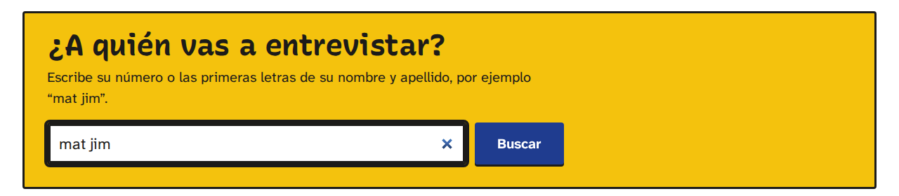
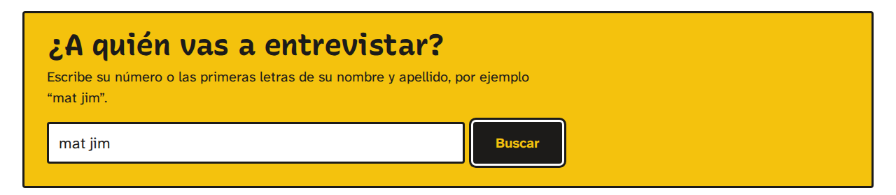
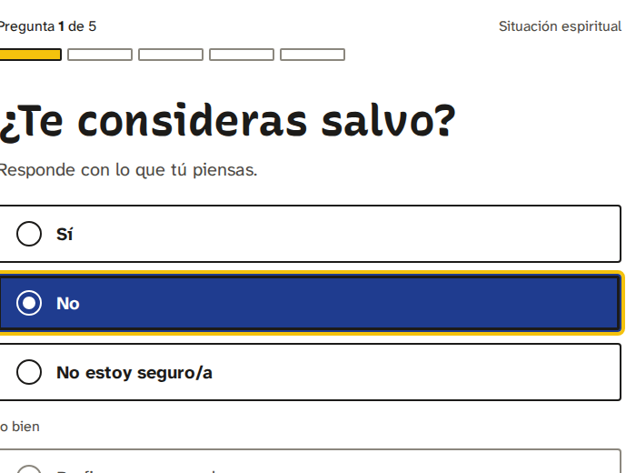

# Sistema de diseño · "Rótulo"

Todas las pantallas de Emmaus usan este sistema: el coordinador y la entrevista, el modo campero, tutores, pastores, administración, reportes y presentación, inicio de sesión y errores, y el módulo de discipulado. El sistema anterior ("Cuaderno de campo", `emmaus.css`) se retiró el 23 de octubre de 2026.

| | |
|---|---|
| Hoja de estilo | `static/css/rotulo.css`: tokens y componentes compartidos, y al final una sección por área (liderazgo, administración, público, discipulado, reportes y presentación) con lo que solo esa área necesita |
| Base de plantilla | `templates/layout/skeleton.html` (fuentes, hoja, colores propios de la iglesia) |
| Marcos | `events/rotulo/shell_coordinator.html` y `shell_leader.html` para el evento (la variable `rotulo_shell` elige por rol), `events/shell_focus.html` y `shell_kiosk.html` para la entrevista y el campero, `base.html` para discipulado, inicio de sesión y errores |
| Comportamiento | `static/js/emmaus.js`, sin dependencias; depende de atributos `data-*`, no de clases |

La prueba `test_every_screen_of_every_role_is_on_rotulo` recorre las pantallas de cada rol, y `test_rotulo_css_blocks_are_balanced` revisa que ningún bloque de la hoja quede abierto (una fusión dejó tres sin cerrar y todo lo que seguía dejó de aplicarse).

## 1. Tokens

Todos viven en `:root`, al inicio de `rotulo.css`.

### Color

| Token | Valor | Uso | Contraste |
|---|---|---|---|
| `--page`, `--cal` | `#FFFFFF` | Página y superficies (campos, opciones) | — |
| `--cal-2` | `#F3F2EE` | Zonas hundidas: hover, renglón que pide acción, avisos | — |
| `--carbon` | `#1C1B19` | Texto, bordes de control, la tinta del letrero | 17.2:1 sobre blanco, 10.3:1 sobre maíz |
| `--ink-2` | `#4D4A44` | Texto secundario | 8.8:1 (7.9:1 sobre cal-2) |
| `--ink-3` | `#68645C` | El texto más claro permitido | 5.9:1 (5.3:1 sobre cal-2) |
| `--line` | `#DEDBD3` | Separadores decorativos, nunca el único borde de un control | — |
| `--line-strong` | `#8B877E` | Bordes discretos de control ("Prefiero no responder") | 3.6:1, cumple WCAG 1.4.11 |
| `--anil` / `--anil-hover` / `--anil-tint` | `#1F3C8F` / `#16306F` / `#E8ECF7` | Acción principal, opción elegida, enlaces, confirmación, información | 10:1 con blanco |
| `--maiz` / `--maiz-tint` | `#F4C20D` / `#FDF3CC` | **Solo orientación:** el letrero, "estás aquí", la marca de la pregunta actual, el foco, avisos de atención | carbón sobre maíz 10.3:1 |
| `--chile` / `--chile-tint` | `#B8321C` / `#FBE6E1` | **Solo error y riesgo** | 6:1 sobre blanco |

Reglas:

- **Maíz nunca es dato** (1.67:1 contra blanco) y nunca decora. Si en una pantalla aparecen dos letreros amarillos, uno sobra.
- **Chile nunca es estado normal.** Un seguimiento "pendiente" es la primera etapa (contorno), no un error.
- El color nunca es la única señal: toda marca lleva palabra, cifra o leyenda.
- Si la iglesia activa sus colores propios, `layout/skeleton.html` los asigna a `--anil` (principal), `--maiz` (acento), `--page`, `--cal`, `--carbon`, `--ink-3` y `--line`.

### Datos

El avance es **ordinal** (sin iniciar → en curso → completada), así que usa una sola tinta en escalones de claridad. Validado con `validate_palette.js --ordinal` (monótona, saltos de claridad de 0.06 o más, el extremo claro a 3.02:1 sobre blanco, un solo tono):

| Token | Claro (sobre `#FFFFFF`) | Proyector oscuro (sobre `#141B33`, propuesta) |
|---|---|---|
| `--data-done` | `#1F3C8F` | `#8FA6E8` |
| `--data-progress` | `#7D93CF` | `#4B63A8` (2.96:1) |
| `--data-track` ("sin iniciar") | `#E7E5DF` con contorno `#8B877E` | `#222B4D` |
| `--data-grid` / `--data-axis` | `#ECEAE4` / `#8B877E` | — |

Una sola serie (respuestas, columnas por hora) usa `--data-done`. Las gráficas de una sola serie no llevan cuadro de leyenda: el título dice qué se mide.

### Tipografía

| Token | Familia | Para qué |
|---|---|---|
| `--font-voice` | **Recursive**, eje `CASL` 1, peso 700 (500 a 900 disponibles) | Lo que dice una persona: preguntas, saludos, titulares que son frases, el letrero, la marca "Emmaus". Clase `.voice` |
| `--font-ui` | **Atkinson Hyperlegible Next**, 400 a 700 | Todo lo demás, incluidas todas las cifras de datos |

| Token | Tamaño | Uso |
|---|---|---|
| `--t-caption` | 15 px | Solo texto dentro de gráficas y notas al pie |
| `--t-small` | 16 px | Metadatos, etiquetas de cifras, estado |
| `--t-body` | 18 px | Cuerpo (interlineado 1.5) |
| `--t-lead` | 20 px | Opciones, nombres en renglones, respuestas, entradilla |
| `--t-h3` | 22 px | Encabezado de lista (`.heading`) |
| `--t-h2` | 28 px | Pregunta del informe, saludo |
| `--t-h1` | 40 px | Título de página |
| `--t-display` | 56 px | Confirmación, bienvenida; el titular del pastor llega a 64 px y la pregunta a 48 px con `clamp()` |

- Títulos con `text-wrap: balance`; párrafos de entrada con `text-wrap: pretty`.
- Cifras en columnas con `tabular-nums`; cifras sueltas grandes, proporcionales.
- Atkinson dibuja el cero con diagonal para no confundirlo con la O. Es intencional y se queda; los titulares pintados usan el cero de Recursive, que no la tiene.
- Fuentes propias en `static/fonts/` con su licencia OFL. Recursive se sirve solo con los ejes `wght` (500–900) y `CASL`, 109 KB para latín.

### Espacio, forma, bordes

- Escalones de 4 px: `--s-1` (4) a `--s-20` (80).
- Radios: `--r-mark` 2 px (marcas, etiquetas) y `--r-control` 4 px (todo lo que se toca y el letrero). Nada en píldora, nada de 8 a 24 px.
- Bordes: `--b-control` 2 px (campos, opciones, botones secundarios), `--b-sign` 3 px (letrero, búsqueda dentro del letrero, diálogo).
- Sin sombras de profundidad. La única sombra es la de "tecla": `0 3px 0` de tinta bajo el botón principal.
- Anchos: `--w-wide` 80 rem (páginas y barras), `--w-focus` 46 rem (entrevista y campero).
- Puntos de quiebre (literales en las consultas): 600 px (teléfono), 900 px (una columna), 1180 px (la barra pasa a "Menú").

### Foco

Adaptado de GOV.UK, porque se ve en cualquier fondo:

| Elemento | Foco |
|---|---|
| Enlaces, "Atrás", `summary` | Fondo maíz, texto carbón, subrayado de tinta de 4 px |
| Botones | Fondo maíz, borde carbón, sombra de tecla |
| Botones y enlaces dentro del letrero | El negativo del rotulista: fondo carbón, letra maíz, anillo blanco y anillo carbón |
| Campos | Contorno maíz de 4 px y borde carbón engrosado |
| Opciones | El mismo contorno sobre toda la tabla de la opción |

| Campo | Botón en el letrero | Opción elegida |
|---|---|---|
|  |  |  |

## 2. Componentes

### Letrero (`.sign`)
Fondo maíz, borde carbón de 3 px, título pintado (`.sign__title`), una frase (`.sign__text`) y **una** acción (`.sign__actions`, `.search`). Es lo siguiente que hay que hacer. **Uno por pantalla, a lo mucho.** Si el contenido no es una acción inmediata, no es un letrero.

### Estás aquí (`.here`)
Una marca maíz con borde carbón (`.here__blaze`) y el nombre del lugar: "Estás en Computadora 4". Va en la barra del coordinador y en la de la entrevista.

### Botones (`.btn`)

| Variante | Uso |
|---|---|
| `.btn--primary` | La acción principal. Añil con sombra de tecla. Una por pantalla |
| `.btn` / `.btn--secondary` | Acciones de renglón ("Entrevistar", "Decidir") y salidas ("Guardar y salir") |
| `.btn--link` | Alternativas de menor peso ("Mejor hago yo las preguntas", "Volver a mi inicio") |
| `.btn--danger` | Solo para borrar ("Sí, descartar y borrar respuestas") |
| `.btn--large` / `.btn--small` | 60 px / 44 px de alto (normal: 48 px) |

El texto del botón dice lo que pasa: "Comenzar entrevista", "Finalizar entrevista", "Entregar la computadora". Sin flechas.

### Opciones (`.choices`, `.choice`)
Tablas de 64 px a todo el ancho, borde carbón de 2 px, marca redonda (o cuadrada en `.choice--multi`) de 28 px. Elegida: fondo añil y texto blanco. `.choice--quiet` para "Prefiero no responder" y opciones de salida, después de "o bien" (`.choices__or`). El `input` real queda transparente, de 44 × 44 px, exactamente encima de la marca pintada (técnica de GOV.UK): recibe clics, teclado y lectores de pantalla. `.choice__sub` agrega una línea de explicación.

### Pregunta (`.question`)
La pregunta es el `h1` (dentro de la `legend` en opciones, o envolviendo la `label` en texto libre), pintada a mano y a lo mucho de 22 caracteres por línea. Pista (`.question__help`) a 20 px. Las preguntas que se revelan (`.reveal`) llevan una línea de 4 px a la izquierda. Confidencial: `.privacy` con la etiqueta `.privacy__tag`.

**Enter avanza.** El navegador envía con Enter el primer botón de envío del formulario en el orden de la página. Por eso `step.html` y `kiosk/step.html` ponen un "Continuar" oculto en el bloque `default_submit`, antes de la barra ("Guardar y salir") y de "Atrás". Cualquier pantalla nueva con botones fuera del formulario debe hacer lo mismo.

### Camino (`.trail`)
"Atrás" arriba a la izquierda (botón de envío que guarda), "Pregunta 2 de 5", la sección a la derecha y una marca por pregunta: añil respondidas, maíz con borde la actual, contorno las que faltan. Las marcas son decorativas (`aria-hidden`); el texto da la posición.

### Conteo (``)
Una marca por campero, en la escala de datos. Con más de 80 personas se dibuja como regla. Siempre con `role="img"` y la frase completa en `aria-label`. Va con su clave (`.key`).

### Regla (``)
Barra apilada con 2 px de separación entre segmentos y, si se pide, una raya de tinta en el promedio. Para avance de equipos y del campamento.

### Estado (``, ``)
Una marca pequeña más la palabra. Completada / atendido: añil. En curso / en proceso: añil claro. Sin iniciar / pendiente: contorno.

### Renglones (`.rows`, `.row`)
Nombre a 20 px en negrita, dato debajo a 16 px, la acción a la derecha. Separados por líneas de 1 px. `.row--attention` (fondo hundido y barra de tinta) para lo que espera una decisión. El encabezado de una lista es `.heading`: texto de 22 px con una regla de tinta de 2 px debajo.

### Lista resumen (`.summary-list`)
Para datos de una persona ("¿Es la persona correcta?") y, con `.summary-list--answers`, para revisar respuestas: la pregunta arriba en gris, la respuesta abajo en negrita, "Cambiar" a la derecha con texto oculto que dice qué se cambia.

### Mensajes
- `.error-summary`: "Hay un problema" con enlaces a cada campo, cada uno con el nombre del campo ("Correo electrónico: Escribe un correo válido…"); recibe el foco al cargar.
- Campos: `partials/ui/field.html` dibuja el control con `{{ field|described }}`, que le pone `aria-describedby` con su pista y su error, y `aria-invalid` cuando hay error. Los formularios propios de Django (contraseña) usan subclases en tú (`core/forms.py`).
- `.error-message` junto al campo, y `.field--error` / `.question--error` con barra chile de 5 px.
- `.notice` con variantes `--info` (añil), `--warning` (maíz claro), `--danger`, `--quiet`.
- `.live-status`: "Última actualización: 10:44:14"; en rojo si se perdió la conexión.

### Encabezado de página (`events/rotulo/_page_head.html`)
Título pintado, entradilla opcional, una línea de datos, el enlace "Volver" de GOV.UK arriba (`back_url`, `back_label`) y, a la derecha, la acción principal y una secundaria. Úsalo en vez de escribir el encabezado a mano.

### Filtros (`.filters`)
Vistas de la misma lista ("Todos", "Sin entrevista", "En curso"…), con su cuenta. La vista actual es "estás aquí": subrayado maíz y `aria-current`. Para buscar dentro de la lista, `.list-search` con una pista visible debajo.

### Ficha (`.split`, `.block`)
Dos columnas en escritorio (datos | lo que pasó con la persona), una en teléfono. `.narrow` limita formularios y fichas al ancho de lectura. `.link-button` es un botón de formulario que se lee como enlace ("Marcar como recibida"). `.status--risk` (marca chile) solo para "Urgente" en situaciones de riesgo.

### Plegable (`.fold`)
`
` para bloques largos y secundarios: abierto en escritorio, cerrado al cargar en teléfono. En las regiones que se actualizan solas, todo `
` con `id` conserva el estado que dejó la persona (antes, una actualización cerraba la tabla de datos que alguien había abierto).

### Cifras (`.figures`)
Lista de definiciones: etiqueta de 16 px, valor de 36 px en Atkinson, nota de 16 px. Una regla fina arriba de cada una, sin tarjetas. Dos por renglón en teléfono. `.figures__alert` solo para situaciones de riesgo.

### Confirmación (`.confirm`)
Panel añil con título pintado en blanco. Después, el siguiente paso como botón.

### Promesas (`.promises`)
Lista corta con marcas de sendero (o números dentro de un cuadro, si es `ol`). Para lo que la pantalla le asegura a la persona.

### Agenda (`.agenda`)
Asuntos numerados para la reunión (sí es una secuencia: es el orden de la reunión), con la evidencia debajo.

### Tablas (`.table` dentro de `.table-wrap`)
Siempre dentro de `
`, que desplaza la tabla en teléfono sin ensanchar la página. Números con `.num` (cifras tabulares, a la derecha). Un `th scope="row"` no lleva la regla gruesa de los encabezados de columna. En administración, la fila que pide una decisión lleva una orilla de tinta y la que tiene un error, una orilla chile.

### Paginación (`events/rotulo/_pagination.html`)
"Anterior", "Página 2 de 7", "Siguiente"; conserva los demás parámetros de la dirección.

### Presentación (`.deck`)
Diapositivas de 16:9 para proyector: titular pintado de más de 100 px a 1920 × 1080 y nada por debajo de unos 26 px. "Cal" (claro) por omisión y "Noche" (`.deck--noche`, fondo `#141B33`, datos `#8FA6E8` y `#4B63A8`, contornos `#6B74A0` a 3.8:1) con el botón "Modo noche", que se recuerda en esa computadora. Al pie de cada diapositiva: "Solo totales. Sin nombres ni respuestas." Teclado: flechas, Inicio, Fin y F.

### Barras "Emmaus", el evento, "Estás en", los enlaces del rol con la marca maíz en la página actual, y "Cerrar sesión". Bajo 1180 px los enlaces pasan a "Menú" (`.menu-panel`, pantalla completa). `.focusbar` (entrevista y campero): quién o qué computadora, y una salida. Mismo ancho que la columna de contenido.

## 3. Gráficas

`events/charts.py` dibuja SVG en el servidor; `rotulo.css` les da estilo.

- Línea de 2.5 px, sin área rellena, punto final con anillo blanco y la cifra junto a él.
- Columnas de 24 px como máximo, punta redondeada de 4 px y base recta.
- Cuadrícula de 1 px muy tenue y eje de 1 px; sin segundo eje.
- `eta_minutes`: proyección punteada desde el último punto hasta la meta, con "Hacia las 16:43". Solo si el término cae dentro de 12 horas.
- `partial_last`: la última columna (la hora en curso) en añil claro, explicado en el subtítulo.
- `compact`: el mismo dibujo en un lienzo de 360 px para teléfonos, con a lo mucho cuatro etiquetas de hora. La plantilla incluye los dos y CSS muestra uno (`.chart__wide`, `.chart__narrow`), así el texto se lee a su tamaño real.
- Gráficas compartidas: `events/rotulo/_chart_cumulative.html` y `_chart_columns.html` (dibujo ancho, dibujo compacto y tabla de datos). Úsalas en vez de llamar a las etiquetas de plantilla directamente.
- Las líneas de la cuadrícula caen en números redondos (0, 10, 20 o 0, 100, 200; nunca 0, 12, 25, 37 ni 0, 125, 250). Cuando el último punto queda junto a la meta, su cifra va debajo para no tapar "Total".
- Las etiquetas de hora nunca chocan (`_label_indexes`): siempre está la primera y la última, y ninguna queda a menos de tres cuartos del espaciado normal. Esto aplica a **todas** las gráficas, también a las de pantallas no migradas (avance, reportes, presentación): cuando la penúltima etiqueta quedaba pegada a la última, ahora se omite.
- Toda gráfica tiene `<title>`, `<desc>` y, si importa el detalle, "Ver los datos en una tabla".

## 4. Pantallas

| Plantilla | Base | Qué la distingue |
|---|---|---|
| `events/coordinator/home.html` + `_home_live.html` | `events/rotulo/shell_coordinator.html` | Letrero de búsqueda o de entrevista abierta; conteo; dos columnas de renglones |
| `events/interview/*.html`, `events/kiosk/*.html` | `events/shell_focus.html`, `events/shell_kiosk.html` (ya en Rótulo) | Sin navegación; camino; una pregunta; revisión; confirmación |
| `events/pastor/home.html` + `_home_live.html` | `events/rotulo/shell_leader.html` | Informe de cinco preguntas: pregunta y respuesta a la izquierda, evidencia a la derecha |
| `events/tutor/home.html` + `_home_live.html` | `rotulo_shell` (líder) | Letrero solo si hay entrevistas detenidas; "Tu equipo lleva X de Y."; una fila por coordinador con su conteo (`events/rotulo/_coordinator_rows.html`) |
| `events/admin/*.html` | `rotulo_shell` (líder, barra de dos renglones) | Letrero solo si algo impide entrevistar; "Preparación" con estado por paso; tablas densas |
| `events/reports/*.html`, `events/presentation/*.html` | `rotulo_shell`; la presentación usa `layout/skeleton.html` | El corte se lee como el resumen del pastor; diapositivas de 16:9 en Cal y Noche |
| `templates/core/*.html` | `base.html` (barra de dos renglones) | Discipulado: el panorama de la iglesia como el resumen del pastor; el participante con su siguiente lección en un letrero; las lecciones como las preguntas de la entrevista |
| `registration/*.html`, `errors/*.html`, `events/events_list.html` | `base.html` | Una columna, el título pintado, un solo botón principal |
| `events/join/join.html` (`/unirme/`), `events/join/entry.html` (`/e/<código>/`), `events/join/requested.html` | `base.html` | Como la entrada: una columna (`.auth-card`). `/unirme/` es un solo campo con su botón (`.search`); la página del evento lleva su nombre como título pintado, la iglesia y las fechas, y pide nombre, correo y rol en `.choices` (solo tutor o coordinador) |
| `events/admin/join_code_sign.html` | `rotulo_shell` (líder) | La hoja para imprimir: el nombre del evento, el código a 96 px en la letra pintada, la dirección y tres pasos. Sin letrero; al imprimir no salen la barra ni los botones |

Las partes vivas (`_home_live.html`) se recargan cada 20 o 30 s con `data-live-url`; el indicador `.live-status` queda fuera de la región que se reemplaza.

## 5. Lenguaje

- Español de México, tuteando, frases completas y cortas. "Llevas 18 de 31." "Te faltan 2 entrevistas."
- Los datos se escriben como frase, con comas, nunca con "·": "Cabaña 11, 17 años", "#0102, Cabaña 19".
- El nombre de una acción es el mismo en todo el flujo: "Entregar la computadora" → "Recuperar la computadora".
- Los errores dicen qué pasó y cómo arreglarlo; no se disculpan.
- Lo privado se dice en voz alta: "Confidencial. Solo el equipo de cuidado autorizado podrá leer esta respuesta."
- Los mensajes propios de Django también tutean: `locale/es_MX/LC_MESSAGES/django.po` reemplaza los de validación, archivos y contraseñas (ver `docs/architecture.md`).
- El PDF del corte usa el mismo sistema: Recursive Casual para el título, las preguntas y la frase principal; Atkinson Next para lo demás; añil para datos, chile solo para riesgo y nada de maíz (en un documento no hay "lo siguiente que hay que hacer").

## 6. Accesibilidad

- axe-core 4.10 (WCAG 2.0, 2.1 y 2.2 A y AA): 0 problemas en 17 pantallas × 3 anchos (`e2e/design-review.mjs`, ver `ux-review.md`).
- Objetivos de 44 px como mínimo; opciones de 64 px; botón principal de 60 px en el flujo.
- Un solo `h1` por página; títulos en orden; regiones con nombre; "Saltar al contenido".
- Las marcas de avance son imágenes con texto alternativo completo; nada depende solo del color.
- `prefers-reduced-motion` quita transiciones y el hundido del botón; `forced-colors` agrega bordes a todas las marcas; impresión sin barras ni botones.

## 7. Cómo hacer una pantalla nueva

1. Extiende el marco que corresponde: `` dentro de un evento, `events/shell_focus.html` si no lleva navegación, `base.html` en discipulado.
2. Empieza con `events/rotulo/_page_head.html`. Si hay algo que hacer ahora, ponlo en un letrero; si hay dos, elige.
3. Usa los componentes de arriba antes de escribir CSS. Si de verdad hace falta CSS nuevo, va en la sección del área al final de `rotulo.css`.
4. Nada de "·", flechas en los botones, etiquetas encima de los títulos, tarjetas, píldoras o íconos. Maíz solo para orientar; chile solo para errores y riesgo.
5. Agrega la pantalla a `e2e/design-review.mjs` y a la prueba de alcance de `events/tests/test_rotulo.py`; revisa las capturas en los tres anchos y corre axe.
