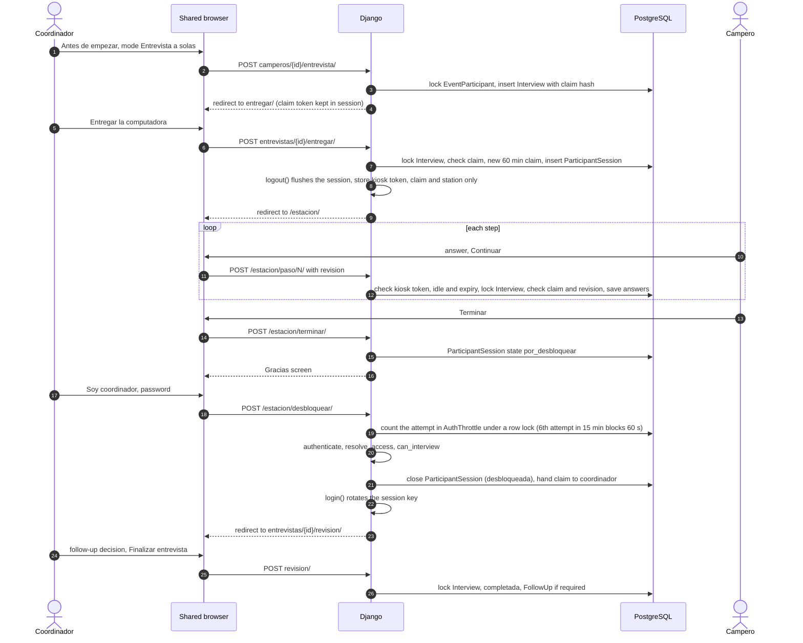

# Interview station workflow

This page describes how an interview runs on a shared "computadora de entrevista" (an `InterviewStation`), from the code in `events/services/interviews.py`, `events/views/interview.py`, `events/views/kiosk.py` and `events/middleware.py`.

There are two modes (`Interview.Mode`):

| Mode | Label in the UI | Who types |
|---|---|---|
| `asistida` | "Entrevista asistida" ("Tú haces las preguntas y anotas las respuestas.") | The coordinador, logged in |
| `supervisada` | "Entrevista a solas" ("El campero responde solo en la computadora. Necesitarás tu contraseña para recuperarla.") | The campero, on an anonymous kiosk session |

Only coordinadores (for their own active camperos) and administradores (for any active campero) can run interviews.

## Preconditions

`event_blockers(event)` must return nothing, otherwise the start button is disabled and every reason is shown, each with what to do:

1. The event status is "En curso" (`activo`). "En preparación": "El evento todavía no está en curso. Avisa a la administración."; "Terminado" or "Archivado": "El evento ya terminó. Si falta alguna entrevista, avisa a la administración."
2. The event has a published questionnaire version (`Event.questionnaire_version`). Otherwise: "Todavía no hay un cuestionario publicado para este evento. Avisa a la administración."
3. An administrador has confirmed in "Configuración" that the church approved its authorization, child-protection and risk procedures (`procedures_approved_at`). Until then: "La administración todavía no confirma los procedimientos de autorización y protección de la iglesia. Avísale."

Registering camperos does not need these; interviewing does.

## Station selection

* "Crear campamento" creates ten stations, "Computadora 1" to "Computadora 10". Administrators add more or take one out of use in "Configuración" → "Computadoras de entrevista".
* The first time a browser opens "Iniciar entrevista" while active stations exist, it is sent to "¿En qué computadora estás?" ("Usar esta computadora"). The choice is stored in the browser's session (`session["stations"][event_id]`) and can be changed with "¿No estás en {computadora}? Cambia de computadora" on the search page.
* The station is recorded on the interview (and updated on take-over) so supervisors see where it was opened. It is informational; it does not restrict anything.
* The station choice survives the hand-over to a campero and the unlock: `hand_over_to_participant` copies it into the new anonymous session (it is not a secret), and `login()` keeps it. A new login (after "Cerrar sesión" or an idle logout) asks again.

## Consent and assent

The "Antes de empezar" screen (`interview/start.html`) has three parts: "¿Es la persona correcta?", "Autorización" (with "Leer el aviso de privacidad para explicárselo") and "¿Cómo se va a responder?". The required checkboxes come from `consent_requirements(participant)`:

| Campero | Required |
|---|---|
| Minor (`age < event.adult_age`, default 18) and the event requires guardian authorization | **Guardian authorization**, unless the latest `ConsentRecord` of kind guardian is "Otorgado". If missing, the coordinador must tick "Tengo la autorización firmada de su padre, madre o tutor legal" ("Confírmalo solo si viste el formato firmado...") |
| Any minor | **Assent**: "Le expliqué el aviso de privacidad a {nombre} y está de acuerdo en conversar" |
| Adult | **Consent**: "Le expliqué el aviso de privacidad a {nombre} y acepta participar" |

On start, each newly confirmed item becomes a `ConsentRecord`: guardian authorization with method `papel` and no interview link; assent or consent with method `verbal`, linked to the interview, recorded by the coordinador. Guardian authorization can also be recorded beforehand: on registration ("Ya entregó la autorización firmada..."), in the CSV import (column "Autorización"), or with "Marcar como recibida" on the campero page.

## Assisted interview, step by step

1. "Iniciar entrevista" → search by name or number → "Entrevistar" (or "Retomar" if one is in progress).
2. "Antes de empezar": check the data, tick the authorizations, choose "Entrevista asistida", "Comenzar entrevista".
3. `start_interview` locks the campero row, refuses if a live interview exists, creates the `Interview` with the event's current questionnaire version, sets a 15-minute claim, records the consents, sets the campero to "En curso" and writes the audit row `entrevista_iniciada`.
4. One question per screen ("Pregunta N de M", with the section title under it). A conditional follow-up question of the same section appears on the same screen and is revealed when a matching option is chosen (it is also visible without JavaScript, with a hint). "Prefiero no responder" and other exclusive options sit after an "o bien" divider; choosing one clears the others.
5. Buttons: "Continuar" (or "Revisar respuestas" on the last step), "Atrás", and "Guardar y salir" in the top bar. All three save the current screen first. Validation runs on every save; the default questionnaire has no required questions.
6. "Revisa las respuestas de {nombre}": every visible question with "Cambiar". Then "¿Necesita seguimiento?" and "Finalizar entrevista".

## "Entrevista a solas", step by step

1. Same search and "Antes de empezar", choosing "Entrevista a solas". The coordinador still confirms the authorizations.
2. "Entrega la computadora a {nombre}" (`interview/handoff.html`): three reminders, then "Entregar la computadora". "Mejor hago yo las preguntas" switches to assisted mode, allowed only while no answer was typed by the campero (`switch_to_assisted`). "Cancelar" in the top bar opens the discard screen. If the coordinador leaves this screen, "Retomar" on that interview brings them back here as long as the campero has not typed any answer (`interview_resume`).
3. `hand_over_to_participant` verifies the claim, closes any older capture session, creates a `ParticipantSession` (random token, only its hash stored; expires in 60 minutes), sets a 60-minute claim whose raw token is kept only in the kiosk session, sets mode `supervisada`, audits `captura_iniciada`, then **calls `logout()`**. The browser keeps only `session["kiosk"]`.
4. The campero sees "Hola, {nombre}", the reassurances (including who reads the answers, in the words of the default privacy notice: "Tus respuestas las lee tu coordinador y, las generales, también el equipo del campamento. Las de temas personales, solo quien te entrevistó, tu coordinador y el equipo de cuidado. Las marcadas “Confidencial”, solo el equipo de cuidado autorizado.") and "Empezar". Steps look like the coordinador's, with "Parar por ahora" in the top bar and "Tus respuestas se guardan cada vez que avanzas." "Parar por ahora" submits the current screen (`direction=pause`): what is chosen there is saved, nothing is required, and the review opens. Answers are stored with `answered_by_participant=True`.
5. "Revisa tus respuestas": all their answers ("Sin responder" for the ones left), each with "Cambiar", and the same sentence about who reads them. "Cambiar" opens that one question (`?volver=revision`) and, once it is saved, returns to the review instead of going on to the next question. While visible questions are unanswered, the review says "Te faltan {n} preguntas. Toca “Seguir contestando” para continuar donde te quedaste, o “Ya terminé” si ya no quieres responder más." and "Seguir contestando" opens the first unanswered one. "Ya terminé" ends the capture: the session moves to `por_desbloquear`.
6. The campero sees "¡Gracias!" and "Ya terminaste. Avisa a tu coordinador para que recupere la computadora." (no name, so the next person to sit down does not see who was there), and the button "Soy coordinador: recuperar la computadora".
7. "Recuperar la computadora": the coordinador types their password (or "Soy otro coordinador" to use another account's e-mail). On success the browser is logged in again, the claim is handed back, and the coordinador lands on the review screen: "Recuperaste la computadora. Revisa y finaliza la entrevista."
8. On review, confidential rows show only "Confidencial" and cannot be changed; conditional questions that depend on a confidential answer are not listed. The coordinador chooses the follow-up decision and finalizes.

## Claims, locks and "Tomar el control"

* A claim is a random token. Its SHA-256 is stored on the interview row; the token itself lives only in the server-side session of the browser that holds it. Every write locks the row and checks claim and `revision`.
* A staff claim lasts 15 minutes (`CLAIM_MINUTES`) and each save extends it. Once a claim has expired, whoever opens the interview next (the same browser or another one) gets it without a prompt, audited as `entrevista_retomada`.
* If another browser holds an active claim, opening the interview shows "Esta entrevista está abierta en otra computadora" with the station, holder and last activity, and the warning "Si tomas el control aquí... La otra computadora ya no podrá guardar cambios." The button "Tomar el control aquí" replaces the claim, closes any capture session on the other computer (`retomada`) and is audited as `entrevista_control`.
* A tab with an old `revision` cannot overwrite newer answers: "Las respuestas cambiaron desde que abriste esta pantalla. Te mostramos la versión más reciente: revísala y guarda otra vez."
* A browser whose claim was taken or expired is told "Esta entrevista se abrió en otra computadora o pasó mucho tiempo sin cambios. Vuelve a abrirla desde tu inicio." (`CLAIM_LOST_MESSAGE`; "tu inicio" because the administración's tab is "Inicio", the coordinador's "Mi inicio").
* Administrators can clear claims and capture sessions in "Configuración" → "Computadoras en uso" ("Liberar", "Cerrar la pantalla").
* "Liberar" (`revoke_claim`) closes any capture session of that interview and frees the claim, but keeps the released token's hash on the row with no expiry. Every other browser sees the interview as free and opens it normally. The browser that had it open is refused on its next save, review, hand-over, discard or step, and a stale "Entrevista completada" address does not re-open it either (`interview_done` continues without `reopen`). It lands on the conflict page, which in this case says "La administración liberó esta entrevista" and "Esta computadora ya no puede guardar. Para seguir aquí, toca “Tomar el control aquí”; para seguir en otra computadora, ábrela desde “Mi inicio”." (no station, holder or "otra computadora": nobody else has it). Nothing is saved or discarded. That browser continues only by opening the interview again on purpose ("Retomar entrevista" on "Mi inicio", "Retomar" in a list, the camper page: `interview_resume`, which calls `claim(reopen=True)`) or with "Tomar el control aquí". The scheduler's clean-up of expired claims leaves released ones alone. Once another browser has opened the interview, the old one is refused like any other browser while that claim is active.
* "Cerrar la pantalla" (`revoke_participant_session`) ends a capture session; if the kiosk still held the claim, the claim is cleared and the coordinador continues from any computer.

## Interrupted and abandoned interviews

* Nothing is lost: every step is saved when the coordinador or campero moves on.
* "Interrumpidas" are interviews in progress with no saved change for 20 minutes or more (`STALE_MINUTES`; templates print it with ``). They appear on the tutor's "Mi equipo" and "Pendientes" screens, in the recommendations ("Próximos pasos") of dashboards and cutoffs, and in the presentation. On "Mi inicio" the coordinador's yellow sign says "Termina la entrevista de {nombre}" with "Retomar entrevista"; other open interviews are listed under "También sin terminar" with "Retomar". They are also in "Entrevistas pendientes".
* "Retomar" goes to the first visible step whose main question has no stored answer, otherwise to the review. A text question left blank is not stored, so resuming can land on that blank question again.
* The scheduler clears expired claims, moves capture sessions idle for 10 minutes to `por_desbloquear` and deletes expired Django sessions on every pass (`run_report_cutoffs`).

## Kiosk confinement and timeouts

* `KioskConfinementMiddleware`: while the session holds `kiosk`, every path outside `/estacion/` (and `/static/`, `/health/`) redirects to the kiosk home. The login page, the back button and typed URLs all land there. There is no coordinador privilege left in the browser to abuse.
* Every kiosk request validates the token against the `ParticipantSession` (hash comparison), its state, the interview state, the 10-minute idle limit (`KIOSK_IDLE_MINUTES`) and the 60-minute absolute limit (`KIOSK_MAX_MINUTES`).
* In the browser, the welcome, step and review screens use a 5-minute idle timer (`data-kiosk-idle="300"`). One minute before, a dialog asks "¿Sigues aquí?" with "Sí, sigo aquí". When it runs out, the page goes to `/estacion/tiempo/`, which locks the session if the server saw no activity for over 60 seconds. Any key press, tap, click or scroll sends a heartbeat to the server at most every 2 minutes, so a campero writing a long answer is not locked out.
* A locked session shows "La pantalla se cerró... Lo que respondiste está guardado." and needs the coordinador's password.
* Closing the browser normally ends the kiosk session, because the session cookie expires with the browser (`SESSION_EXPIRE_AT_BROWSER_CLOSE`). Some browsers restore such cookies when they reopen previous tabs, so do not rely on this alone. The interview stays in progress; the coordinador continues it or takes control from any computer.
* If the session was revoked or taken over, the kiosk shows "No hay una entrevista abierta en esta computadora" with "Entrar a Emmaus".

## Unlock

`kiosk_unlock` authenticates the password of the coordinador who handed over the computer, or of the e-mail typed after "Soy otro coordinador". The account must resolve to a role that `can_interview` this campero: the assigned coordinador or an administrador.

* A capture session that was already closed (closed from "Computadoras en uso", taken over, or unlocked) cannot be unlocked: the browser is released to "No hay una entrevista abierta en esta computadora" and the original end reason is kept.
* Attempts are limited in the database (`events/services/throttle.py`, key `unlock:<ParticipantSession id>`), not in the browser session, so clearing cookies or sending requests in parallel does not give more tries. Each attempt is counted under a row lock before the password is checked. Five attempts are checked within a 60-minute window; the sixth is refused and starts a 60-second block ("Demasiados intentos. Espera N segundos e inténtalo otra vez."). After each block one more attempt is checked, and the next refusal starts a block twice as long (2, 4, 8 minutes...), up to 15 minutes. The counter is forgotten 60 minutes after the last block started, or when the unlock succeeds. Since blocks never reach 60 minutes, that means about a dozen checked guesses in the first hour and about four per hour after that. The unlock screen stays available after the 60-minute capture limit (the session then just waits for its coordinador).
* The staff login page has its own limit: 8 checked attempts per typed e-mail, then blocks of 5, 10, 20, 40 and 60 minutes with 3 checked attempts after each. There is no per-IP limit.

## Review, finalize and the follow-up decision

* "Lo que {nombre} pidió" lists deterministic hints from options marked `suggests_follow_up` in **non-confidential questions the coordinador can read**: "Pidió hablar con un líder", "Tomó una decisión espiritual". It says "Tú decides. Emmaus solo te recuerda lo que el campero pidió." If there are hints, "Se requiere seguimiento" is preselected.
* Choices: "Se requiere seguimiento", "No se requiere seguimiento", "Por decidir". One is mandatory.
* `finalize` is idempotent, checks claim and revision, refuses if a visible required question is empty (naming it: "Falta responder “{pregunta}”. Toca “Cambiar” junto a ella."), marks the interview and campero "Completada", clears the claim and closes capture sessions. Then:
  * if the decision is "required", it creates one ordinary care `FollowUp` (reason from the first hint, else "A criterio del coordinador");
  * independently of the decision, if the campero chose a support option in a confidential question, it creates one **confidential** care referral ("Pidió apoyo en un área de su vida", `confidential=True`, no creator) that only members with confidential access can see.
* "Entrevista completada" offers "Entrevistar a otro campero" and "Volver a mi inicio", and shows how many are left.
* An interview left "Por decidir" can be resolved later, once, on its detail page with "Sí requiere seguimiento" / "No requiere seguimiento". After that the decision cannot be changed ("El seguimiento de esta entrevista ya se decidió.").

## Corrections

On a completed interview, the assigned coordinador or an administrador sees "Corregir" next to each answer they can read. Permission is decided per answer, not per screen (`correctable_step`): when a question shares its screen with a confidential follow-up (for example "¿Tienes dudas acerca de tu fe?" and "¿Qué dudas te gustaría compartir?"), someone without confidential access gets the screen with only the question they can read; the follow-up is not shown and a posted value for it is ignored. A screen whose main question they cannot read (a confidential question) has no "Corregir" link and its URL answers 403. An administrador or the assigned coordinador who also has confidential access corrects every answer. A pastor with confidential access cannot correct: `can_correct` allows only administradores and coordinadores. The correction screen asks "¿Por qué corriges esta respuesta?" (required). `correct_step` checks permission and revision, then for every value that actually changed stores an `AnswerRevision` with the previous option codes or text, the reason, who and when. Every answer the correction hides (a "Sí" changed to "No"), on the same screen or on another one (`_prune_hidden`), is removed as on any save and gets an `AnswerRevision` with its previous value, the reason "ocultada por corrección", who and when. It increments `correction_count` and audits `entrevista_corregida` (count only, no content; the count includes only answers the person could read, so it does not reveal a hidden one). A correction never creates a second interview, so the metrics do not double count. The "Historial de correcciones" list (question, date, who, reason; previous values are stored but not shown) is visible only to members with confidential access.

## Discard

"Descartar esta entrevista" (from the review screen) asks for a reason ("Se abrió la entrevista de otro campero por error", "El campero decidió no participar por ahora", "Hay que empezar de nuevo", "Otro motivo") and "Sí, descartar y borrar respuestas". The discard screen is claim-bound like a step save: the browser must hold the interview (an expired claim is picked up again; a released or taken one goes to the conflict page and nothing changes), and `discard(check_claim=True)` checks the claim again under the row lock. `discard` deletes all answers of that interview (data minimization), marks it `descartada`, closes capture sessions and puts the campero back to "Sin entrevista". The partial unique index then allows a new interview. Only interviews in progress can be discarded.

## Safety reports during an interview

"Reportar una situación de riesgo" (review screen, campero page) first shows "Primero, actúa" with the event's safeguarding instructions, then "¿Qué pasó?" and "Enviar reporte". "Cancelar", and the redirect after sending, go back where the person came from: the review links to the report with `?siguiente=`, and the report follows it only when it is exactly this interview's review address and this browser holds the interview's claim at that moment (`allowlisted_next`). Any other `siguiente` (another page, another interview's review, a foreign address) and any browser without the claim go to the campero page. So a tutor or pastor never lands on a 403, and an administrador, or a coordinador whose claim expired, never claims the interview by cancelling or sending. See `privacy-and-safeguarding.md`.

## Load and concurrency testing

The Python suite has 455 tests (counted on 2026-10-26; the files under `core/` and `events/tests/`), including `events/tests/test_security_review.py`, which keeps every finding of the adversarial security review fixed (kiosk confinement, unlock limits, take-over killing the kiosk, hidden-row inference, released aggregates and others). `e2e/station-flow.mjs` is a Playwright browser check of the assisted and supervised flows against a running server with demo data.

**Threaded PostgreSQL tests** (`events/tests/test_concurrency.py`, skipped on SQLite):

1. Ten stations start, answer three steps and finalize in parallel: no failures, 10 completed interviews.
2. Five threads race to start the same campero: exactly one interview is created, four get `AlreadyInProgress`.
3. Four simultaneous finalizes of one interview: all return the interview, one follow-up, one completion.
4. Ten parallel registrations: participant numbers stay unique.

**HTTP load test** (`scripts/simulate_camp_day.py`): each station logs in as a different coordinador, chooses its computer and completes the assisted interview of every pending campero assigned to it through the real forms, while two pastor pollers fetch the live dashboard fragment every 2 seconds. The script then checks the database for duplicates and prints latency percentiles. It exits non-zero on any HTTP error or duplicate.

Result recorded on 2026-10-23 after the security fixes, gunicorn (3 workers x 4 threads) on local PostgreSQL 16:

| Measure | Result |
|---|---|
| Stations | 10 |
| Interviews completed | 321 in 31.8 s |
| HTTP errors | 0 |
| Duplicate interviews | 0 |
| p95 step save | 169 ms |
| p95 start | 151 ms |
| p95 finalize | 156 ms |
| p95 live pastor fragment | 122 ms |

Measured in the first run the same day, before the security fixes, and not re-measured: building the dashboard payload for 400 camperos took 50 ms with 32 queries, and generating the 5 cutoff scopes took 133 ms.

Accessibility: axe-core 4.10 reported 0 WCAG A/AA violations on 33 screens.

How to repeat the load test is in `deployment.md`.

## Known limitations

* A computer left waiting for its coordinador stops accepting the unlock after 3 hours (the scheduler closes the capture). The interview stays in progress and the coordinador continues it after a normal login.

* A text question left blank is not stored, so "Retomar" can land on that blank question again instead of the review.
* Confidential steps cannot be opened by the coordinador once the campero has answered on their own; opening one by URL redirects to the review with "Esa pregunta es confidencial y la respondió el campero."
