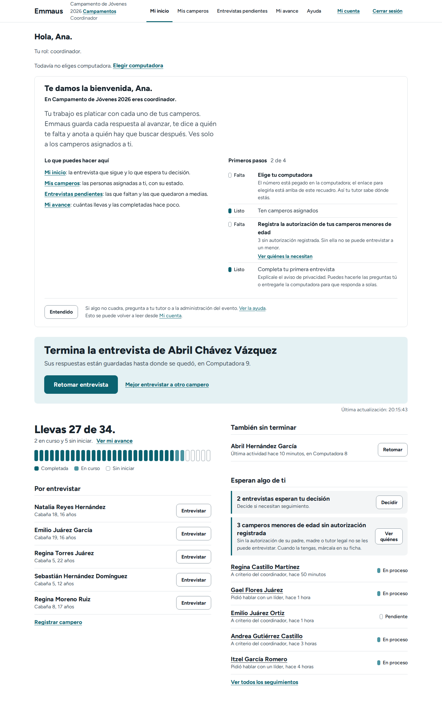
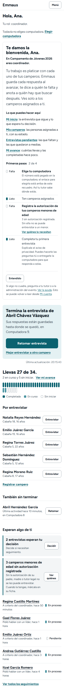
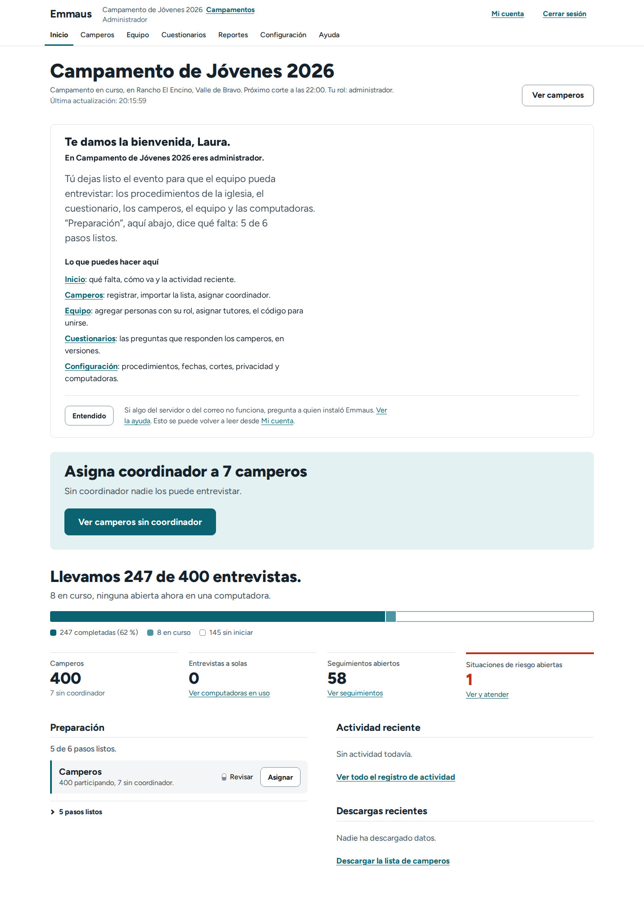
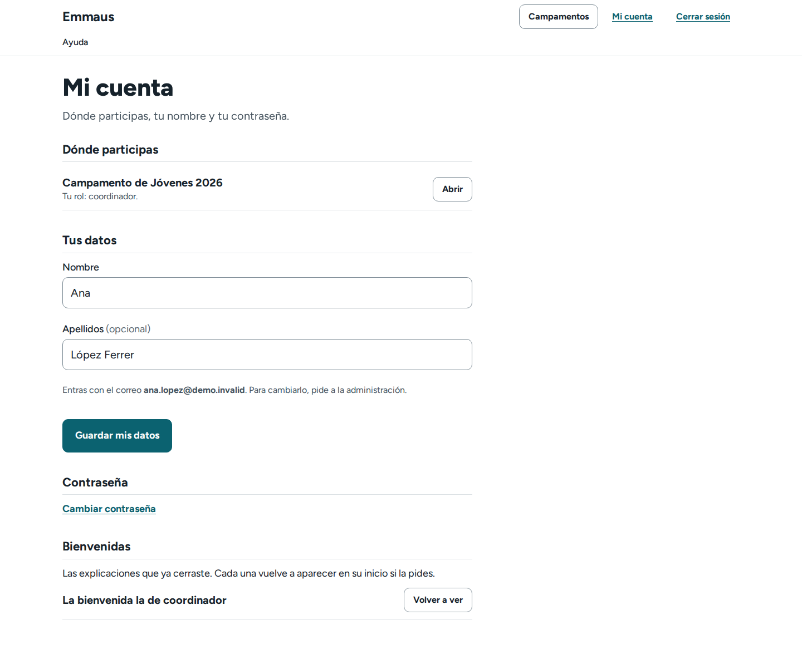
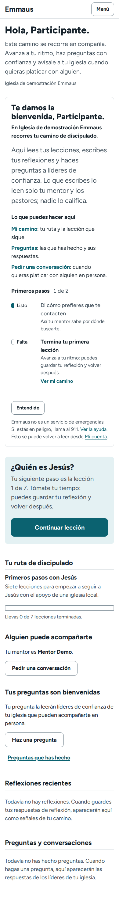

# Product completeness and guided onboarding audit

Audit of Emmaus at `032d846` (main, 2026-11-04), then the implementation on the branch `feature/product-completeness-onboarding`. The question it answers: can a new person sign in and understand, without help, **where am I, what can I do, what am I missing, what do I do next**; and can a leader understand **what needs my attention, who needs help, what is incomplete, what should I do**. Every finding points at the code; nothing below was taken as missing without reading the view, the template or the test that would hold it. The earlier UI/UX audit (`docs/auditoria-ux-2026-10.md`, 26 October 2026) found the first-use gaps of the administration (UI-03, UX-11, UX-12); those were fixed before this audit, and this one starts from there.

Implementation status is in §9 and in each backlog row ("Done", "Deferred").

## 1. Executive summary

Emmaus is a finished camp-operations product with an unusually complete authorization model, a next-action panel on every role's home and a help page per role. What it lacked was the **frame**: a new coordinador, tutor, pastor or administrator lands on a home that already shows the next thing to do, but nothing tells them what the role is for, which screens are theirs, what is missing before they can work, and where to fix their own name or password. There was also no way for a person with several roles (church admin and camp coordinator, tutor in one camp and coordinator in another) to see them in one place.

What this round adds, all from live data and persisted server side:

- **A welcome per role** (`partials/ui/welcome.html`), on the home of each of the nine roles the application really has: the four event roles, the four church roles and "someone with no role yet". It answers the four questions, lists the role's screens, shows "Primeros pasos" read from the database ("Listo" / "Falta", each with the screen where it is done), and goes away for good with "Entendido" (`core.OnboardingState`). People who were already working in Emmaus never see it for the roles they held (data step of `core/0011`). "Mi cuenta" brings it back.
- **"Mi cuenta"** (`/cuenta/`): every event and church role the person holds, the name the greetings use, the e-mail they sign in with, a password change that keeps the session, a participant's contact preference, and the welcomes they put away.
- **Action-required for coordinators:** minors without a registered guardian authorization now appear in "Esperan algo de ti" and have their own filter in "Mis camperos". Before, a coordinador learned about it only when the interview refused to start.
- **Five motion rules** on top of the eight Atrio had, documented in `docs/design/motion-system.md`: the welcome that leaves, the menu that opens, a revealed question, a figure that changed on a live refresh, the press of a button. All through the existing tokens; reduced motion still switches everything off.

Nothing in the permission model changed. The welcomes are built through the same `EventAccess` querysets the homes use; a tutor's welcome counts their team, a coordinador's their own camperos, and a pastor's follow-up count excludes confidential referrals exactly as "Seguimiento" does.

## 2. Current product capabilities (verified)

| Area | What exists | Evidence |
|---|---|---|
| Authorization | Per-event roles (`administrador`, `pastor`, `tutor`, `coordinador`) resolved by `resolve_access`; church roles (`church_admin`, `pastor`, `mentor`, `participant`) in `core.UserChurchRole`; every queryset scoped server side; field-level answer visibility; explicit, audited confidential access | `events/access.py`, `core/access.py`, `docs/roles-and-permissions.md`, `events/tests/test_access.py` (403s per role, no cross-event leakage) |
| An event role is not a church role | `EventMembership` is per event; a church admin is administrador of the church's events through `resolve_access`, a church pastor its pastor; nothing else crosses. The requirement "a camp coordinator is not thereby a church leader" already holds | `events/access.py:resolve_access`, `accessible_events` |
| Role homes with the next action | Coordinador "Mi inicio" (the open interview, the search, "¡Terminaste!" or the first camper), tutor "Mi equipo" (the stalled interview), pastor "Resumen general" (five questions), administración "Inicio" (the first blocker, then "Preparación": 6 steps from live state) | `templates/events/coordinator/home.html`, `tutor/_home_live.html`, `pastor/_home_live.html`, `admin/_home_live.html`, `events/views/dashboards.py:_preparation_steps` |
| Help per role | "Ayuda" as the last link of every bar: five tasks per role with the screen where each happens; a church-level help outside events | `events/views/ayuda.py`, `templates/events/ayuda.html`, `templates/core/ayuda.html`, `events/tests/test_ux_marco.py:AyudaPageTests` |
| Joining | Printed code → `/unirme/` → access request → approval creates the account and the password link; one path for "Agregar persona" and approvals | `events/views/join.py`, `events/services/team.py:add_member`, `templates/events/admin/member_created.html` |
| First password | Password-set link (on screen and by e-mail when one can go out), "¿Olvidaste tu contraseña?" also serves accounts that never set one | `core/views.py:ThrottledPasswordResetView`, `templates/registration/password_set.html` |
| Empty states | Specific sentences with the next step: no camperos, no coordinators, no search results, no events, no cutoffs | `templates/events/coordinator/participants.html`, `events_list.html`, `core/church_dashboard.html`, `core/mentor_dashboard.html` |
| Live data | Polled regions with "Última actualización", stale and session-ended states, idle-logout notice, offline guard on question forms | `static/js/emmaus.js`, `events/middleware.py` |
| Design system and motion | Atrio tokens, components, eight motion rules with `prefers-reduced-motion` enforced by tests | `static/css/rotulo.css`, `docs/design-system.md`, `events/tests/test_rotulo.py:AtrioMotionTests` |
| Tests | 1420 tests green on SQLite at the start (6 skipped: PostgreSQL row locks), 1449 at the end | `manage.py test` |
| Discipleship module | Church overview, mentor home, participant path, invitations; shown only to churches that turn it on | `core/views.py`, `Church.discipleship_enabled` |

## 3. User journey analysis by role

Traced by reading the dispatch (`core.views.dashboard`, `events.views.home.events_home`) and each home, then in a browser with the synthetic data (`seed_camp_demo`, `seed_dev_data`).

| Role | Entry after sign-in | What they saw before | What was missing | Now |
|---|---|---|---|---|
| **Coordinador** (new account, password just created) | `/dashboard/` → `/eventos/` → the one active event → "Mi inicio" | "Hola, Ana." "Tu rol: coordinador." the search panel, "Llevas 0 de 30", "Por entrevistar", "Esperan algo de ti" | What the role means, which screens are theirs, that a computer must be chosen, that minors without authorization cannot be interviewed, where to fix their own name | Welcome with four steps (computer, camperos, authorizations, first interview); the minors row in "Esperan algo de ti" |
| **Tutor** | Same dispatch → "Mi equipo" | Team name, rows per coordinator, follow-ups, activity, cutoffs | Who assigns their coordinators, that they never read answers, what "Pendientes" holds | Welcome with the team in a sentence and two steps |
| **Pastor** (event or church pastor) | Church pastor without discipleship → `/eventos/`; else the event → "Resumen general" | The five questions, "Mostrar presentación" | That confidential answers need explicit access, what a cutoff is, that follow-ups need a responsible person | Welcome with three steps (camperos, a cutoff, responsables) and the "sin responsable" filter link |
| **Administrador** (church admin or event member) | `/eventos/` → the event → "Inicio" | The first blocker as a sign, "Preparación: N de M" | The frame: what "ready" means, which screen does what, who to ask when the server or e-mail fails | Welcome that frames "Preparación" without repeating it |
| **Church admin, first day** | `/setup/` → `/eventos/` with "Crear campamento" as the sign | The sign | Church-level orientation: logo, team, where events live; one place to see their roles | Welcome on "Campamentos y eventos" and on the discipleship overview |
| **Mentor** | `/mentor/` | Questions waiting, follow-ups, their people | That they see only their assigned people, where escalations go | Welcome with two steps |
| **Participant (church member)** | `/participant/` "Mi camino" | The next lesson as the sign, questions, follow-ups | How to change the contact preference given at the invitation; a plain intro | Welcome with two steps; contact fields in "Mi cuenta" |
| **Someone with no role** | `/eventos/` "Aún no formas parte de ningún evento" | The sentence and the join link | A frame | Welcome "sin-rol" with the join step |
| **Campero** | No account: the supervised computer | Welcome "Hola, N.", three promises, who reads the answers | Nothing: this screen was already the best onboarding in the product | Unchanged |

## 4. Missing or incomplete functionality

Distinguished as the brief asks. "Essential" means a current workflow needs it; "future" means the church-platform vision.

### 4.1 Essential to current workflows (done in this round)

| ID | Problem | Affected | Where |
|---|---|---|---|
| M1 | No first-time orientation: sign-in lands on the home with no frame | Every new account | `core/views.py:dashboard`, `events/views/home.py:events_home` |
| M2 | No server-side record of what a person has been shown, so any welcome would repeat forever or depend on cookies on shared computers | Every role | (new) `core.OnboardingState` |
| M3 | No account page: a person cannot see their roles across events, fix a blank name ("Hola, ." in `coordinator/home.html`), or change their password while signed in (only the e-mail reset, which sends nothing with the default console backend) | Everyone, most of all volunteers on a first camp | (new) `core/views.py:account`, `AccountPasswordChangeView` |
| M4 | Minors without a registered guardian authorization are invisible until the interview refuses to start | Coordinadores, the minors themselves | (new) `events/services/participants.py:minors_without_authorization`, `coordinator/_home_live.html`, `my_participants?autorizacion=falta` |
| M5 | A participant of the discipleship module cannot change the contact preference given at the invitation | Participants, their mentors | (new) `ParticipantContactForm` in "Mi cuenta" |

### 4.2 Incomplete or awkward, documented and deferred (P2)

| ID | Finding | Why deferred |
|---|---|---|
| D1 | After creating the first password, the person must sign in again (`PasswordResetConfirmView` without `post_reset_login`) | A deliberate shared-computer choice; auto-login would keep a session on whichever computer opened the link. Trade-off documented, not changed |
| D2 | A required confidential question left blank in an "Entrevista a solas" is a dead end for a coordinador without confidential access | Known gap in `docs/roles-and-permissions.md`; needs a product decision on who completes it |
| D3 | The discipleship URLs stay reachable with the module off; archived events stay reachable by URL | Known limitations in `docs/architecture.md`; harmless (same permissions), low value to close |
| D4 | The church-level welcome is seen only on "Campamentos y eventos", which auto-redirects to the single active event | By design: the event's own welcome follows. Reachable with "Campamentos" → `?todos=1` |
| D5 | The event list is the only place that shows every role, apart from "Mi cuenta"; the bar shows one role at a time | Correct: a screen belongs to one event |

### 4.3 Future product opportunities (not for this round)

- A church-wide **person** record shared by events, discipleship and future modules (small groups, ministries). The `v2/*` worktrees in this checkout (`issue-23-foundations-step-1c-link-people-backfill`, `issue-30-campusaffiliation`, `issue-38-tenant-integrity`) are that foundation; this round touches none of their tables and adds one table of its own, keyed by `auth_user`.
- Group, ministry and engagement modules: out of scope, and the welcomes deliberately name nothing that does not exist.
- Account self-service of the e-mail: changes the sign-in identity and the audit trail; keep it with the administration.

## 5. UX friction points found

| ID | Screen | Friction | Fix |
|---|---|---|---|
| F1 | Every home | "Tu rol: coordinador." says the role, not what it means or where its screens are | Welcome: role line, intro, "Lo que puedes hacer aquí" |
| F2 | `coordinator/home.html`, `tutor/home.html` | An account without a name greeted "Hola, ." | `{{ user\|nombre }}` filter: "Hola." and a first step "Escribe tu nombre" |
| F3 | Bars | No way to reach one's own account | "Mi cuenta" in `.bar__end` and in "Menú" |
| F4 | `coordinator/_home_live.html` | "Nada espera tu decisión por ahora." while a minor could not be interviewed | The minors row, with its count and link |
| F5 | `coordinator/participants.html` | No way to list the minors who need authorization | `?autorizacion=falta`, a notice line and two empty states (own / event) |
| F6 | Pastor | Follow-ups without a responsible person are findable only through the filter | The welcome names the count and links the filter |
| F7 | Administración | "Preparación" is complete but says nothing about what "ready" is for | The welcome frames it ("Tú dejas listo el evento para que el equipo pueda entrevistar") |
| F8 | Menu panel | Opened with no transition, unlike every other change of state | `atrio-rise` on open |
| F9 | Live homes | A figure changed and nothing marked it; the eye re-read the sentence | `[data-count]` + `.is-changed` fade (rule 12) |

## 6. Onboarding requirements, as implemented

| Requirement (brief) | How Emmaus meets it |
|---|---|
| Welcome with a clear, friendly explanation | `Welcome.title` ("Te damos la bienvenida, Ana."), `role_line`, `intro`; tú-voice Mexican Spanish like the rest |
| Accessible functions based on actual permissions | `Welcome.can`: the role's own nav items, built in `events/services/welcome.py` from `EventAccess` and in `core/onboarding.py` from the church role; a coordinador's never names "Reportes" or "Configuración" (test) |
| What they can accomplish | The `intro` of each role in one or two sentences |
| Short personalised checklist | `Welcome.steps`: 2 to 5 steps, each `done` from a query (station in session, camperos, consent records, completed interviews, snapshots, unassigned follow-ups, lesson progress, contact preference, name) |
| First meaningful action | The existing sign (next-action panel) stays right below; the welcome frames it and never duplicates its button (tests count the links) |
| Skip, dismiss, resume, revisit | "Entendido" (POST, 204 to the page's fetch, redirect otherwise); nothing else is modal or forced; the state persists across sessions; "Mi cuenta" → "Volver a ver" |
| Real application state, never a client-side checklist | No client storage; every `done` is computed at render |
| Server-side persistence | `core.OnboardingState(user, key, dismissed_at)`, unique per (user, key) |
| Existing users not forced | Data step of `core/0011`: every role a person held when they had already signed in is marked as put away |
| Users with multiple roles | One key per role, not per event: coordinador in A and tutor in B read each once; church admin reads the church welcome on the list and the administrador one inside an event |
| Partially completed profiles | "Escribe tu nombre" first when the name is blank; a participant's contact preference |
| Contextual, not a separate help page | The welcome is on the home; "Ayuda" is linked from it and gains one sentence about "Mi cuenta" (still five tasks) |

## 7. Security and authorization review of the changes

- **Scoping.** `for_coordinator` uses `access.participants()` and `access.interviews()`; `for_tutor` uses `access.coordinators()` and `access.participants()`; `for_pastor` uses `access.follow_ups()`, which already removes confidential referrals from someone without the flag; `for_admin` receives only two integers. The church-role welcomes read church-level booleans (events exist, a team exists, a logo exists) that the church admin already sees. Tests: `core/test_onboarding.py` (another coordinator's camperos never appear; the pastor's count equals the filter's).
- **The welcome never widens a page.** It is rendered by the same view, after the same `event_view(*roles)` check, outside the live region, and only on the full page (`is_fragment` returns before it is built).
- **Writes.** `welcome_dismiss` and `welcome_restore` are `login_required`, POST only, refuse any key outside `core.onboarding.KEYS` (400) and write only the caller's own row. `siguiente` passes `url_has_allowed_host_and_scheme`. CSRF is Django's; the page's `fetch` sends the token both in the body and the header.
- **"Mi cuenta"** edits only `request.user`'s name (and their own `ParticipantProfile`); it lists `accessible_events` resolved through `resolve_access`, the same rule as "Campamentos y eventos"; the e-mail is read only. `PasswordChangeView` rotates the session hash, so the current session continues and others end.
- **The minors query** runs on the already scoped queryset and is null-safe (a minor with no record at all counts as pending; the first version was not, and the test caught it).
- **No new data about camperos is stored.** `OnboardingState` holds a user id, a key and a timestamp.
- **Known, unchanged:** an administrador can add any account by e-mail; access-request e-mails are not verified; Django admin changes are not audited (`docs/roles-and-permissions.md`, "Known gaps").

## 8. Prioritised backlog

P0 = a new person cannot orient themselves without it; P1 = important for a complete, safe workflow; P2 = future.

| ID | P | Finding | Affected | Solution | Code | Verification | Status |
|---|---|---|---|---|---|---|---|
| B1 | P0 | No welcome or frame on first sign-in (M1, F1) | All nine roles | `Welcome` built from live data, shown on each home, dismissed server side | `core/onboarding.py`, `events/services/welcome.py`, `partials/ui/welcome.html`, eight home templates, the views that render them | `core/test_onboarding.py` (12 tests); browser: 9 homes × 3 widths, axe 0 violations | Done |
| B2 | P0 | No persisted onboarding state (M2) | All | `core.OnboardingState`, `core/0011` with its data step | `core/models.py`, `core/migrations/0011_onboardingstate.py` | `ExistingUsersTests`, `EntendidoTests` | Done |
| B3 | P1 | No account page; blank names; no signed-in password change (M3, F2, F3) | All | "Mi cuenta", `password_change`, `nombre` filter, bar and menu links | `core/views.py`, `core/forms.py`, `templates/core/account.html`, `registration/password_change.html`, `partials/ui/bar.html`, `menu_panel.html` | `core/test_account.py` (10 tests); browser at 3 widths | Done |
| B4 | P1 | Minors without authorization invisible to the coordinador (M4, F4, F5) | Coordinadores, minors | Query helper, the row in "Esperan algo de ti", the list filter | `events/services/participants.py`, `events/views/coordinator.py`, `coordinator/_home_live.html`, `coordinator/participants.html` | `events/tests/test_ux_coordinator.py:test_a_minor_without_authorization_waits_for_you_and_the_list_filters_them` | Done |
| B5 | P1 | Participants cannot update their contact preference (M5) | Participants | Contact fields in "Mi cuenta"; the welcome's step reads them | `core/forms.py:ParticipantContactForm` | `core/test_account.py:ParticipantAccountTests` | Done |
| B6 | P1 | Interaction polish: the menu, revealed questions, changed figures, the press, the dismissal (F8, F9) | All | Five motion rules on the existing tokens; `docs/design/motion-system.md` | `static/css/rotulo.css` §13, `static/js/emmaus.js` | `AtrioMotionTests` (tokens, keyframes, reduced motion); browser: reduced-motion context, rapid clicks, the fade of one changed figure | Done |
| B7 | P2 | Sign in automatically after creating the first password (D1) | New accounts | Decide against shared-computer risk; if adopted, `post_reset_login=True` with a short session | `emmaus/urls.py` | A test that the session belongs to the link's account | Deferred (product decision) |
| B8 | P2 | Required confidential question left blank in "a solas" (D2) | Coordinadores without the flag | Options in `docs/roles-and-permissions.md` | `events/services/interviews.py:finalize` | — | Deferred (documented) |
| B9 | P2 | Church-wide person record and the modules of the vision | Future | The `v2/*` foundations | — | — | Out of scope |

### Acceptance criteria (per implemented item)

- **B1.** A new coordinador, tutor, pastor, administrador, church admin, church pastor, mentor, participant and a person with no role each see exactly one welcome on their home, with the key of their role, a role line naming the event or church, a list of their own screens and "Primeros pasos" whose marks match the database. The live fragment never carries it. The coordinador's welcome contains neither "Reportes" nor "Configuración". Every welcome passes the English-word scan. ✔ `core/test_onboarding.py`, `events/tests/test_ui.py`.
- **B2.** "Entendido" removes the welcome for that key only, for that user only, across sessions; a second role still shows its own; an unknown key is a 400; GET is a 405; a foreign `siguiente` lands on the dashboard; after the data step, every user who had signed in before has their held roles put away and nobody else. ✔ `EntendidoTests`, `ExistingUsersTests`.
- **B3.** `/cuenta/` lists every event the person can open with their role there (and "con acceso confidencial" when it applies), their church role, and nothing of other events; saving a name changes the greeting; a blank first name is refused; the password change refuses a wrong current password, accepts the right one, keeps the session and signs in with the new one; "Mi cuenta" is linked from every bar and from "Menú". ✔ `core/test_account.py`.
- **B4.** With one minor without a record, "Mi inicio" (page and fragment) shows "1 campero menor de edad sin autorización registrada" and links `?autorizacion=falta`; that list shows only them; once recorded, the row disappears and the filter's empty state names it. ✔ `test_ux_coordinator.py`.
- **B6.** No literal durations; every animation names an `atrio-` keyframe; the reduced-motion block covers every animated selector; in a reduced-motion browser context nothing animates and "Entendido" still removes the panel; a double click sends one request; after a live replacement exactly the changed `[data-count]` fades. ✔ `AtrioMotionTests` and the browser run (§9).

## 9. Dependencies, implementation order and status

1. `core/0011_onboardingstate` (depends on `events/0012_confidential_level` for the data step) → `core/onboarding.py` (keys, dismissal, church welcomes) → `events/services/welcome.py` (event welcomes, imports the former) → views → templates → CSS and JS → tests → docs. Each slice was added in that order and the suite was run after each.
2. "Mi cuenta" depends on nothing above except the restore view; the minors query depends on nothing.
3. Motion rules 9 and 12 depend on `emmaus.js`; the others are CSS only.

Status at the end of the round: 1449 tests, all green on SQLite (6 skipped, PostgreSQL row locks); `manage.py check` clean; `makemigrations --check` clean. Browser verification (Playwright, Chromium, synthetic data): the nine welcomes at 1440, 820 and 390 px with no horizontal overflow, axe-core 0 violations on every captured screen, "Entendido" by fetch with the fade and the focus landing on `<main>`, persistence across reloads, restore from "Mi cuenta", one POST on a double click, the reduced-motion context with no animations and a working dismissal, the leader bar in one row at 1281–1440 px with "Mi cuenta", and exactly one changed figure fading after a live replacement. Screenshots of the welcomes are in `docs/img/onboarding/`:

### Remaining verification gaps

- No real volunteers have used the welcomes; the copy was written for them, not tested with them. The step "Elige tu computadora" points at the line above the block, which reads fine in the screenshots and should be watched in a real first camp.
- The full suite also ran on PostgreSQL 16 (a throwaway container) before the merge: 1449 tests, OK, none skipped.
- The Spanish was reviewed by reading, not by a native copy editor.

## 10. Recommended next steps

1. Watch, in the first real camp, whether coordinadores dismiss the welcome before choosing a computer; if so, move the computer step above the role line.
2. Decide B7 (auto sign-in after the first password) with the safeguarding owner.
3. When the `v2` person record lands, key `OnboardingState` by that person if accounts and people are ever split; today `auth_user` is the identity on every screen.
