# Guía de uso de Emmaus Campamentos

Esta guía es para el equipo del campamento: coordinadores, tutores, pastores y administración. Explica, paso a paso, cómo se usa Emmaus durante el campamento. No necesitas saber nada de computación.

## Palabras que vas a ver

| Palabra | Qué significa |
|---|---|
| **Campero** | La persona que vino al campamento. No tiene cuenta en Emmaus. |
| **Coordinador** | Acompaña a un grupo de camperos y los entrevista. |
| **Tutor** | Acompaña a varios coordinadores y revisa cómo van. |
| **Pastor** | Ve el avance de todo el campamento y los reportes. |
| **Administración** | Prepara el campamento: equipo, camperos, computadoras y configuración. |
| **Entrevista** | La conversación espiritual con cada campero. Hay una sola por campero. |
| **Computadora de entrevistas** | Una computadora compartida con un número pegado, por ejemplo "Computadora 3". |
| **Corte de seguimiento** | Una "foto" del avance que Emmaus guarda a ciertas horas. No cambia después. |
| **Seguimiento** | Un campero que pidió o necesita que un líder lo acompañe después. |
| **Equipo de cuidado** | Las pocas personas autorizadas para leer las respuestas confidenciales. |

## Entrar y salir

1. Abre Emmaus en el navegador y escribe tu **Correo electrónico** y tu **Contraseña**.
2. Toca **"Entrar"**.
3. Si es tu primera vez, la administración te mandó un correo o te dio un enlace para crear tu contraseña.
4. Si olvidaste tu contraseña, toca **"¿Olvidaste tu contraseña?"**, escribe tu correo y toca **"Enviar enlace"**. Te llegará un correo para crear una nueva. Si no llega, revisa el correo no deseado o pide ayuda a la administración.
5. Si te equivocas muchas veces, Emmaus te pide esperar unos minutos antes de intentar otra vez, y cada vez un poco más si sigues fallando. Es para proteger tu cuenta.
6. Cuando termines, toca **"Cerrar sesión"**. En computadoras compartidas esto es muy importante.

Por seguridad, si dejas Emmaus sin usar unos 30 minutos, se cierra tu sesión y tienes que volver a entrar. Esto pasa aunque la pantalla se esté actualizando sola: cuando ocurre, verás "Tu sesión terminó. Vuelve a entrar para ver datos actuales."

En una computadora o celular pequeño, el menú está en el botón **"Menú"**.

---

## Para la administración

### Tu pantalla de inicio

En **"Inicio"** ves cuántos camperos hay, cuántas entrevistas van completadas, cuántas están en curso y cuántas capturas supervisadas están abiertas. Arriba aparece un recuadro **"Requiere tu atención"** cuando falta algo importante, por ejemplo confirmar los procedimientos o asignar coordinadores.

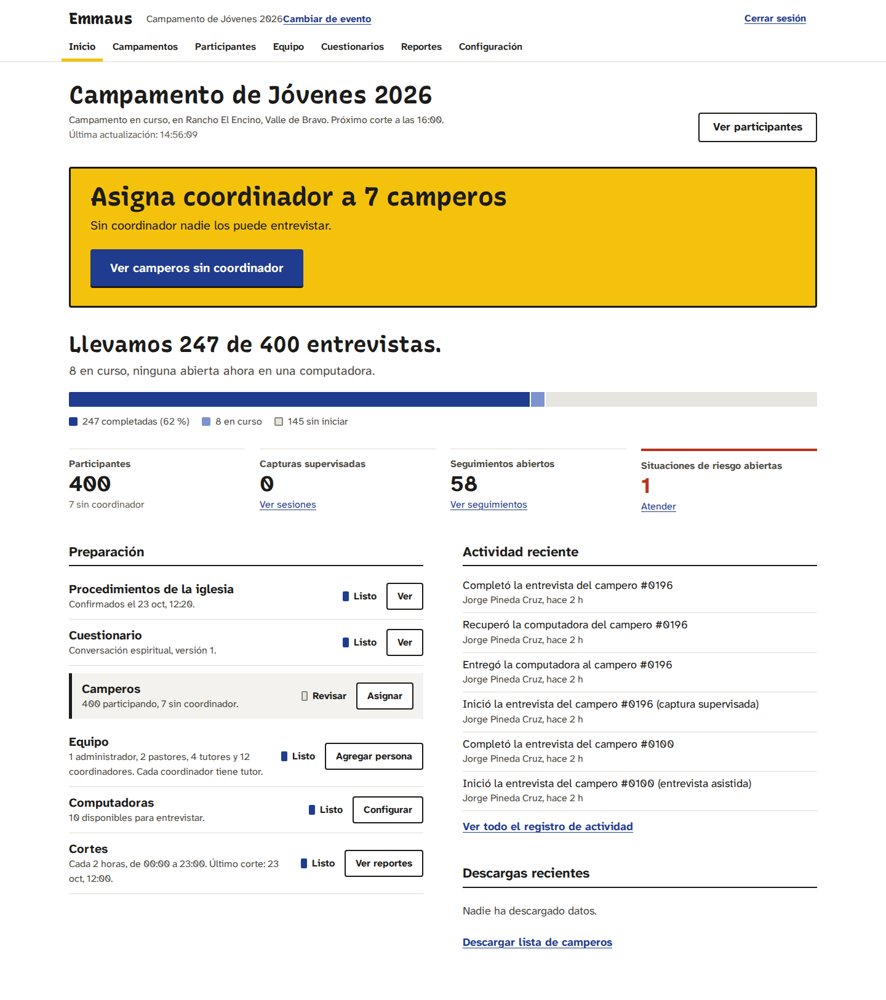

Debajo están las **Herramientas**: "Importar camperos", "Agregar persona al equipo", "Asignar tutores", "Cuestionario", "Cortes, privacidad y computadoras" y "Registro de actividad".

### 1. Crear el campamento

1. En **"Campamentos y eventos"**, toca **"Crear campamento"**.
2. Escribe el nombre, el tipo de actividad, un identificador corto para la dirección web (solo minúsculas, números y guiones, por ejemplo `jovenes-2026`), el lugar y las fechas.
3. Toca **"Crear campamento"**.

Emmaus prepara solo 10 computadoras de entrevista ("Computadora 1" a "Computadora 10") y el cuestionario: usa el último que haya publicado tu iglesia o, si no hay ninguno, el cuestionario de conversación espiritual que trae Emmaus.

### 2. Confirmar los procedimientos de la iglesia

Antes de entrevistar a cualquier campero, la iglesia debe definir y aprobar quién autoriza, cómo se guardan las autorizaciones de padres o tutores, quién atiende las situaciones de riesgo y cuánto tiempo se guardan los datos.

1. Ve a **"Configuración"**.
2. En **"Procedimientos de la iglesia"** marca la casilla "Confirmo que la iglesia definió y aprobó sus procedimientos..." y toca **"Confirmar"**.

Mientras no lo confirmes, nadie puede iniciar entrevistas. En la misma pantalla revisa también el **"Aviso de privacidad"** y **"Qué hacer ante una situación de riesgo"** (pon nombres y teléfonos reales), la zona horaria, la edad de mayoría y si se pide autorización de padres para menores. Toca **"Guardar configuración"**.

### 3. Agregar al equipo

1. Ve a **"Equipo"** y toca **"Agregar persona"**.
2. Escribe su nombre completo y su correo, y elige su **rol en este evento**: Administrador, Pastor, Tutor o Coordinador.
3. Si es tutor, escribe el **nombre del equipo** (por ejemplo "Equipo Monte Sion"). Ese nombre aparece en la presentación, así que no uses nombres de personas.
4. Si es coordinador, puedes elegir de una vez al **tutor que lo supervisa**.
5. Marca **"Puede leer información confidencial"** solo para el equipo de cuidado. Cada consulta que hagan queda registrada. Nadie puede darse este permiso a sí mismo: otra persona de la administración tiene que dártelo.
6. Toca **"Agregar al equipo"**.

Si la persona es nueva, Emmaus le manda un correo para crear su contraseña. También verás el enlace en pantalla con el botón **"Copiar enlace"**: compártelo solo con esa persona. Si alguien ya tiene contraseña y la olvidó, debe usar "¿Olvidaste tu contraseña?" en la pantalla de entrada.

Para cambiar el rol de alguien o quitarle el acceso, en **"Equipo"** toca **"Editar"**. Si desmarcas **"Puede entrar y trabajar en este evento"**, deja de poder trabajar en este campamento desde su siguiente clic, aunque sea pastor de la iglesia. (Si es administradora de la iglesia, conserva su acceso; eso se cambia en la configuración de la iglesia.)

### 4. Asignar tutores

Cada coordinador tiene un solo tutor. Un tutor solo ve a sus coordinadores y a los camperos de ellos.

1. Ve a **"Equipo"** y toca **"Asignar tutores"**.
2. Junto a cada coordinador elige su tutor.
3. Toca **"Guardar asignaciones"**.

### 5. Registrar camperos

**Uno por uno:** en **"Participantes"**, toca **"Registrar campero"**. Escribe nombre y apellido, edad, cuarto e iglesia o grupo, y elige su coordinador (o déjalo "Sin coordinador por ahora"). Si es menor y ya entregó la autorización firmada, marca **"Ya entregó la autorización firmada de su padre, madre o tutor legal"**. Toca **"Guardar"** o **"Guardar y registrar otro"**.

**Desde un archivo (CSV):**

1. En Excel o Google Sheets haz una tabla con estos encabezados en la primera fila: **Nombre**, **Edad**, **Cuarto**, **Iglesia o grupo**. Puedes agregar **Coordinador** (su correo o su nombre) y **Autorización** (sí o no).
2. Guárdala como **CSV UTF-8** (máximo 2 MB).
3. En **"Participantes"**, toca **"Importar CSV"**, elige el archivo y toca **"Revisar archivo"**.
4. Emmaus te muestra todo antes de guardar: cuántas filas están listas, cuáles tienen errores y cuáles podrían estar repetidas ("Ya existe..." o "Repetido en la fila..."). Nada se guarda todavía.
5. Las filas con errores no se importan. Las posibles repetidas aparecen **desmarcadas**: revísalas. Si es otra persona con el mismo nombre, márcala.
6. Toca **"Importar filas marcadas"**. Si te equivocaste de archivo, toca **"Cancelar y subir otro archivo"**.

Emmaus nunca junta a dos personas con el mismo nombre. Solo te avisa para que decidas.

### 6. Computadoras de entrevista

En **"Configuración"**, sección **"Computadoras de entrevista"**:

* **"Agregar computadora"** crea la siguiente.
* **"Poner fuera de uso"** la quita de la lista; **"Volver a usar"** la regresa.

Pega en cada computadora una etiqueta con su número.

### 7. Sesiones abiertas

Si una computadora se quedó con una entrevista abierta, ve a **"Configuración"** → **"Sesiones abiertas"**:

* En **"Capturas supervisadas"**, **"Cerrar"** termina la pantalla del campero en esa computadora. La entrevista sigue en curso para retomarla.
* En **"Entrevistas en curso"**, **"Liberar"** deja la entrevista libre para abrirla en otra computadora. Las respuestas guardadas no se pierden.

### 8. Datos de un campero

En la ficha de un campero, la administración ve:

* **"Descargar todos sus datos"** (solo con acceso confidencial): por ejemplo, si la familia lo pide.
* **"Eliminar sus datos"**: borra su registro, su entrevista, sus respuestas, autorizaciones y seguimientos. Tienes que escribir su nombre completo para confirmar. No se puede deshacer.

En **"Participantes"**, **"Descargar lista"** baja la lista de camperos sin respuestas. Cada descarga queda registrada.

---

## Para coordinadores

### Tu pantalla de inicio

**"Mi inicio"** te dice qué hacer ahora en un letrero amarillo: terminar la entrevista que dejaste a medias, buscar al campero que vas a entrevistar o registrar a tu primer campero. Debajo ves cuántas llevas (una marca por cada uno de tus camperos), los siguientes por entrevistar, los seguimientos y las que completaste hace poco. Arriba dice en qué computadora estás. La pantalla se actualiza sola.

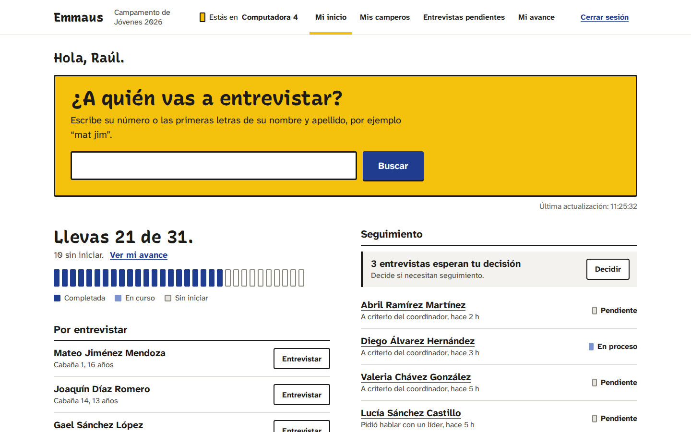

En las demás pantallas, arriba está el botón **"Iniciar entrevista"**.

### Registrar a un campero

1. En **"Mis camperos"**, toca **"Registrar campero"**.
2. Escribe nombre y apellido, edad, cuarto e iglesia o grupo. Quedará asignado a ti.
3. Si es menor y ya entregó la autorización firmada, márcalo.
4. Si Emmaus te avisa "Ya hay un campero registrado con este nombre", revisa la lista. Si es la misma persona, no la registres otra vez. Si es otra, marca **"Sí, es otra persona con el mismo nombre"**.
5. Toca **"Guardar y empezar la entrevista"** o **"Guardar y registrar otro"**.

### Elegir tu computadora

La primera vez que buscas a un campero o tocas "Iniciar entrevista", Emmaus te pregunta **"¿En qué computadora estás?"**. Busca el número pegado en la computadora, elígelo y toca **"Continuar"**. Si te equivocaste, en la pantalla de búsqueda toca **"Cambiar"**.

### Iniciar una entrevista

1. En el letrero amarillo de **"Mi inicio"** escribe el número del campero o las primeras letras de su nombre y de su apellido (por ejemplo, "mat jim" para Mateo Jiménez) y toca **"Buscar"**. Desde otras pantallas, toca **"Iniciar entrevista"**.
2. Toca **"Entrevistar"** (o **"Continuar"** si ya la habías empezado). También puedes tocar "Entrevistar" junto a un nombre en "Por entrevistar".
3. Se abre **"Antes de empezar"**:
   * **¿Es la persona correcta?** Revisa nombre, edad, cuarto y grupo. Si algo está mal, toca "Corregir datos del campero".
   * **Autorización.** Toca "Leer el aviso de privacidad para explicárselo" y léeselo con calma. Después marca las casillas:
     * Si es **menor de edad** y no hay autorización registrada: "Tengo la autorización firmada de su padre, madre o tutor legal". **Márcala solo si viste el formato firmado.** Si no lo tienes, no inicies la entrevista.
     * Si es **menor**: "Le expliqué el aviso de privacidad a ... y está de acuerdo en conversar".
     * Si es **adulto**: "Le expliqué el aviso de privacidad a ... y acepta participar".
     * Si no quiere conversar, no inicies. Puede decidirlo en otro momento.
   * **¿Cómo se va a responder?** Elige **"Entrevista asistida"** (tú haces las preguntas y anotas) o **"Captura supervisada"** (el campero responde solo en la computadora).
4. Toca **"Comenzar entrevista"**.

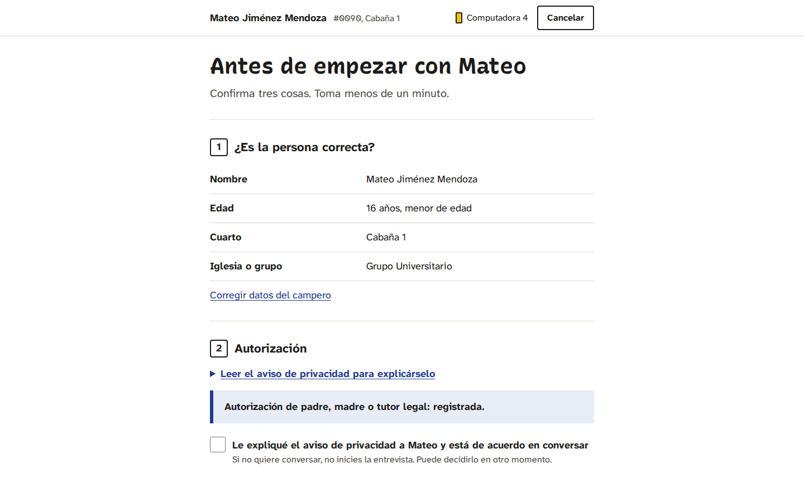

Si aparece "Todavía no se puede iniciar", la administración aún no termina de preparar el campamento. Avísale.

### Completar el cuestionario

* Aparece **una pregunta por pantalla**. Arriba dice en qué pregunta y sección vas.
* A veces, según la respuesta, aparece una pregunta más en la misma pantalla (por ejemplo, si dice que sí tiene dudas, se abre un espacio para contarlas).
* Debajo de las opciones, después de "o bien", está **"Prefiero no responder"**. Siempre se puede elegir.
* Las preguntas marcadas "Confidencial: solo el equipo de cuidado autorizado podrá leerla" son privadas: después de terminar ya no podrás ver esa respuesta.
* **"Continuar"** guarda y pasa a la siguiente. En la última pregunta el botón dice **"Revisar respuestas"**.
* **"Atrás"** (arriba, a la izquierda) guarda y regresa a la anterior.
* **"Guardar y salir"** (arriba) guarda y te regresa a tu inicio. Puedes continuar después.

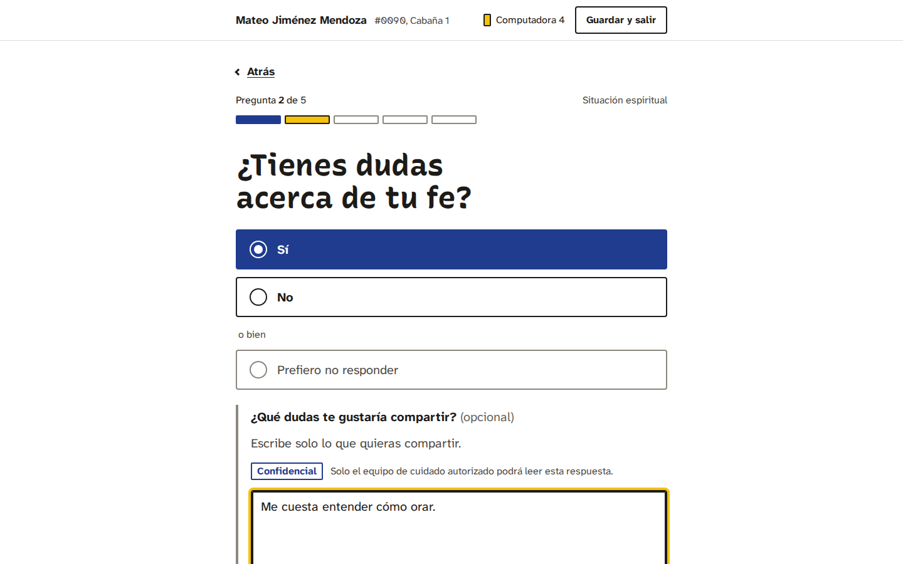

Las respuestas se guardan cada vez que avanzas. Lo único que se pierde es lo que escribiste en la pantalla actual si no tocaste ningún botón.

### Revisar y finalizar

1. En **"Revisa las respuestas de ..."** ves todas las respuestas. Si algo no está bien, toca **"Cambiar"**.
2. En **"¿Necesita seguimiento?"** elige:
   * **"Se requiere seguimiento"**,
   * **"No se requiere seguimiento"**, o
   * **"Seguimiento pendiente de evaluación"** (si quieres pensarlo o consultarlo).

   Si el campero pidió hablar con un líder o tomó una decisión, Emmaus te lo recuerda en **"Sugerencia según sus respuestas"**. Tú decides.
3. Toca **"Finalizar entrevista"**.

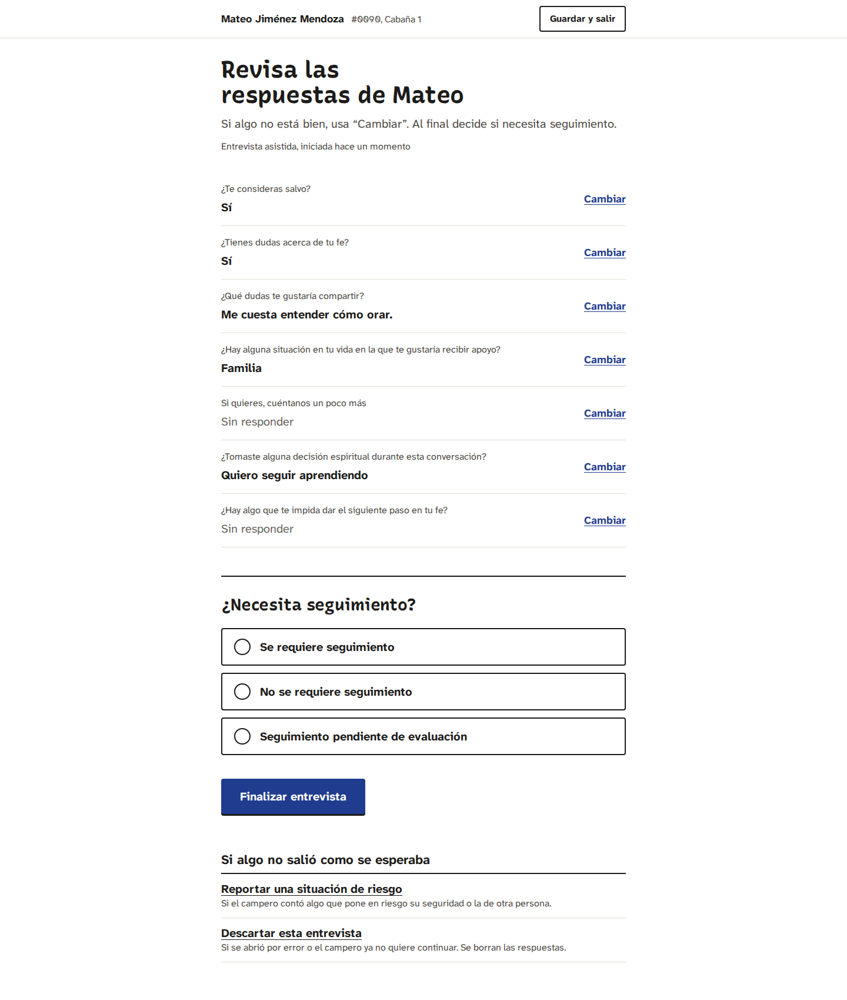

Verás **"Entrevista completada"**. Toca **"Entrevistar a otro campero"** o **"Volver a mi inicio"**.

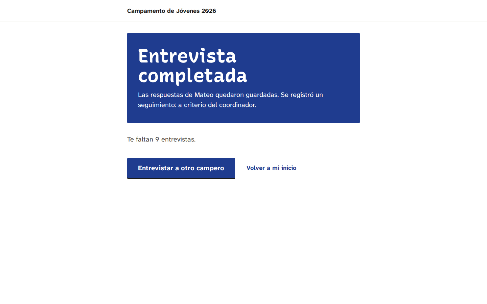

Si el campero pidió apoyo en una pregunta confidencial, el equipo de cuidado se entera solo, sin que tengas que hacer nada.

Si marcaste "pendiente de evaluación", después ve a **"Entrevistas pendientes"** → **"Seguimiento por decidir"** → **"Decidir"**, y toca **"Sí requiere seguimiento"** o **"No requiere seguimiento"**. Esta decisión solo se puede tomar una vez.

### Usar las computadoras compartidas (captura supervisada)

Úsala cuando el campero prefiere responder solo. Tu sesión se cierra en esa computadora para que el campero no pueda ver nada más.

**Entregar la computadora**

1. En "Antes de empezar" elige **"Captura supervisada"** y toca **"Comenzar entrevista"**.
2. Lee la pantalla **"Entrega la computadora a ..."**: dile que puede responder con calma, que puede elegir "Prefiero no responder", que nadie más verá sus respuestas en la pantalla y que te avise al terminar.
3. Toca **"Entregar la computadora"**. Si cambias de idea antes de entregarla, toca **"Mejor hago yo las preguntas"**. Si sales de esta pantalla sin entregarla, cuando toques "Continuar" en esa entrevista Emmaus te regresa aquí. Si una computadora se queda esperando a su coordinador más de 3 horas, ya no se puede recuperar con la contraseña: entra normalmente y continúa la entrevista desde "Mi inicio".

**Lo que ve el campero**

* Una bienvenida con su nombre y el botón **"Empezar"**.

  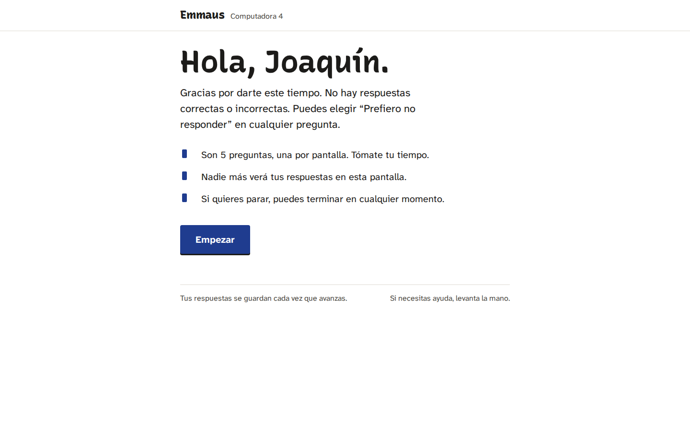

* Las mismas preguntas, con **"Continuar"**, **"Atrás"** y arriba **"Terminar por ahora"**.
* Al final, **"Revisa tus respuestas"**, donde puede tocar **"Cambiar"**, y el botón **"Terminar"**.
* Luego la pantalla **"¡Gracias!"**, que le pide avisarte.

  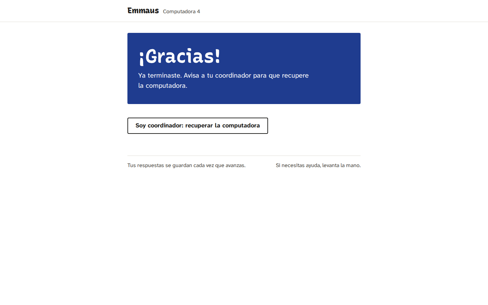

* Si deja de usar la computadora unos minutos, aparece **"¿Sigues aquí?"** con el botón **"Sí, sigo aquí"**. Si nadie responde, la pantalla se cierra ("La pantalla se cerró"). Lo que respondió está guardado.

Mientras el campero responde, esa computadora no puede abrir ninguna otra página de Emmaus.

**Recuperar la computadora**

1. Toca **"Soy coordinador: recuperar la computadora"**.
2. Escribe tu **contraseña** y toca **"Recuperar la computadora"**. Si otra persona autorizada va a recuperarla (por ejemplo la administración), toca **"Soy otro coordinador"** y escribe su correo y contraseña.
3. Si la contraseña se escribe mal varias veces, Emmaus pide esperar un minuto, y más tiempo si se sigue equivocando.

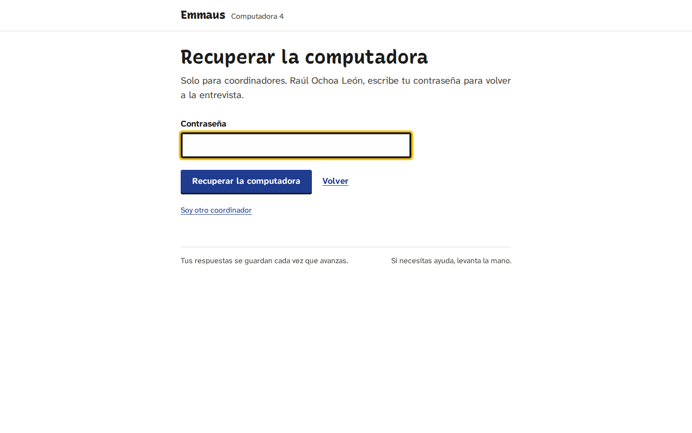

Al recuperarla, Emmaus te lleva a la revisión. Las respuestas confidenciales aparecen solo como **"Confidencial"**: es normal, tú no las puedes leer. Elige si necesita seguimiento y toca **"Finalizar entrevista"**.

Emmaus recuerda en qué computadora estás, así que no tienes que elegirla otra vez.

**Cerrar sesión:** cuando dejes la computadora para otra persona, toca siempre **"Cerrar sesión"**.

### Qué hacer si una entrevista se interrumpe

No se pierde nada de lo que ya se guardó.

* **Para continuarla:** en "Mi inicio" aparece en **"Continúa donde te quedaste"**; toca **"Continuar"**. También está en **"Entrevistas pendientes"**.
* **Si dice "Esta entrevista está abierta en otra computadora":** solo una computadora puede editarla a la vez. Si la otra ya no se usa, toca **"Tomar el control aquí"**. La otra computadora ya no podrá guardar cambios. Si no, toca **"Volver"**.
* **Si la computadora se trabó o se apagó:** abre Emmaus en otra computadora, busca al campero y toca "Continuar". Si te lo pide, toma el control.
* **Si nada de esto funciona:** pide a la administración que la libere en **"Sesiones abiertas"**.

Una entrevista que lleva 20 minutos o más sin cambios aparece como **interrumpida** para tu tutor.

### Corregir una respuesta después de terminar

1. Abre la entrevista (desde "Completadas hace poco" o desde la ficha del campero con **"Ver respuestas"**).
2. Junto a la respuesta toca **"Corregir"**.
3. Cambia la respuesta y escribe **por qué la corriges** (por ejemplo: "Se marcó una opción por error").
4. Toca **"Guardar corrección"**.

La corrección queda registrada con tu nombre y la respuesta anterior. No cuenta como una entrevista nueva. Las respuestas confidenciales no las puedes corregir.

### Descartar una entrevista

Si abriste la entrevista de otro campero por error, o el campero ya no quiere continuar:

1. En la revisión toca **"Descartar esta entrevista"**.
2. Elige el motivo y toca **"Sí, descartar y borrar respuestas"**.

Se borran todas sus respuestas y el campero queda "sin entrevista", así que se puede empezar de nuevo. Solo se pueden descartar entrevistas que no se han finalizado.

### Lista de respaldo en papel

En **"Mis camperos"**, toca **"Imprimir lista de respaldo"** y luego **"Imprimir"**. Úsala solo si falla la red o una computadora. Tiene nombres, edades y cuartos, pero ninguna respuesta. No la dejes a la vista y destrúyela al terminar.

---

## Para tutores

En **"Mi equipo"** ves cómo va tu equipo: el avance, las entrevistas pendientes, el ritmo por hora y cuánto falta. La pantalla se actualiza sola.

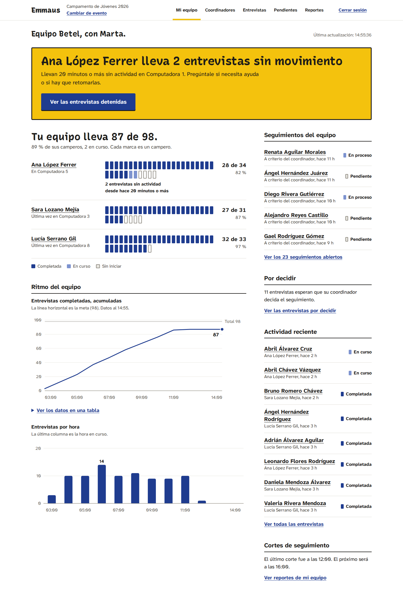

* **"Avance por coordinador"**: primero aparecen los que van más atrás.
* **"Requiere atención"**: entrevistas interrumpidas (20 minutos o más sin actividad), seguimientos abiertos y entrevistas con seguimiento por decidir.
* **"Ver pendientes"** junta todo lo que necesita una decisión o un empujón.
* **"Coordinadores"** y **"Entrevistas"** (con filtros) te ayudan a buscar.
* **"Ver reportes de mi equipo"** te lleva a los cortes de tu equipo.

Si una entrevista está interrumpida, pide al coordinador que la retome desde "Mi inicio". Si no puede, la administración la puede liberar.

Como tutor no ves las respuestas de los camperos (salvo que te hayan dado acceso confidencial). Ves avances y totales. Sí puedes actualizar los seguimientos de tu equipo: en **"Pendientes"** o en el seguimiento, elige el estado y el **"Líder responsable"**, y toca **"Guardar"**.

---

## Para pastores

### Resumen general

**"Resumen general"** responde cinco preguntas y se actualiza solo. En la columna izquierda cada pregunta tiene su respuesta en una frase: si solo lees esa columna, ya tienes el resumen para la reunión.

1. **¿Cómo va el campamento?** Cuántas entrevistas van y, al ritmo de las últimas dos horas, a qué hora terminaríamos.
2. **¿Cuánto falta?** Pendientes, ritmo por hora, tiempo estimado y gráficas. La línea punteada es la proyección al ritmo actual; la última columna es la hora en curso.
3. **¿Qué equipos necesitan apoyo?** Equipos del que va más atrás al que va más adelante, con una raya que marca el promedio del campamento.
4. **¿Qué necesidades hay?** Seguimientos abiertos, atendidos y por decidir. Si tienes acceso confidencial, también las situaciones de riesgo y las solicitudes de apoyo confidenciales. Aquí aparecen además los **resúmenes de respuestas** del último corte guardado.
5. **¿Qué hay que coordinar?** Asuntos sugeridos para la próxima reunión. Salen de reglas fijas sobre los números; no hay inteligencia artificial ni juicios sobre las personas.

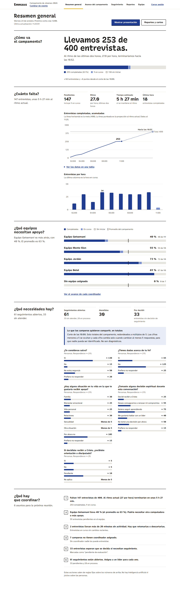

Los resúmenes de respuestas solo muestran totales de todo el campamento, redondeados. Por eso a veces verás "Menos de 5" o "≈ 10": así nadie puede ser identificado. No son diagnósticos; son lo que cada campero quiso compartir.

### Seguimiento

En **"Seguimiento"** ves a los camperos que pidieron o necesitan acompañamiento. Las situaciones de riesgo aparecen con la etiqueta "Urgente" solo para quien tiene acceso confidencial. Abre uno, elige el estado y el **"Líder responsable"**, y toca **"Guardar"**. Los detalles y la nota de cierre solo los ve el equipo de cuidado.

---

## Reportes y cortes de seguimiento

### Qué es un corte

Un corte es una foto del avance a cierta hora. Emmaus los genera solos durante el horario configurado (por ejemplo, cada 2 horas de 8:00 a 22:00) y los guarda sin cambios. Así puedes comparar cómo iba el campamento a las 10:00 y a las 12:00. Si el servidor estuvo apagado a la hora de un corte, ese corte no se hace después.

Los pastores y la administración ven los cortes de todo el campamento y de cada equipo. Cada tutor ve los de su equipo.

### La pantalla de Reportes

En **"Reportes"** ves el último corte, la hora del próximo y el historial.

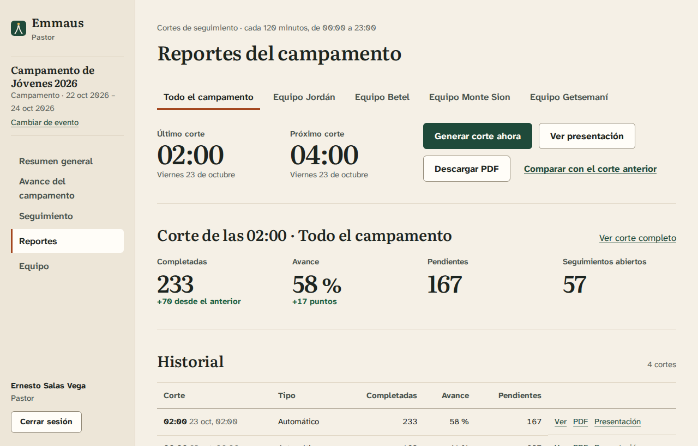

* **"Generar corte ahora"** hace un corte en este momento. Si alguien lo acaba de hacer, Emmaus te muestra ese mismo en lugar de repetirlo.
* **"Ver corte completo"** o **"Ver"** abre el corte con sus gráficas, la comparación **"Comparado con el corte anterior"** y los próximos pasos.
* **"Comparar con el corte anterior"** va directo a esa comparación.
* Si hay varios equipos, arriba puedes elegir de cuál quieres ver los cortes.

### Descargar el PDF

Toca **"Descargar PDF"** (en el último corte o en el historial, botón **"PDF"**). El PDF trae las cifras principales, la gráfica de avance, el avance por equipo, los seguimientos, los próximos pasos y cómo se calcula cada número. Dice "Documento confidencial de uso interno. No reenviar.": no lo compartas fuera del equipo. Cada descarga queda registrada.

### Mostrar la presentación

Sirve para proyectar el avance en una reunión del equipo.

1. Toca **"Mostrar presentación"** (en "Resumen general") o **"Ver presentación"** (en "Reportes"). Esta versión está **en vivo** y se actualiza cada minuto; en la barra de controles dice cuándo fue la última actualización. Si nadie toca la computadora durante 30 minutos, tu sesión se cierra, la presentación deja de actualizarse y la barra lo avisa: vuelve a entrar. Para mostrar un corte guardado, toca **"Presentación"** en el historial.
2. Toca **"Pantalla completa"** (o la tecla **F**).
3. Avanza con la **flecha derecha** o **"Siguiente"**; regresa con la **flecha izquierda** o **"Anterior"**.
4. Toca **"Salir"** al terminar.

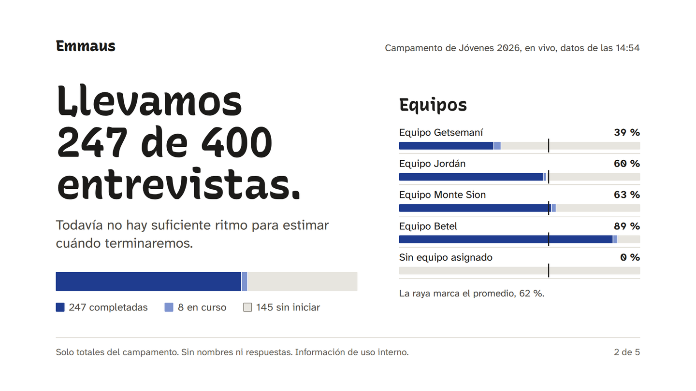

Son 5 diapositivas: cómo va el campamento, avance de entrevistas, avance por equipo, necesidades de seguimiento y próximos pasos. **No muestra nombres de camperos, coordinadores ni tutores, ni respuestas.** Las cifras de seguimiento vienen del último corte y están redondeadas; antes del primer corte aparecen como "—".

---

## Qué hacer ante una situación de riesgo

Si un campero cuenta algo que pone en riesgo su seguridad o la de otra persona:

1. **Primero actúa.** Si alguien está en peligro inmediato, llama al **911**. Después avisa en persona a la persona responsable de protección del campamento. No investigues por tu cuenta ni prometas guardar un secreto que ponga en riesgo a alguien.
2. Después regístralo en Emmaus: en la revisión de la entrevista o en la ficha del campero toca **"Reportar una situación de riesgo"**.
3. En **"¿Qué pasó?"** escribe solo lo necesario para que el equipo responsable pueda actuar.
4. Toca **"Enviar reporte"**.

Solo el equipo de cuidado autorizado puede leer el reporte. Emmaus les avisa por correo sin nombres ni detalles. Emmaus no llama a nadie: el paso 1 siempre lo haces tú.

---

## Quién ve qué

| | Coordinador | Tutor | Pastor | Administración | Equipo de cuidado |
|---|---|---|---|---|---|
| Datos de sus camperos (nombre, edad, cuarto) | Los suyos | Su equipo | Todos | Todos | Según su rol |
| Respuestas espirituales | De sus camperos | No | No | Solo si hizo la entrevista | Sí |
| Respuestas confidenciales | Solo mientras las anota en una entrevista asistida | No | No | Igual que el coordinador, si hace la entrevista | Sí |
| Reportes y presentación | No (solo "Mi avance") | Su equipo | Todo | Todo | Según su rol |
| Detalles de situaciones de riesgo | No | No | No | No (solo sabe que existe) | Sí |

El "equipo de cuidado" son las personas con **"Puede leer información confidencial"**, sea cual sea su rol.

---

## Preguntas frecuentes

**¿Se pierden las respuestas si se va el internet o se cierra la ventana?**
No se pierde lo que ya se guardó: cada vez que tocas "Continuar", "Atrás" o "Guardar y salir", se guarda. Solo se pierde lo que estaba escrito en la pantalla actual. Si falla la red, usa la lista de respaldo y captura después.

**¿Por qué no puedo iniciar entrevistas?**
Puede faltar que la administración confirme los procedimientos de la iglesia, que haya un cuestionario publicado o que el campamento esté "En curso". La pantalla dice cuál es el motivo.

**El campero es menor y no tiene autorización registrada.**
Si viste el formato firmado, márcalo en "Antes de empezar" (o en su ficha con **"Marcar como recibida"**). Si no lo tienes, no inicies la entrevista.

**¿Puedo entrevistar a un campero de otro coordinador?**
No. Pide a la administración que te lo asigne.

**Me equivoqué de campero.**
Toca "Descartar esta entrevista" y elige "Se abrió la entrevista de otro campero por error". Sus respuestas se borran.

**¿Un campero puede tener dos entrevistas?**
No. Cada campero tiene una sola. Si hay un error después de finalizar, se corrige con "Corregir".

**Soy tutor o pastor: ¿por qué no veo las respuestas?**
Por privacidad. Los tutores y pastores ven avances y totales. Las respuestas espirituales las ve el coordinador del campero, y las confidenciales solo el equipo de cuidado.

**¿Por qué dice "Menos de 5" o "≈ 10"?**
Para que nadie pueda adivinar lo que respondió una persona. Los números pequeños se ocultan y los demás se redondean.

**Me pide otra vez elegir la computadora.**
Pasa cada vez que vuelves a entrar a Emmaus. Elige el número pegado en la computadora.

**Se cerró mi sesión sola.**
Pasa si no usas Emmaus unos 30 minutos (aunque la pantalla se actualice sola) o si cerraste el navegador. Vuelve a entrar.

**Olvidé mi contraseña.**
En la pantalla de entrada toca "¿Olvidaste tu contraseña?". Si nunca creaste tu contraseña, pide a la administración un enlace nuevo.

**Escribí mal la contraseña varias veces y no me deja entrar.**
Espera unos minutos y vuelve a intentar.

**¿Se puede cambiar el cuestionario durante el campamento?**
La administración puede crear una versión nueva. Las entrevistas ya hechas conservan la versión con la que se hicieron.

**¿Emmaus usa inteligencia artificial?**
No. En los campamentos Emmaus no usa inteligencia artificial y no envía respuestas por correo ni a otros servicios.
