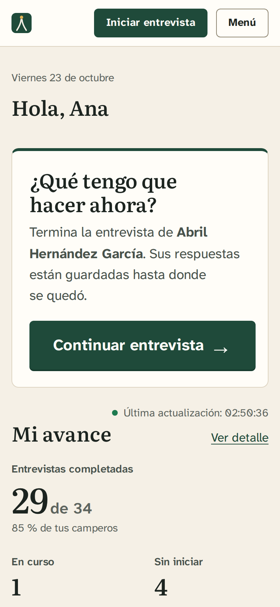
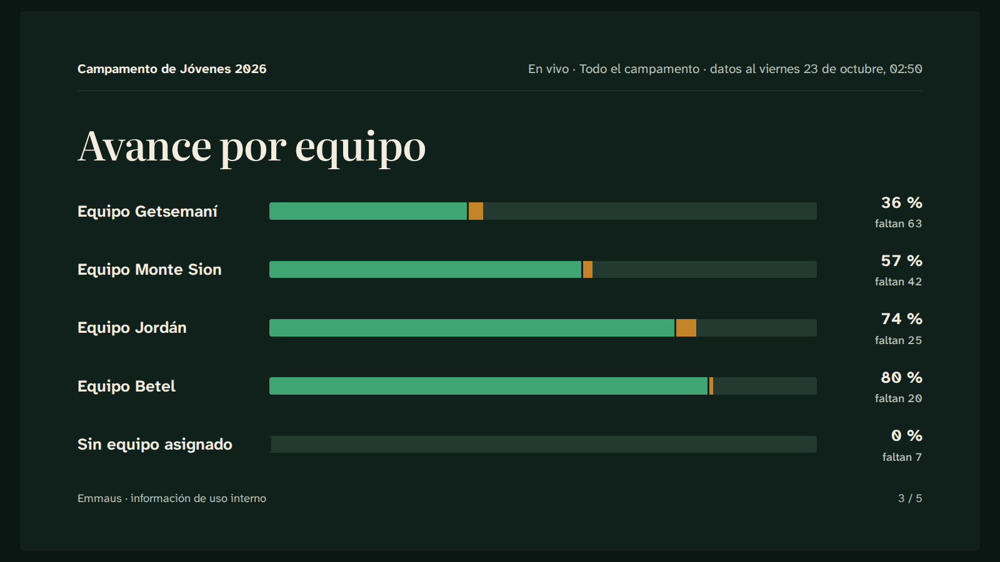

# Revisión UX con capturas · Emmaus Campamentos

Las capturas se tomaron con Playwright 1.63 (Chromium), en `es-MX`, zona horaria America/Mexico_City, a 1440 px (escritorio), 834 px (tableta) y 390 px (móvil, densidad 2×). Los datos son **sintéticos**: el campamento lo genera `seed_camp_demo` y los nombres son combinaciones aleatorias de nombres y apellidos comunes. Ninguna persona real aparece.

Hubo cuatro rondas: captura → crítica → cambios → nueva captura. La cuarta repitió todas las capturas después de la revisión de seguridad, contra el código final. Al final se incluyen los problemas que siguen abiertos.

## Pantallas actuales

### Coordinador: "Mi inicio"

### Entrevista: una pregunta por pantalla

### Modo campero: devolver la computadora

### Tutor: "Mi equipo"

### Pastor: "Resumen general"

### Modo presentación (proyector 16:9)

### Administración

## Crítica por criterio (estado final)

| Criterio | Evaluación | Evidencia |
|---|---|---|
| **Tipografía** | Fuerte. Literata da carácter a títulos y cifras; Atkinson Hyperlegible Next mantiene la lectura clara en textos chicos. El cuerpo nunca baja de 15 px. | Las preguntas miden 28–40 px; las cifras de la presentación, ~8.5 % del ancho del cuadro |
| **Jerarquía** | Cada pantalla tiene una sola pregunta o una sola cifra dominante, y una acción principal. | "¿Qué tengo que hacer ahora?" + "Iniciar entrevista"; "60 %" + oración en el pastor |
| **Alineación** | Retícula de 4 px; columnas de lectura (46 rem en entrevista) y de tablero (72 rem). Acción principal a la izquierda, como en GOV.UK. | Ronda 3 |
| **Espaciado** | Generoso en entrevista y modo campero; medio en tableros, con renglones en vez de tarjetas. | Listas tipo libro de registro |
| **Contraste** | Todo texto ≥ 4.5:1 y bordes de control ≥ 3:1; el foco combina tinta y halo amarillo. | Tabla de tokens en `design-system.md` |
| **Legibilidad** | Meses en minúscula, hora de 24 h, "Cuarto 12" o "Cabaña 4" según el dato, sin dobles etiquetas. | Correcciones de la ronda 1 |
| **Densidad** | El coordinador ve como máximo 4 cifras y listas cortas (5–6 renglones). El administrador tiene más, agrupado en herramientas y equipo. | Mi inicio frente a Inicio de administración |
| **Originalidad** | Papel cálido, tinta pino, numeración en itálica terracota, barras tipo regla, símbolo propio del camino a Emaús. Sin degradados, vidrio esmerilado, íconos decorativos ni imágenes religiosas trilladas. | Todas las capturas |
| **Consistencia** | Los mismos componentes en el módulo de campamentos y en el de discipulado, que también se tradujo y rediseñó. | `templates/core/*` |
| **Accesibilidad** | Etiquetas en todos los controles (verificado por prueba), resumen de errores, "Saltar al contenido", texto alternativo y tabla en cada gráfica, objetivos de ≥ 48 px. | `events/tests/test_ui.py` |
| **Facilidad de uso** | La entrevista asistida completa toma 5 pantallas de pregunta + revisión. La captura supervisada no deja al campero salir de su pantalla (verificado en el navegador). | `e2e/station-flow.mjs` |

### Comparación con las referencias

- **GOV.UK**: tomamos el patrón de pregunta, la revisión de respuestas, el resumen de errores y el panel de confirmación, adaptados a español y a una identidad propia. No copiamos su tipografía ni su paleta.
- **Planning Center**: la idea de que la computadora tiene identidad ("Computadora 3 · Modo campero") y el respaldo en papel ("Imprimir lista de respaldo").
- **Tally**: progreso discreto arriba y sin avance automático.
- **Herramientas de quiosco**: bloqueo con la contraseña del coordinador, aviso "¿Sigues aquí?" y cierre por inactividad sin perder respuestas.
- **Guía de tableros del Analysis Function y Stripe**: pirámide invertida, línea de frescura y cortes rotulados como fotos fijas.

## Rondas de revisión

### Ronda 1: primera captura

| Hallazgo | Cambio |
|---|---|
| Las pestañas de la barra del coordinador se partían en dos líneas ("Mi / inicio") | `white-space: nowrap` y menos separación |
| En móvil la barra superior desbordaba el ancho (scroll horizontal en 4 pantallas) | El nombre del evento se oculta en móvil; queda el símbolo, "Iniciar entrevista" y "Menú" |
| "Viernes 23 de Octubre": el mes con mayúscula | Filtros propios `fecha_larga` / `fecha_corta` con meses en minúscula |
| "Cuarto Cabaña 12" (etiqueta duplicada) | Filtro `cuarto`: antepone "Cuarto" solo si el dato es un número |
| Hora de 12 h en el estado en vivo y 24 h en el resto | Todo en 24 h |
| Botones de las listas bajaban a otra línea en móvil | Base flexible de 12 rem para el texto del renglón |
| Las preguntas del resumen del pastor parecían etiquetas (itálica pequeña) | Encabezados h2 en Literata con número en terracota |
| "Desde el corte de las 02:00: sin cambio entrevistas" | "Sin cambios desde el corte de las 02:00." / "+18 entrevistas y +5 puntos desde…" |
| Los resúmenes de respuestas usaban el verde de "completadas" | Color neutro de medida, para no sugerir "logrado" |
| Los ceros con diagonal de Atkinson se veían técnicos en cifras enormes ("400") | Las cifras grandes usan las figuras de Literata |
| En presentación, "Viernes" con mayúscula a media oración | Minúscula a media oración |

### Ronda 2: flujo de entrevista y presentación

| Hallazgo | Cambio |
|---|---|
| La diapositiva 3 ("Avance por equipo") no mostraba barras: el estilo de pista solo existía en la diapositiva 1 | Estilos de pista compartidos por toda la presentación |
| "Apoyar a Equipo Getsemaní" (contracción incorrecta) | "Equipo Getsemaní necesita apoyo: lleva 37 %…" |
| Ayuda duplicada: "(opcional)" en la etiqueta y "Opcional." en la ayuda | Textos de ayuda del cuestionario sin repetición |
| El icono de "Confidencial" se veía como un cuadro vacío | Etiqueta de privacidad con barra lateral azul, sin icono |
| Respuestas múltiples en orden alfabético en la revisión | Se muestran en el orden de las opciones |
| Viñetas fuera del aviso de sugerencia | Sangría dentro del aviso |
| El panel "Cortes de seguimiento" del tutor se estiraba a toda la altura | Se alinea arriba |

### Ronda 3: patrones de la investigación y móvil

| Hallazgo | Cambio |
|---|---|
| "Continuar" a la derecha, lejos del contenido en pantallas anchas | Acción principal primero y a la izquierda en todas las filas de acciones (GOV.UK) |
| En móvil, la barra fija de "Comenzar entrevista" invitaba a pulsar antes de leer las autorizaciones | Barra fija solo en pasos de pregunta |
| "Mejor la hago yo" en la entrega llevaba a la revisión con la entrevista aún en modo supervisado (el coordinador no podía capturar las preguntas confidenciales) | Botón "Mejor hago yo las preguntas" que cambia la entrevista a asistida, con prueba |
| El campero no veía en qué computadora estaba | "Computadora 3 · Modo campero" en la barra |
| Filtros de "Mis camperos" en una lista desplegable | Pestañas Todos / Sin entrevista / En curso / Completada con conteos |
| Sin respaldo si falla la red | "Imprimir lista de respaldo" por coordinador, sin respuestas |
| Cortes y datos en vivo se veían iguales | "Corte guardado: no cambia" y "En vivo" en la presentación |

### Ronda 4: después de la revisión de seguridad

Una revisión adversarial (ver `docs/privacy-and-safeguarding.md`) cambió lo que algunas pantallas pueden mostrar. Se volvieron a tomar todas las capturas contra el código final, en las tres medidas, sin desbordes ni errores de JavaScript.

| Cambio visible | Por qué |
|---|---|
| La pantalla de devolución dice "¡Gracias!" sin el nombre del campero | La siguiente persona que se sienta no debe saber quién estuvo antes |
| En revisión y detalle, las respuestas ocultas dicen solo "Confidencial"; las preguntas que dependen de una respuesta oculta no se listan | La sola presencia de una fila revelaba la respuesta oculta |
| La sugerencia de seguimiento del coordinador solo usa respuestas que puede ver; la nota general explica que el equipo de cuidado recibirá lo confidencial | "Pidió apoyo en un área de su vida" revelaba una respuesta confidencial |
| Los resúmenes de respuestas del pastor vienen del último corte y lo dicen ("Resumen del corte de las 02:00") | Las cifras en vivo permitían comparar antes y después de una persona |
| La diapositiva de seguimiento indica de qué corte salen sus cifras, o "—" antes del primer corte | Mismo motivo, en el proyector |
| La ficha de un integrante solo ofrece "Generar enlace" a cuentas que nunca crearon contraseña; las demás ven "¿Olvidaste tu contraseña?" | Evita tomar cuentas ajenas |
| "¿Olvidaste tu contraseña?" en la pantalla de entrada | El enlace llega al correo de la persona, no a la administración |
| Conteos de las pestañas separados de su etiqueta ("Todos 34") | En la captura se veía "Todos34" |

## Problemas abiertos

- **Sin pruebas con personas reales.** Todo se validó con datos sintéticos y navegadores automatizados. Antes del campamento conviene una prueba de 30 minutos con 2–3 coordinadores reales en una de las computadoras del lugar.
- **Lector de pantalla.** Se cuidaron estructura, etiquetas y textos alternativos, pero no se probó con NVDA ni VoiceOver.
- **El editor de cuestionarios es básico.** Edita textos, tipo, privacidad, condiciones y opciones de un borrador, pero no reordena arrastrando ni muestra una vista previa en vivo.
- **El panel técnico `/admin/` de Django** usa la traducción de Django y nombres de modelo en español, pero algunos nombres de campo internos del módulo de discipulado siguen en inglés. No es una pantalla para voluntarios.
- **La presentación muestra hasta 8 equipos.** Con más equipos se ven los 8 con menos avance, con una nota.
